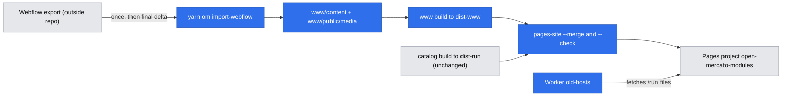
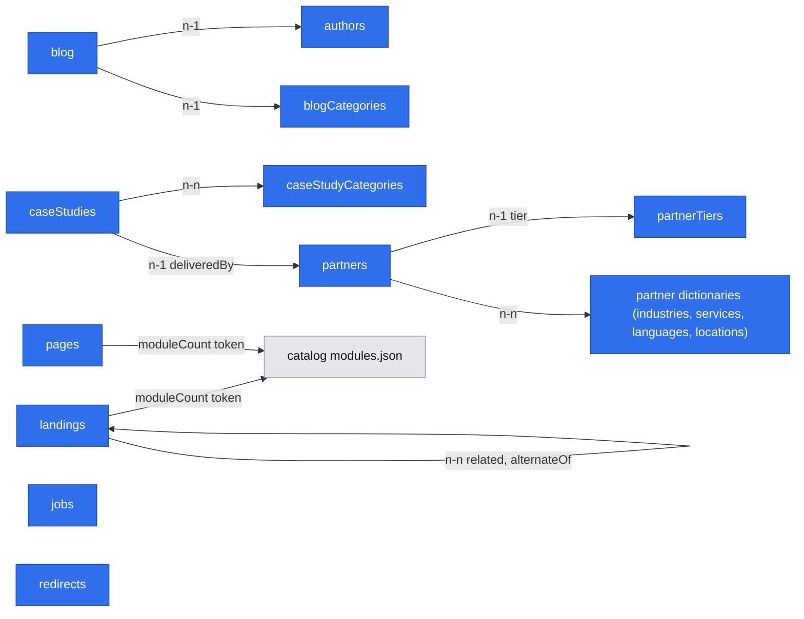

# www.openmercato.com off Webflow: the main site as Astro content in this repository

Status: Draft for review by the design and core team. Author: catalog maintainers. Date: 2026-11-24. Decisions 1 to 8
below were made by the Open Mercato team on 24 and 25 Nov 2026. Visual design and component architecture: Oliwia
(designer). Input: the Webflow export of 24 and 25 Nov 2026 (API v2, public HTML and sitemap), kept outside the
repository.

## TLDR

- **Who needs it.** Everyone who edits or ships the main site: today a page change is a manual edit in Webflow, a new
  "X alternative" landing is a page duplicated by hand, and the `/run` catalog has to copy the Webflow navbar and
  footer and follow every change of it.
- **Today.** www.openmercato.com is a Webflow site behind Cloudflare: 50 static pages (32 SEO landings on one layout,
  18 unique pages with the home page and three list pages), 13 CMS collections (blog, case studies, certified partners,
  one job, their dictionaries, and 304 copied docs items), about 700 images on the Webflow CDN, Google Analytics, a
  custom cookie banner, Finsweet filters and Swiper carousels. No page has a canonical URL, the 32 landings have no OG
  image, and FAQPage JSON-LD exists only on the home page and `/product`.
- **Proposed (future behavior).** The main site becomes a second Astro project in this repository (`www/`), with every
  piece of content as a file in a typed content collection and every change as a pull request. One build writes the
  main site at the root and the existing catalog under `/run`, and one Cloudflare Pages project serves both on
  www.openmercato.com. A deterministic importer turns the Webflow export into content files and media once, and again
  for a final delta before the switch. Every current URL keeps answering, `/docs/*` and `/documentation` redirect to
  docs.openmercato.com, and the SEO gaps above are closed by the build instead of by hand.
- **Why.** One source for the design system and the menus, schema checks on content (a landing without a description
  stops the build), reviewable history for every edit, and no Webflow plan or CMS to run.

## Decisions

Made by the Open Mercato team on 24 and 25 Nov 2026. This spec designs within them and does not reopen them.

| #   | Decision                                                                                                                                                                                                                                                                                                                                                                                                                                                                                                                                                         |
| --- | ---------------------------------------------------------------------------------------------------------------------------------------------------------------------------------------------------------------------------------------------------------------------------------------------------------------------------------------------------------------------------------------------------------------------------------------------------------------------------------------------------------------------------------------------------------------- |
| D1  | www.openmercato.com moves from Webflow to Astro in this repository, deployed on Cloudflare. Moving or renaming the repository is a later decision.                                                                                                                                                                                                                                                                                                                                                                                                               |
| D2  | No CMS. Strapi was considered and rejected. All content lives in the repository as files; every content change is a pull request.                                                                                                                                                                                                                                                                                                                                                                                                                                |
| D3  | Every current URL stays as it is today (`/hubspot-alternative`, `/blog-posts/<slug>`, `/case-studies/<slug>`, `/certified-partners/<slug>`, `/careers-jobs/<slug>` and the rest).                                                                                                                                                                                                                                                                                                                                                                                |
| D4  | `/docs/*` and `/documentation` become 301 redirects to docs.openmercato.com. The 304 Webflow `docs` items are a copy pushed by an automation and are not migrated.                                                                                                                                                                                                                                                                                                                                                                                               |
| D5  | Images and files go into the repository. The site's own Webflow assets are 3.6 MB; CMS images are separate, about 700 files on the Webflow CDN.                                                                                                                                                                                                                                                                                                                                                                                                                  |
| D6  | Webflow CMS drafts (11 blog posts, 4 case studies, 1 partner) are migrated with `draft: true` and are not built.                                                                                                                                                                                                                                                                                                                                                                                                                                                 |
| D7  | Visual design and component architecture belong to Oliwia. This spec fixes the content model and the data contract and names the components each page needs; it does not fix their look. The openmercato.com design system stays.                                                                                                                                                                                                                                                                                                                                |
| D8  | The 301 list configured in Webflow cannot be read by the API (Enterprise plan only). It is copied from the Webflow panel shortly before the DNS switch: a cutover precondition, not a build step.                                                                                                                                                                                                                                                                                                                                                                |
| D9  | Google Analytics keeps today's behavior: the GA4 property `G-64ZQGMNZKB` loads on every page as now, with no Consent Mode call, and the consent banner keeps today's texts ("We use essential cookies", "Privacy" linking to `/terms-conditions`) and the `cookieAccepted` cookie (180 days). Parity is the decision, not an interim.                                                                                                                                                                                                                            |
| D10 | Stan Swiatkiewicz, who runs the Webflow site today, reviews and merges content pull requests (`www/content/**`) once Webflow editing ends.                                                                                                                                                                                                                                                                                                                                                                                                                       |
| D11 | Decided 26 Nov 2026: before the www switch, `modules.openmercato.com` serves the whole merged site (the main site at the root, the catalog under `/run`). 1a: not indexed while www is on Webflow (noindex, so no Google Analytics). 2a: canonical, `og:url`, hreflang, JSON-LD and sitemap addresses stay on `https://www.openmercato.com`. 3a: old catalog page addresses answer a 301 under `/run` on the same host; where one collides with a main-site page, the main site wins. See "Before the switch: the merged site on modules.openmercato.com" below. |

## Resolved assumptions (autonomous defaults)

Open questions this spec answered with the most reversible default. Each can be changed before merge. Rows marked
`⚠ NEEDS HUMAN CONFIRMATION` are the team's call; the spec only names an interim behavior that changes nothing for
visitors until they are decided, and the phase that needs the answer.

| #   | Question                                                                                           | Applied default                                                                                                                                                                                                                                                                                                                                                                                                                                                                                                                                                                                                                                                                                                                                                                            | Why                                                                                                                                                             | Confirm?                   |
| --- | -------------------------------------------------------------------------------------------------- | ------------------------------------------------------------------------------------------------------------------------------------------------------------------------------------------------------------------------------------------------------------------------------------------------------------------------------------------------------------------------------------------------------------------------------------------------------------------------------------------------------------------------------------------------------------------------------------------------------------------------------------------------------------------------------------------------------------------------------------------------------------------------------------------ | --------------------------------------------------------------------------------------------------------------------------------------------------------------- | -------------------------- |
| Q1  | Who owns the automation that pushes docs into the Webflow `docs` collection, and who turns it off? | No answer assumed. It only matters at the switch: it may keep writing into Webflow until C8, and after C8 it writes into a site nobody serves, which is harmless. The only need is that its owner turns it off at C9. Finding (25 Nov): a search of every repository of the open-mercato GitHub organization (code search for `webflow`, `api.webflow.com` and `items/live`, and the workflow files of open-mercato/open-mercato) found no such automation, so it runs outside GitHub. The question is asked to Stan.                                                                                                                                                                                                                                                                      | The owner is not named in the export, in this repository or in the organization's repositories.                                                                 | ⚠ NEEDS HUMAN CONFIRMATION |
| Q4  | Where is the source of the custom code embedded in Webflow pages?                                  | No answer assumed. The `/crm` page is 12 embeds of compiled Astro output (scoped `data-astro-cid-*` classes), every landing carries the same 47 KB animation embed, and the home page carries a video slider script. Finding (25 Nov): no source was found in the organization's repositories (code search for distinctive `/crm` copy such as "Your pipeline. Already moving." and for `omlp`, and the file trees of cezar-landing, mercato-builder and openmercato-com, the archived Next.js site). The `data-astro-cid-*` classes show that `/crm` was built with Astro outside these repositories and pasted into Webflow. The question is asked to Stan. Interim: Phase 5 and 6 port the compiled HTML and CSS into components as they are, marked `legacy`, until a source is found. | Rebuilding from compiled output loses the original; a source repository, if it exists, is cheaper and safer.                                                    | ⚠ NEEDS HUMAN CONFIRMATION |
| A1  | One spec or several (the importer, the site, the old-host Worker)?                                 | One spec, delivered in phased PRs. The merged layout and the old-host Worker (Phases 1a to 1c) are catalog infrastructure that could be a spec of their own; they stay here because this migration is their only reason, and they ship and roll back on their own.                                                                                                                                                                                                                                                                                                                                                                                                                                                                                                                         | The importer has no output without the site and the site no content without the importer; splitting the infrastructure out would leave a spec with no consumer. | reversible                 |
| A2  | How the main site and the catalog share one Pages project.                                         | Option B below: two Astro projects in one repository, one merged `dist/`, one Pages project. Old catalog hosts move to a small Worker.                                                                                                                                                                                                                                                                                                                                                                                                                                                                                                                                                                                                                                                     | Smallest change to the catalog, no Functions on main-site pages.                                                                                                | reversible                 |
| A3  | Markdown or MDX for rich text?                                                                     | Markdown (`.md`) for CMS bodies, YAML for structured pages. No MDX.                                                                                                                                                                                                                                                                                                                                                                                                                                                                                                                                                                                                                                                                                                                        | Webflow rich text maps to Markdown without loss, MDX parsing breaks on `{` and `<` in 142 code spans, and MDX would add a dependency.                           | reversible                 |
| A4  | Images in `public/` or through `astro:assets`?                                                     | Original files under `www/public/media/`, served as they are.                                                                                                                                                                                                                                                                                                                                                                                                                                                                                                                                                                                                                                                                                                                              | `astro:assets` needs `sharp`, a new dependency; optimization can come later without moving files.                                                               | reversible                 |
| A5  | Long dashes in migrated copy (196 in page texts, in 22 posts and 24 partner bios).                 | The importer writes U+2014 as `-` and U+2013 as `-`, as `lib/core/main-site.ts` already does for the navbar copy.                                                                                                                                                                                                                                                                                                                                                                                                                                                                                                                                                                                                                                                                          | AGENTS.md rule 7 and `yarn om check-text` ban them in texts for people.                                                                                         | reversible                 |
| A6  | Hand-typed numbers in copy ("1,928 stars on GitHub", "50+ plugins").                               | Copy holds tokens (`{githubStars}`, `{moduleCount}`) that the build fills from data.                                                                                                                                                                                                                                                                                                                                                                                                                                                                                                                                                                                                                                                                                                       | AGENTS.md rule 8. The landings already disagree with the navbar (1,928 against 1,914).                                                                          | reversible                 |
| A7  | How long Webflow stays paid and published after the switch.                                        | 30 days, then the owner cancels.                                                                                                                                                                                                                                                                                                                                                                                                                                                                                                                                                                                                                                                                                                                                                           | Long enough for one full Search Console cycle and a rollback.                                                                                                   | reversible                 |
| A8  | If CMS media turn out larger than expected.                                                        | The importer reports total bytes and fails above 150 MB; R2 is then a separate decision.                                                                                                                                                                                                                                                                                                                                                                                                                                                                                                                                                                                                                                                                                                   | Keeps D5 safe without guessing the size before download.                                                                                                        | reversible                 |
| A9  | Order against the `/run` switch of the catalog (RUNBOOK, Switch, in order).                        | The `/run` switch completes and is stable first; the main site switch follows.                                                                                                                                                                                                                                                                                                                                                                                                                                                                                                                                                                                                                                                                                                             | Each switch keeps its own rollback.                                                                                                                             | reversible                 |

## Problem Statement

- **Editing cost.** A new landing is a duplicated Webflow page with 56 text nodes and a 47 KB embed changed by hand. 25
  "X alternative" landings exist and more are planned. Nothing checks that a landing has a description, an FAQ or a
  reviewed date.
- **Two copies of the design system.** The catalog under `/run` copies the Webflow navbar and footer
  (`site/src/components/Header.astro`, `Footer.astro`, `lib/core/main-site.ts`) and must follow every Webflow change
  in the same week (RUNBOOK, Navbar and footer). The Run menu itself has to be added to Webflow by hand.
- **SEO gaps measured in the export.** No canonical on any of the 56 crawled pages (the 50 static pages, `/documentation` and one
  detail page each of docs, blog, partners, case studies and jobs, in the export's `_pages.json`); no OG image on the 32 landings; 22
  pages without `og:title`; 4 pages without a description (`/team`, `/certified-partners`, `/blog`,
  `/terms-conditions`); FAQPage JSON-LD on 2 pages while 32 landings have an FAQ section. `/docs/` answers a 301 to
  `/docs`, which answers 404.
- **Copy that drifts.** Star counts are typed into each landing and already differ from the navbar.
- **Data that is not ours.** 304 docs items are a stale copy of docs.openmercato.com that an automation overwrites.

## Proposed Solution

1. **`www/`, a second Astro project in this repository**, sharing the design system with the catalog: one header, one
   footer, one font and palette set, the menus in `lib/core/main-site.ts`. Content in typed collections under
   `www/content/`, pages in `www/src/pages/`, components owned by Oliwia in `www/src/components/`.
2. **Schemas in `lib/schema/`** (AGENTS.md: the single source of truth), used by the Astro collections. A missing
   field, a broken reference or a slug collision fails `yarn build`.
3. **`yarn om import-webflow`**, a deterministic importer from the export to content files and media. Its output is a
   normal content PR.
4. **One merged build, one Pages project.** The main site at `/`, the catalog at `/run` as today, root files merged.
5. **SEO from data.** Canonical, OG, sitemap, robots and JSON-LD are computed per page type, never typed per page.
6. **Webflow features replaced** by small islands and CSS: partner and blog filters, carousels, consent banner,
   analytics, 404.
7. **A cutover with a comparison of every URL**, a DNS switch inside Cloudflare, and Webflow kept for rollback.

### Alternatives considered

- **A git-based editor (Decap, Keystatic, TinaCMS) on top of the files.** Not now: D2 asks for pull requests and no
  CMS. The content model below is plain files, so such an editor can be added later without a migration.
- **Static HTML export of Webflow, committed as is.** Rejected: it keeps Webflow class soup, jQuery and the Webflow
  runtime, and gives no schema, no component reuse and no SEO fixes.
- **MDX for every page.** Rejected (A3).
- **Building the docs from the open-mercato repository into this site.** Rejected by D4.

### What market leaders do, and what this spec takes

- Astro's own docs and blog, Cloudflare's developer docs and Supabase keep content as Markdown in git with typed
  frontmatter and render it through shared components. Taken: typed collections, reference fields, drafts as a flag.
- Webflow-to-Astro migration tools (DOM scrapers) produce one HTML blob per page. Not taken: the 32 landings would
  stay 32 copies; the importer here parses the shared `omlp-*` layout into one schema instead.
- Google limits FAQ rich results to a small set of authoritative sites since 2023, so FAQPage JSON-LD on the landings
  is for parity, other search engines and LLM crawlers, not a promised rich result.

## Architecture

### Repository layout (new paths)

```
www/
  astro.config.ts            srcDir www/src, publicDir www/public, outDir dist-www, site https://www.openmercato.com, base /
  content.config.ts          collections, schemas imported from lib/schema/www-content.ts
  content/                   all content (see Data Model)
  public/media/<collection>/ CMS media written by the importer
  public/files/              the site's own Webflow assets (logos, icons, fonts not already in site/public/fonts)
  src/pages/                 routes (see Routing)
  src/components/            Oliwia's components
  src/layouts/               page shells using the shared Base layout
lib/schema/www-content.ts    Zod schemas of every collection
lib/import-webflow/          the importer (Node, not isomorphic)
lib/commands/import-webflow.ts
lib/commands/compare-live.ts the cutover comparison
workers/old-hosts/           the Worker for modules.openmercato.com and templates.openmercato.com (Phase 1b)
```

Shared code stays where it is: `lib/core/main-site.ts` (menus, footer, links) and the header and footer components,
which become the only copy; the main site imports them. The catalog keeps `site/` unchanged except for the build
layout (below).

### Routing and the one Pages project

Today the catalog builds with `SITE_URL=https://www.openmercato.com`, `BASE_PATH=/run`, `HOME_PATH=/modules` into
`dist/run/`, and `functions/_middleware.ts` answers the old hosts `modules.openmercato.com` and
`templates.openmercato.com` (302 for pages, 200 with the same bytes for files). `_routes.json` runs Functions on every
path except `/run/*` and the fixed root files.

| Option                                                                     | What it means                                                                                                                                                                                                                                                                                                                                                                                       | Cost                                                                                                                                                                                                                                                                      |
| -------------------------------------------------------------------------- | --------------------------------------------------------------------------------------------------------------------------------------------------------------------------------------------------------------------------------------------------------------------------------------------------------------------------------------------------------------------------------------------------- | ------------------------------------------------------------------------------------------------------------------------------------------------------------------------------------------------------------------------------------------------------------------------- |
| A. One Astro project                                                       | The catalog pages move to `site/src/pages/run/**`, base becomes `/`.                                                                                                                                                                                                                                                                                                                                | Rewrites the catalog's base and home logic (`href()`, `pages-layout.ts`, `site-host.ts`, the layout check) for no visitor gain.                                                                                                                                           |
| **B. Two Astro projects, one merged `dist/`, one Pages project (default)** | `www/` builds to `dist-www/`, the catalog to `dist-run/` with today's three variables, `yarn om pages-site --merge` composes `dist/`: `dist-www/*` at the root, `dist-run/run/*` under `/run`, root files merged. The Pages project `open-mercato-modules` gets `www.openmercato.com` as a custom domain. The old hosts move off the project to a Worker (below), so the project runs no Functions. | The catalog's pages and data do not change; its build output moves to `dist-run/`, and `astro.config.ts` (`outDir`), `pages.yml`, `lib/emit/pages-layout.ts`, `lib/core/site-host.ts` and `functions/` change (Phases 1a to 1c, reviewed by their work packages' owners). |
| C. Two Pages projects behind the existing `/run` proxy                     | A new project for the main site; the Worker of `docs/proxy/` keeps sending `/run*` to `open-mercato-modules`.                                                                                                                                                                                                                                                                                       | Works with no catalog change, but keeps two projects, a proxy hop on every catalog request and the proxy contract. Not "one project".                                                                                                                                     |
| D. B, but the old hosts stay on the Pages project through Functions        | `_routes.json` must exclude every main-site path from Functions.                                                                                                                                                                                                                                                                                                                                    | The root `/` cannot be both the main home page (www) and a 302 (old host) without a Function on it; the exclude list must grow with every landing at the root and Pages allows 100 rules. Every miss costs a Function call.                                               |

**Default: B.** Why the old hosts move to a Worker: Pages `_routes.json` and `_redirects` cannot match on host, and in
one project both hosts share every path, `/` included. The Worker `workers/old-hosts/` runs on the routes
`modules.openmercato.com/*` and `templates.openmercato.com/*`, calls the same `hostRedirect` and `hostFile` of
`lib/core/site-host.ts` (isomorphic already), and fetches files from the project's own address, `https://open-mercato-modules.pages.dev/run<path>`, never
through `www`, so a rollback of the `www` record (C10) cannot break the old hosts. The
behavior the RUNBOOK lists for the old hosts (302 for pages, 200 for files, the fixed schema addresses, CORS) does not
change, and the checks of RUNBOOK step 5 are its acceptance test. The fixed root copies (`schema/`, `templates.json`,
`picker.json`, `modules.json`) then leave the root of `dist/`, because the Worker maps them to `/run/...`; the
`schema/<name>-1.json` `$id` stays `https://modules.openmercato.com/...` (`SCHEMA_ORIGIN`). Check in
Phase 1b: the old hosts' daily request count (Cloudflare analytics of the zone, last 30 days) is below the account's
Workers plan limit with a margin of 50%; else the plan changes before Phase 1c.

Routes of the main site (all without a trailing slash, as today):

| Path                                                | Source                                      | Notes                                                                                                                                                                                                                             |
| --------------------------------------------------- | ------------------------------------------- | --------------------------------------------------------------------------------------------------------------------------------------------------------------------------------------------------------------------------------- |
| `/`                                                 | `pages` entry `home`                        |                                                                                                                                                                                                                                   |
| `/<slug>`                                           | `pages` or `landings`, one shared namespace | The build fails on a slug in both, or on a reserved first segment (`run`, `docs`, `media`, `blog-posts`, `case-studies`, `certified-partners`, `careers-jobs`, `files`, `_astro`, `sitemap-index`, `sitemap-0`, `robots`, `404`). |
| `/blog`, `/blog-posts/<slug>`                       | `blog`                                      | List and detail.                                                                                                                                                                                                                  |
| `/case-studies`, `/case-studies/<slug>`             | `caseStudies`                               |                                                                                                                                                                                                                                   |
| `/certified-partners`, `/certified-partners/<slug>` | `partners`                                  |                                                                                                                                                                                                                                   |
| `/careers`, `/careers-jobs/<slug>`                  | `pages` entry `careers`, `jobs`             |                                                                                                                                                                                                                                   |
| `/docs`, `/docs/*`, `/documentation`                | `_redirects`                                | 301 to docs.openmercato.com (Docs redirects below).                                                                                                                                                                               |
| `/run`, `/run/*`                                    | the catalog build                           | Unchanged.                                                                                                                                                                                                                        |
| `/media/*`, `/files/*`, `/_astro/*`                 | static files                                |                                                                                                                                                                                                                                   |
| `/sitemap.xml`                                      | `_redirects`                                | 301 to `/sitemap-index.xml` (the address Webflow published).                                                                                                                                                                      |
| any other path                                      | `dist/404.html`                             | The catalog keeps `dist/run/404.html`; Pages serves the nearest 404 up the path.                                                                                                                                                  |

Collection template pages of Webflow's dictionaries (`/blog-categories/<slug>`, `/blog-authors/<slug>`,
`/partners-tiers/<slug>`, `/case-studies-categories/<slug>` and the other partner dictionaries) answer 404 on the live
site today (checked 24 Nov) and are not in the sitemap, so they get no route.

### Merged root files

`yarn om pages-site --merge` writes and `yarn om pages-site --check dist` proves:

- `_redirects`: the docs map, the Webflow 301 list (D8), `/sitemap.xml`, and the catalog's `/run` rule. Pages allows
  2,000 static and 100 dynamic rules; the check fails above 1,800 static or 90 dynamic.
- `_headers`: `X-Robots-Tag: noindex` for preview builds only, as today (`PAGES_NOINDEX=1`).
- `sitemap-index.xml` listing `/sitemap-0.xml` (main site) and the catalog's own sitemap files under `/run/`. A
  sitemap index cannot list another index, so the merge lists the catalog's sitemap files, not its index.
- `robots.txt`: allow all, `Sitemap: https://www.openmercato.com/sitemap-index.xml`. This replaces item 4 of the
  RUNBOOK proxy contract.
- No `_routes.json` and no `functions/` in the Pages upload once the Worker serves the old hosts.

The layout check today accepts only the main-site addresses listed in `lib/core/main-site.ts`. After the merge, links
from the catalog to the main site are checked against the routes the `www` build actually wrote.

### Build and deploy

`pages.yml` builds the catalog as today, then `www`, then merges, then checks, then deploys one `dist/`. Preview
deployments use a branch alias `www-preview` with `PAGES_NOINDEX=1`, like `run-preview` today. A build of `www` reads
no network: `{moduleCount}` comes from the catalog's `modules.json` of the same run, `{githubStars}` from the data
branch (`sync.yml` already reads GitHub stars of entries; it gains one field for `open-mercato/open-mercato`). With
no data branch, the build prints the token's fallback text ("on GitHub") and never a typed number.



Takeaway: the catalog build does not change; the new parts are the importer, the `www` build, the merge and the
Worker for the old hosts.

## Data Model

Astro content collections with the `glob` loader (one file per entry) or the `file` loader (one file holding a list).
Schemas live in `lib/schema/www-content.ts`. Every entry's id is its slug, from the file name. Slugs match
`^[a-z0-9]+(-[a-z0-9]+)*$` and keep the Webflow slug exactly (D3). Every entry carries `webflowId` (the item or page
id) while it came from Webflow; new entries leave it out. `draft: true` entries are validated but never routed,
listed, linked or put in a sitemap (D6); a published entry that references a draft builds, and the reference renders
as plain text with a build warning.

Shared field types: `Seo = { title, description, ogImage? (path under /media or /files), noindex? }`
(both required and non-empty; the importer reports titles over 70 and descriptions outside 50..170 characters as SEO
notes without changing them, so parity holds),
`Image = { src (path under /media or /files), alt (required, may be empty only with decorative: true), width?, height? }`,
`Cta = { label, href, tracking? { placement, action } }`, `Markdown` = a string rendered as Markdown inline.

| Collection                             | Files                                                              | Count (export) | Fields                                                                                                                                                                                                                                                                                                                                                                                                                                                                                                                                                                                                                                                                                                                                                                                                                                                 |
| -------------------------------------- | ------------------------------------------------------------------ | -------------- | ------------------------------------------------------------------------------------------------------------------------------------------------------------------------------------------------------------------------------------------------------------------------------------------------------------------------------------------------------------------------------------------------------------------------------------------------------------------------------------------------------------------------------------------------------------------------------------------------------------------------------------------------------------------------------------------------------------------------------------------------------------------------------------------------------------------------------------------------------ |
| `landings`                             | `content/landings/<slug>.yaml`                                     | 32             | `locale` (`en` or `pl`), `kind` (`alternative` or `industry`), `competitor?` (name), `alternateOf?` (reference to `landings`, for hreflang), `seo`, `hero` { eyebrow, title, lead, primary: Cta, secondary?: Cta, proof[] }, `sectionNav[]`, `pains?` { title, items[] { title, body } }, `features?` { title, lead?, items[] }, `capabilities?` { columns [2], groups[] { title, rows[] { label, ours: yes, no or build, oursNote?, theirs, theirsNote? } }, legend, note, reviewed (date), sources[] { label, url } }, `comparison?` { rows[] { topic, theirs, ours } }, `demo?` { title, body, cta, animation? }, `steps?` { title, items[] }, `faq` { title, items[] { question, answer: Markdown } } (at least 3), `cta` { title, body, primary: Cta, note? }, `sources?` { reviewed, items[] }, `related[]` (references to `landings`), `draft?` |
| `pages`                                | `content/pages/<slug>.yaml`                                        | 18             | `seo`, `blocks[]`: a list discriminated by `type`. The block types are agreed with Oliwia in Phase 5; the importer writes only one type, `copy` { markdown, webflowNode }, with the page's text in DOM order. A non-draft page with a `copy` block fails the build from Phase 6 on, so no page ships unmapped text.                                                                                                                                                                                                                                                                                                                                                                                                                                                                                                                                    |
| `blog`                                 | `content/blog/<slug>.md`                                           | 60 (11 drafts) | frontmatter: `title`, `description` (Webflow short description), `date` (publication date), `updated?`, `author?` (reference to `authors`; 4 posts have none), `category?` (reference to `blogCategories`; 1 post has none), `featured`, `thumbnail?`: Image, `seo?` (overrides), `draft`; body: Markdown.                                                                                                                                                                                                                                                                                                                                                                                                                                                                                                                                             |
| `authors`                              | `content/authors.yaml` (file loader)                               | 5              | `name`. Optional later: `role`, `avatar`, `url`.                                                                                                                                                                                                                                                                                                                                                                                                                                                                                                                                                                                                                                                                                                                                                                                                       |
| `blogCategories`                       | `content/blog-categories.yaml`                                     | 5              | `name`, `order`, `labelColor?`, `textColor?`.                                                                                                                                                                                                                                                                                                                                                                                                                                                                                                                                                                                                                                                                                                                                                                                                          |
| `caseStudies`                          | `content/case-studies/<slug>.md`                                   | 18 (4 drafts)  | `title` (Webflow name), `heading`, `description`, `thumbnail?`, `heroVideo?` (YouTube id), `deliveredBy?` (reference to `partners`) or `deliveredByUrl?`, `overview` { client, industry, timeline, type, stack: Markdown }, `stats[]` (exactly 3 when present) { title, description }, `screenshots[]`: Image, `categories[]` (references), `featuredOnAgencies`, `order?`, `draft`; body: Markdown.                                                                                                                                                                                                                                                                                                                                                                                                                                                   |
| `caseStudyCategories`                  | `content/case-study-categories.yaml`                               | 8              | `name`.                                                                                                                                                                                                                                                                                                                                                                                                                                                                                                                                                                                                                                                                                                                                                                                                                                                |
| `partners`                             | `content/partners/<slug>.md`                                       | 27 (1 draft)   | `name`, `logo`: Image, `tier` (reference), `industries[]`, `location` (reference), `languages[]`, `services[]` (references), `budget?` (`under-10k`, `10k-20k`, `20k-50k`, `50k-100k`, `100k-plus`), `availability` (`accepting` or `not-available`), `projectsInPortfolio` (boolean), `website`, `description`, `draft`; body: Markdown (bio).                                                                                                                                                                                                                                                                                                                                                                                                                                                                                                        |
| `partnerTiers`                         | `content/partner-tiers.yaml`                                       | 4              | `name`, `order`, `backgroundColor?`, `textColor?`.                                                                                                                                                                                                                                                                                                                                                                                                                                                                                                                                                                                                                                                                                                                                                                                                     |
| `partnerIndustries`, `partnerServices` | `content/partner-industries.yaml`, `content/partner-services.yaml` | 10, 5          | `name`, `order?`.                                                                                                                                                                                                                                                                                                                                                                                                                                                                                                                                                                                                                                                                                                                                                                                                                                      |
| `partnerLanguages`, `partnerLocations` | `content/partner-languages.yaml`, `content/partner-locations.yaml` | 29, 41         | `name`.                                                                                                                                                                                                                                                                                                                                                                                                                                                                                                                                                                                                                                                                                                                                                                                                                                                |
| `jobs`                                 | `content/jobs/<slug>.md`                                           | 1              | `title`, `description`, `location`, `employmentType` (`full-time`, `part-time`, `contract`, `internship`), `department?`, `salary?`, `techStack?`, `applyUrl`, `open`, `order?`, `datePosted`, `validThrough?`, `draft`; body: Markdown.                                                                                                                                                                                                                                                                                                                                                                                                                                                                                                                                                                                                               |
| `redirects`                            | `content/redirects.yaml`                                           | D8 + docs map  | list of { `from` (path), `to` (path or https URL), `status` (301), `source` (`webflow-panel`, `docs-map` or `manual`) }.                                                                                                                                                                                                                                                                                                                                                                                                                                                                                                                                                                                                                                                                                                                               |

Option values of Webflow (`budget`, `availability`, `employment-type`) are written as the stable keys above; labels
("Under $10,000", "Accepting new projects") live in one map in `lib/schema/www-content.ts`, so a label edit is not a
content migration.

Sensitive data: none. Partners and authors are public business profiles already on the live site; no form collects
data (all 21 Webflow forms are Finsweet filters or style-guide samples).



`jobs`, `redirects` and `pages` have no references; `pages` and `landings` read the catalog's module count.

## API Contracts

### `yarn om import-webflow`

```
yarn om import-webflow --export <dir> [--media-cache <dir>] [--offline] [--only <collection>[,...]] [--check] [--force <path>]
```

- **Input.** An export directory in the shape of the 24 and 25 Nov export: `webflow-raw/pages.json`, `dom/*.json`,
  `collections.json`, `col_*.json`, `items_*.json`, `assets.json`, `sitemap.xml`, and `strony/*.txt` plus
  `_pages.json` as a cross-check. The export is never committed. A small, trimmed fixture of public content (two
  landings, three posts with a table and a video, one case study, two partners, the dictionaries) lives in
  `test/fixtures/webflow/`.
- **Output.** Files under `www/content/` and `www/public/media/`, formatted with the repository's Prettier config, LF,
  UTF-8, keys in schema order, lists in Webflow order (dictionaries by `order`, then name), no timestamps of the run.
  Same export and same media cache give byte-identical output; `--check` exits non-zero when the output would differ.
- **Ownership manifest.** `www/content/.webflow-import.json` holds, per written file, its path, `webflowId` and the
  SHA-256 of what the importer wrote. A re-run overwrites a file only while its current hash equals the manifest
  (nobody edited it), reports every edited file as a conflict, and leaves it alone unless `--force <path>` names it.
  Files the importer did not write are never touched. An item gone from the export is reported, not deleted.
- **Media.** Every CDN URL in fields and rich text is downloaded once into the media cache, keyed by Webflow file id,
  and written as `www/public/media/<collection>/<fileId>-<name>.<ext>` (name lowercased, non `[a-z0-9.-]` to `-`).
  The same file id used twice is one file. The content type must match the extension; a file above 25 MiB (the Pages
  limit) or a total above 150 MB stops the run (A8). `--offline` uses the cache only. Image width and height come from
  the rich text attributes when present.
- **Rich text to Markdown.** HTML is parsed into a syntax tree and converted, never by regular expressions:
  `h2`..`h4`, `p`, `strong`, `em`, `a`, `ul` and `ol` (nested), `blockquote`, `code`, `pre` (fenced, language from the
  class when present), `hr`, `br`, `figure` with `img` (image with alt and caption). Tables become GFM tables when
  every cell is inline content, else sanitized HTML (inline `style` removed; the `Prose` component decides how wide tables behave).
  A YouTube `iframe` becomes a `<lite-video id="...">` element rendered by the video component (click to load,
  youtube-nocookie.com). Any other element (a Webflow `w-embed`, a script, an unknown iframe host) stops the run for
  that item with its path, so nothing is dropped silently.
- **Links.** `https://www.openmercato.com/<path>` becomes `/<path>`. Links to `/docs/<slug>` become the docs map
  target. Links to `*.webflow.io` are reported.
- **Text.** U+2014 becomes `-` and U+2013 becomes `-` (A5). Hand-typed star and plugin counts become tokens (A6),
  listed in the run report.
- **Dates.** ISO 8601 in UTC. `date` is the Webflow publication date, else `createdOn` (one post lacks it; reported).
  `updated` is set only when the last publication is more than one day after `date`. The site formats dates in UTC.
- **Landings.** One parser for the shared layout reads the DOM text nodes by their `omlp-*` and `omfm-*` classes and
  heading order into the `landings` schema. Each landing's visible text must equal its `strony/<slug>.txt` minus the
  navbar and footer, as a normalized word sequence; a mismatch stops that landing.
- **Unique pages.** `seo` from `pages.json`, then one `copy` block per DOM section (see `pages` above).
- **Docs map.** For each of the 304 `docs` items, `/docs/<slug>` maps to the docs.openmercato.com path whose sitemap
  entry matches its section and slug (the Webflow slug is the docs path flattened with `-`); unmatched slugs map to
  `https://docs.openmercato.com/`. Plus `/docs`, `/docs/*` (catch-all) and `/documentation`. Written to
  `content/redirects.yaml` with `source: docs-map`; the docs sitemap is the one network read besides media.
- **Report.** `out/import-webflow/report.md` (not committed): counts per collection, drafts, conflicts, reported
  items, replaced dashes, tokens, media bytes. The PR that commits the output pastes its summary.

### `yarn om webflow-export`

Writes a fresh export directory from the Webflow API with a read-only token from `WEBFLOW_TOKEN` (scopes `cms:read`,
`pages:read`, `assets:read`). Run by the owner on a workstation for the final delta (step C3); never in CI, never on
the Cezar server, and the token never enters the repository.

### `yarn om compare-live`

```
yarn om compare-live (--live <origin> | --baseline <report.json>) --candidate <origin> --urls <sitemap.xml> [--redirects <file>] [--planned <file>]
```

For every URL of the Webflow sitemap (444 URLs on 24 Nov, the docs items included) and every entry of
`content/redirects.yaml`, it requests both origins without following redirects and compares: status class (a docs URL
must be a 301 to docs.openmercato.com on the candidate), redirect target, `<title>`, meta description, `h1`, the main
text as a normalized word sequence (similarity at least 0.97, navbar and footer removed), image count, and the
presence of canonical, `og:title`, `og:image` and JSON-LD on the candidate. Output: a Markdown table per URL with pass
or fail, a JSON report that a later run can use as `--baseline`, and a non-zero exit on any fail. It also checks
that `https://openmercato.com/` answers a 301 to `https://www.openmercato.com/`. `--planned` lists intended
differences (the 4 new descriptions, token-filled numbers, A5 dash replacements), each with its URL and field; an
unlisted difference fails. Read-only, at most 4 requests at a time.

### Published files of the main site

`/sitemap-index.xml`, `/sitemap-0.xml`, `/robots.txt`. Nothing else new: the filters read their data from JSON inlined
into the page, not from a new public file.

## SEO

| Signal      | Today (export)                                                                        | After                                                                                                                                                                                                                                                                                                                                                                                                 |
| ----------- | ------------------------------------------------------------------------------------- | ----------------------------------------------------------------------------------------------------------------------------------------------------------------------------------------------------------------------------------------------------------------------------------------------------------------------------------------------------------------------------------------------------- |
| Title       | from Webflow `seo.title`                                                              | Same text from `seo.title`, migrated as is (A5 aside). Collection pages: `<title> \| Open Mercato` from the entry.                                                                                                                                                                                                                                                                                    |
| Description | 4 pages without                                                                       | Required by the schema; the 4 pages get one in their content PR.                                                                                                                                                                                                                                                                                                                                      |
| Canonical   | none                                                                                  | Every routed page: `https://www.openmercato.com<path>`, no trailing slash, no query. The 404 has none (as the catalog's Base layout already does).                                                                                                                                                                                                                                                    |
| OG          | 22 pages without `og:title`, 32 landings without image                                | `og:title`, `og:description`, `og:url`, `og:type` (`article` for posts and case studies) on every page. `og:image`: the entry's `seo.ogImage`, else a 1200 by 630 image generated at build per page with `takumi-js` (already a dev dependency, `scripts/og-default.ts`) from a template Oliwia designs.                                                                                              |
| hreflang    | none                                                                                  | `/baselinker-alternative` (en) and `/baselinker-alternatywa` (pl) link each other through `alternateOf`, plus `x-default` to the English page. `<html lang>` from `locale`.                                                                                                                                                                                                                           |
| Sitemap     | Webflow `/sitemap.xml`, 444 URLs                                                      | `/sitemap-index.xml` (main and `/run`), without docs URLs (they redirect) and without drafts. `/sitemap.xml` 301 to it.                                                                                                                                                                                                                                                                               |
| robots.txt  | Webflow default                                                                       | Allow all, one `Sitemap` line. Previews: `Disallow: /` and `noindex`, as `run-preview` today.                                                                                                                                                                                                                                                                                                         |
| JSON-LD     | Organization site-wide; FAQPage, SoftwareApplication, VideoObject on home and product | `Organization` and `WebSite` site-wide; `FAQPage` from `faq` on every landing and on pages with an FAQ block; `SoftwareApplication` on home and product as today; `BlogPosting` (author as `Person`, dates, image) on posts; `Article` on case studies; `JobPosting` on open jobs; `BreadcrumbList` on detail pages; `VideoObject` where a video block exists. All computed from content, none typed. |
| Redirects   | Webflow panel list (not readable by API)                                              | `content/redirects.yaml` (D8), then `_redirects`.                                                                                                                                                                                                                                                                                                                                                     |

## UI/UX

The look of every component is Oliwia's (D7). This section fixes only which components each page needs, what data
each gets, and the behavior that is not visual. Pages render complete HTML without JavaScript; islands use Preact
(already a dependency) and the catalog's `client:painted` directive.

| Page                                                | Components (names are working titles)                                                                                                                                                    |
| --------------------------------------------------- | ---------------------------------------------------------------------------------------------------------------------------------------------------------------------------------------- |
| Every page                                          | `SiteHeader`, `SiteFooter` (shared with `/run`), `SeoHead` (in the shared Base layout), `ConsentBanner`, `Analytics`                                                                     |
| 32 landings (one template)                          | `LandingHero`, `ProofBadges`, `SectionNav`, `PainList`, `FeatureGrid`, `CapabilityMatrix`, `ComparisonTable`, `DemoBlock`, `StepList`, `Faq`, `CtaBand`, `SourceList`, `RelatedLandings` |
| 18 unique pages                                     | Blocks agreed in Phase 5 (expected from the export: hero, logo wall, feature grid, carousel, video, stats, team grid, quote, steps, FAQ, CTA, prose).                                    |
| `/blog`                                             | `PostList`, `PostCard`, `CategoryFilter` (island), `FeaturedPosts`                                                                                                                       |
| `/blog-posts/<slug>`                                | `PostHeader`, `AuthorByline`, `Prose`, `VideoEmbed`, `RelatedPosts`                                                                                                                      |
| `/case-studies`, `/case-studies/<slug>`             | `CaseStudyCard`, `CaseOverview`, `StatTriplet`, `ScreenshotGallery`, `VideoEmbed`, `DeliveredBy`, `Prose`                                                                                |
| `/certified-partners`, `/certified-partners/<slug>` | `PartnerCard`, `PartnerFilter` (island), `TierBadge`, `PartnerProfile`, `Prose`                                                                                                          |
| `/careers`, `/careers-jobs/<slug>`                  | `JobCard`, `JobDetail`                                                                                                                                                                   |
| 404                                                 | `NotFound` (a way back to the main sections)                                                                                                                                             |

Behavior that replaces Webflow:

- **Partner filter** (replaces Finsweet `fs-list-*`). Facets: tier, industry, location, language, service, budget,
  availability. Within a facet any selected value matches; across facets all must match. State lives in the query
  string (`?tier=ai-native-agency&industry=fintech`), so a filtered view can be shared, and Back works. Without
  JavaScript every published partner is listed. The result count is announced in a polite live region. Data: the
  partner list inlined as JSON at build.
- **Blog filter.** One facet (category), same rules, plus the featured posts block.
- **Carousels** (replaces Swiper 11 and jQuery). Requirements, not a design: it works with touch, keyboard and
  without JavaScript (all items reachable), respects reduced motion, and needs no library. Videos load only on click
  (youtube-nocookie.com, as the home slider already does).
- **Consent banner** (replaces `cookie-banner_component`). Same texts and the same `cookieAccepted` cookie (180 days),
  so a visitor who accepted on Webflow is not asked again. It gates nothing: Google Analytics loads on every page, as today (D9).
- **Analytics.** The same GA4 property `G-64ZQGMNZKB`. The CTA events keep their names
  (`cta_<placement>_<action>`, 40 characters at most, with `cta_placement`, `cta_action`, `link_url`, `video_title`)
  so reports continue across the switch; components declare `data-cta-placement` and `data-cta-action` instead of the
  Webflow selector map.
- **GitHub stars.** The header's existing star script and `localStorage` key, so the count is shared with `/run`.
- **Accessibility.** The catalog's axe checks in Playwright run on one page of each template.

Prototype: none. The `--no-mockups` choice is deliberate: the visual design is Oliwia's.

## Edge Cases & Failure Scenarios

| Case                                                                         | What happens                                                                                                                                                                                       |
| ---------------------------------------------------------------------------- | -------------------------------------------------------------------------------------------------------------------------------------------------------------------------------------------------- |
| A landing slug equals a page slug or a reserved segment                      | Build fails naming both files.                                                                                                                                                                     |
| A published post references a missing author or category                     | Allowed (4 and 1 today): no byline or no category chip. A reference to an id that does not exist fails the build.                                                                                  |
| A published case study is delivered by a draft partner                       | Builds; the partner name renders without a link; build warning.                                                                                                                                    |
| Rich text holds an element the converter does not know                       | The importer stops that item and names it; the PR cannot be produced until a rule is added or the item is fixed by hand.                                                                           |
| A media download fails or the CDN answers HTML                               | The run fails for that file; a re-run resumes from the cache.                                                                                                                                      |
| Someone edits imported content, then the final delta runs                    | The manifest shows a conflict for that file; the edit is kept unless `--force` names it.                                                                                                           |
| Webflow content changes after the final export                               | Prevented by the content freeze (C1); `compare-live` at C6 catches any change as a text mismatch.                                                                                                  |
| Uppercase or trailing-slash variants of a URL                                | `compare-live` checks both against the live site; Pages answers `/x/` with a redirect to `/x` (`trailingSlash: 'never'`, as the catalog).                                                          |
| A docs slug has no match on docs.openmercato.com                             | 301 to the docs home; listed in the import report.                                                                                                                                                 |
| The Webflow 301 list from the panel holds a target that is itself redirected | The merge check resolves chains and fails on a loop or a chain longer than one hop.                                                                                                                |
| Pages limits (20,000 files, 25 MiB per file, `_redirects` 2,000 plus 100)    | Checked in `pages-site --check`; the existing "Check Pages limits" step covers the file count.                                                                                                     |
| The Worker for old hosts fails                                               | `modules.openmercato.com` pages and files fail; www and `/run` are not affected. Rollback: route the old hosts back to the Pages project with the previous catalog-only build (RUNBOOK, Rollback). |
| check-text or Prettier fail on imported content                              | The importer formats with Prettier and replaces dashes; `www/**` is added to the check-text scope.                                                                                                 |

## Risks & Impact Review

- **Search traffic.** A URL that changes status or loses its text loses rank. Mitigation: `compare-live` on every
  sitemap and redirect URL, the same titles and descriptions, a 30-day rollback window (A7), Search Console checked
  daily for the first two weeks. Rollback is a DNS record inside Cloudflare, effective in minutes because the record is
  proxied.
- **Content model lock-in.** Once 150 files exist, renaming a field is a codemod. Mitigation: schemas are reviewed with
  Oliwia in Phase 5 before landings and pages are committed, and the importer can be re-run with a changed schema until
  the freeze.
- **Editors lose Webflow.** Every edit becomes a PR (D2), reviewed and merged by Stan (D10). Risk: urgent copy fixes wait for a
  reviewer.
- **Design dependency.** Phases 5 and 6 need Oliwia's components; Phases 1 to 4 do not and can run first.
- **Catalog impact.** Option B changes the catalog's deploy (merge step, no Functions, a Worker for old hosts). Readers
  of `modules.openmercato.com` files (RUNBOOK, Files on modules.openmercato.com) must see no change; RUNBOOK step 5 is
  the acceptance test of Phase 1b. Affected paths belong to the catalog's work packages; their owners review those PRs.
- **Repository growth.** About 3.6 MB of site assets plus CMS media of unknown size (A8 caps it at 150 MB).
- **Dependencies.** The importer needs an HTML parser and a Markdown writer. Only `unified` is in the lockfile
  today (checked 24 Nov), so these are new dev dependencies: default `hast-util-from-html`, `hast-util-to-mdast`,
  `mdast-util-to-markdown` and `mdast-util-gfm` (syntax-tree based, the unified collective), with versions and
  install size stated in the Phase 2 PR. AGENTS.md rule 1 fixes the dependency list: this spec is the change that allows them, and the
  `package.json` edit is a note to WP01's owner. No runtime dependency is added: no MDX, no `sharp`, no Swiper, no
  jQuery.
- **Rules of this repository honored.** Rule 4: the importer and `compare-live` run only first-party code and read
  public pages; no third-party module code. Rule 5: builds and `compare-live` run on Cezar with limits. Rule 6: all new
  TypeScript is erasable. Rule 7: texts are checked by check-text. Rule 8: counts are tokens. Rule 9: no `catalog` or
  `directory` in command names, identifiers or keys.

## Before the switch: the merged site on modules.openmercato.com (D11)

Why modules first: modules.openmercato.com is no longer needed as a separate catalog site, and the migrated main site
can be used and checked on a real host now, while www.openmercato.com stays on Webflow and the `/run` proxy is not
ready. It needs no DNS, Worker or proxy change: the host is already a custom domain of the Pages project.

- One repository variable, `PAGES_SERVE_ORIGIN` (`https://modules.openmercato.com`), with `PAGES_MERGED=1`,
  `SITE_URL=https://www.openmercato.com`, `BASE_PATH=/run` and `HOME_PATH=/modules`. `SITE_URL` stays the canonical
  origin (2a); `PAGES_SERVE_ORIGIN` names the origin that serves the upload. Set, the Functions on the Pages hosts
  serve the merged layout instead of redirecting to `SITE_URL`, and the build is noindex (1a).
- Old catalog page addresses (3a): the main site answers first; only a path it does not serve and the catalog has a
  page for moves with a 301 to the same path and query under `/run` on the serving origin. Collisions, main site wins:
  `/` and `/about`. The templates host root answers a 302 to `https://modules.openmercato.com/run/templates`.
- Machine-readable files keep their addresses with a 200: the fixed root copies as static files, every other file
  from the catalog's copy under `/run` before the main site's files.
- Rollback: delete the variables; the next `pages` run deploys the catalog alone at the root. At C8, delete only
  `PAGES_SERVE_ORIGIN`.
- Operations: docs/RUNBOOK.md, Main site on modules.openmercato.com (before the www switch).

## Cutover

Each step waits for the one before it.

1. **C1 Freeze.** The team stops editing Webflow; from here content changes are pull requests that Stan reviews and merges (D10). Blog posts that must publish during the freeze are
   written in the repository instead.
2. **C2 Precondition: the `/run` switch** of the catalog is done and stable (A9).
3. **C3 Final export and delta.** `yarn om webflow-export`, then `yarn om import-webflow`; the delta PR shows only what
   changed since the first import, with conflicts listed.
4. **C4 Webflow 301 list (D8).** Copied from Site settings, Publishing, 301 redirects into `content/redirects.yaml`
   with `source: webflow-panel`, in a PR.
5. **C5 Preview.** `www-preview` deployment on pages.dev, `noindex`.
6. **C6 Compare.** `yarn om compare-live --live https://www.openmercato.com --candidate https://www-preview.open-mercato-modules.pages.dev`
   over the live sitemap and `content/redirects.yaml`: 0 failed. Then a person compares every page template side by
   side (one landing per kind, the Polish landing, each unique page, one detail per collection, the lists with
   filters, 404) on desktop and phone, and Oliwia signs off the design.
7. **C7 Apex.** Find out whether the apex 301 to `www` is a Webflow or a Cloudflare rule today; if Webflow, add a
   Cloudflare redirect rule before C8, or the apex breaks with the switch. Pass: `compare-live` apex check green.
8. **C8 Switch.** Add `www.openmercato.com` as a custom domain of the Pages project; Cloudflare repoints the `www`
   record from Webflow to the project. Then remove the Worker route `www.openmercato.com/run*` of `docs/proxy/` (until
   removed it proxies to the same project, so the order is safe). Run `compare-live` against
   `https://www.openmercato.com` with the C6 snapshot of the preview as the reference (`compare-live --baseline <C6 report>`), and the RUNBOOK step 5 checks. Pass: 0
   failed.
9. **C9 After.** Submit the new sitemap in Search Console; the docs automation owner (Q1) turns it off; keep Webflow
   published and paid for 30 days (A7). For 14 days, daily: Search Console "Not found (404)" and "Page with redirect"
   counts for www. Rollback trigger: more than 10 new 404s that are not in the sitemap of C6, or a fall of indexed
   pages by more than 10% against the day before C8.
10. **C10 Rollback** within the window, target 30 minutes: remove `www.openmercato.com` from the custom domains of
    the Pages project, point the `www` record back to Webflow (the domain stays attached in Webflow for those 30 days),
    and restore the Worker route `www.openmercato.com/run*`. The old hosts are not affected (their Worker reads the
    `pages.dev` address). Webflow has no docs map: `/docs/*` answers as before the switch. Content and redirects
    written in the repository during the window are copied to Webflow by hand; the RUNBOOK lists the PRs since C8.

## Phasing

Each phase is one pull request against `main`, reviewable on its own, and leaves the live site unchanged until C8.

| Phase | PR                                                                                                                                                | Needs Oliwia | Visible to visitors  |
| ----- | ------------------------------------------------------------------------------------------------------------------------------------------------- | ------------ | -------------------- |
| 0     | This spec                                                                                                                                         | review       | no                   |
| 1a    | `www/` skeleton, schemas, merged build, `www-preview` deploy                                                                                      | no           | no (noindex preview) |
| 1b    | Worker for the old hosts, additive                                                                                                                | no           | no change expected   |
| 1c    | No Functions in the Pages project, after the Worker is deployed and checked                                                                       | no           | no change expected   |
| 2     | Importer, `webflow-export`, fixtures and tests (no content)                                                                                       | no           | no                   |
| 3     | Blog, authors, categories: content, media, list and detail routes with plain components                                                           | no           | preview only         |
| 4     | Case studies, partners, dictionaries, jobs: content, routes, partner filter                                                                       | no           | preview only         |
| 5     | Design system pass: Oliwia's components, block types for `pages`, landing template, 32 landings, OG template                                      | yes          | preview only         |
| 6     | 18 unique pages mapped from `copy` blocks to blocks (may split into two PRs: home, product, architecture, agent-orchestrator, crm; then the rest) | yes          | preview only         |
| 7     | Consent banner, analytics, CTA tracking, carousels, 404, JSON-LD, sitemap and robots                                                              | yes          | preview only         |
| 8     | `compare-live`, redirects file, RUNBOOK section "Main site switch"                                                                                | no           | no                   |
| C     | Cutover (no code; the runbook steps C1 to C10)                                                                                                    | sign-off     | yes                  |
| 9     | After the window: remove the Webflow-copy notes from `lib/core/main-site.ts` and the RUNBOOK, retire `docs/proxy/`, drop the importer manifest    | no           | no                   |

## Implementation Plan

### Phase 1a: skeleton and merged build

1. `lib/schema/www-content.ts` with every schema above and unit tests (valid and invalid samples per collection).
2. `www/astro.config.ts` and `www/content.config.ts`; one placeholder home page with the shared header, footer and Base
   layout. `yarn build` writes `dist-www/` and `dist-run/`.
3. `yarn om pages-site --merge` and the merged `--check` rules (root files, sitemap index, robots, `_redirects` limits,
   slug namespace, links from `/run` to the main site checked against written routes). Tests on fixture builds.
4. `pages.yml`: build both, merge, check, deploy; `www-preview` alias with `PAGES_NOINDEX=1`. Production stays on the
   catalog-only layout until C8 (a variable selects the merged layout), so this PR changes nothing live.
5. `yarn check` covers `www/` (astro check with its own tsconfig, Prettier, check-text scope).

### Phase 1b: old hosts on a Worker (additive)

1. `workers/old-hosts/` using `hostRedirect`, `hostFile`, `fileResponse`, `redirectResponse` of
   `lib/core/site-host.ts`; upstream `https://open-mercato-modules.pages.dev/run`.
2. Tests: the RUNBOOK step 5 cases against a mocked upstream.
3. RUNBOOK: deploy steps for the owner (routes, variables). Deploy is the owner's action (AGENTS.md rule 3). This PR
   removes nothing: Functions and the fixed root copies stay until Phase 1c.

### Phase 1c: no Functions in the Pages project

Merged only after the owner deployed the Worker and RUNBOOK step 5 passes against it on `modules.openmercato.com`.

1. Remove `functions/`, `_routes.json` and the fixed root copies from the Pages upload; `pages-site --check` refuses
   them in the merged layout.
2. Rollback: revert this PR and remove the Worker routes; the Functions answer again from the next `pages` run.

### Phase 2: importer

1. `test/fixtures/webflow/` trimmed from the export.
2. Converter: rich text tree to Markdown with every rule of the contract; golden tests per element, including tables,
   nested lists, code, figures and the YouTube iframe.
3. Collection writers, dictionary resolution, slugs, dates, dashes, tokens, media cache, manifest, `--check`.
4. Landing parser with the text cross-check; unique page `copy` blocks; docs map from the docs sitemap.
5. `yarn om webflow-export`. Determinism test: two runs on the fixture are byte-identical.

### Phase 3: blog

1. Run the importer for `blog`, `authors`, `blogCategories`; commit content and media with the report summary.
2. Routes `/blog` and `/blog-posts/<slug>`, `Prose`, `VideoEmbed`, category filter island; drafts excluded.
3. Tests: every published post routes, no draft in the sitemap, filter state from the query string.

### Phase 4: case studies, partners, jobs

1. Import `caseStudies`, `caseStudyCategories`, `partners`, the five dictionaries, `jobs`.
2. Routes and the partner filter island with its query-string contract; `/careers-jobs/<slug>` and `JobPosting`.
3. Tests: facet logic (any within, all across), no-JS list complete, draft partner not linked.

### Phase 5: design system and landings

1. Oliwia's components for the landing template and the `pages` block types; the block union added to the schema.
2. Import the 32 landings; the landing route; `FAQPage`, hreflang, OG images from her template.
3. Tests: each landing builds, has an OG image, FAQPage JSON-LD equals its `faq` items.

### Phase 6: unique pages

1. Per page, replace `copy` blocks with typed blocks; legacy embeds (Q4) as components marked `legacy`.
2. Missing descriptions of `/team`, `/certified-partners`, `/blog`, `/terms-conditions` written.
3. The build rule "no `copy` block in a published page" turns on.

### Phase 7: site behavior

1. `ConsentBanner` and `Analytics` with today's behavior (D9); CTA attributes on components. One on/off switch in
   `Analytics` stays only if it costs nothing; nothing is designed for a later consent change.
2. Carousel, 404, the remaining JSON-LD, sitemap index and robots.
3. Tests: consent cookie name and lifetime, event names.

### Phase 8: cutover readiness

1. `yarn om compare-live` with tests against two local fixture servers.
2. `content/redirects.yaml` loader and merge into `_redirects` with loop and chain checks.
3. RUNBOOK section "Main site switch" with C1 to C10 and the rollback.

## Review notes

A fresh reviewer read only this file (scope cohesion, contradictions, testability, rollback, design overreach) on
2026-11-24 and reported 10 findings. All were addressed in this revision:

- The HTML and Markdown libraries are not in the lockfile (only `unified` is); they are now listed as new dev
  dependencies (Risks, Dependencies).
- The catalog build is not untouched: the changed catalog files are named (Option B).
- Removing Functions before the Worker is deployed would break the old hosts: split into Phase 1b (additive) and
  Phase 1c (gated on RUNBOOK step 5).
- The Worker reads the `pages.dev` address, so a `www` rollback cannot break the old hosts.
- SEO length bounds would have broken parity: they are reported, not enforced; `compare-live --planned` lists
  intended differences.
- Bundling: the infrastructure phases stay in this spec with a stated reason (A1).
- Untestable cutover steps got pass conditions (apex check, baseline report, Search Console thresholds).
- Rollback now detaches the custom domain and has a time target.
- Carousel, table and 404 wording now states requirements, not design.
- Q1 timing, reserved segments and the 56 crawled pages were corrected.
