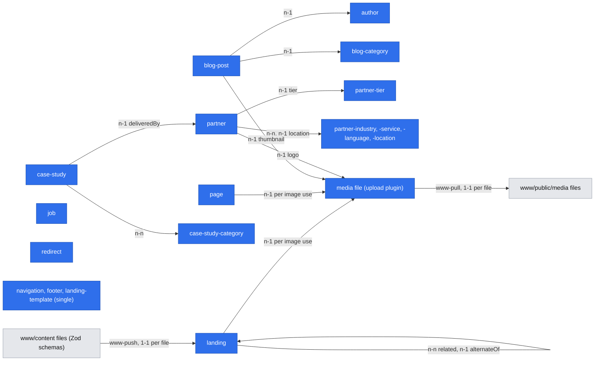

# Strapi CMS for www.openmercato.com: editors publish, the build stays static

Status: Draft for review. Author: catalog maintainers. Date: 2026-11-27. Builds on the www migration spec
([2026-11-24-www-site-migration.md](https://github.com/open-mercato/modules/blob/spec/www-site-migration/docs/specs/2026-11-24-www-site-migration.md),
PR #23, branch `spec/www-site-migration`, still a draft) and on the merged layout of `docs/RUNBOOK.md` (Preview of the
main site, `lib/emit/pages-merge.ts`). Design only: no code, no server, no DNS, Cloudflare or repository-variable change
comes with this document.

## 📝 TLDR

- **Who needs it.** The two marketing editors who run www.openmercato.com in Webflow today. After the www switch the
  content is files in `www/content/` and every change is a pull request (migration spec D2, D10), which they cannot
  work with day to day.
- **Today.** 32 landings, 19 pages, 72 blog posts, 20 case studies, 27 partners, 1 job, 8 dictionary files, `redirects.yaml`,
  9 HTML embeds, 350 media files (71 MB, `www/public/media`) and 15 site files (`www/public/files`) live in the repository (counted on `main`, 27 Nov 2026). The menus and the
  footer are constants in `lib/core/main-site.ts`.
- **Proposed (future behavior).** A self-hosted Strapi 5 (Community edition) holds all of that content. Publishing
  fires a dispatch of the `pages` workflow; the build pulls content and media from the Strapi REST API, turns them
  back into the exact files of today (`yarn om www-pull`), validates them with the existing Zod schemas and builds the
  same static site on Cloudflare Pages. The first import is a round trip whose output must be byte-identical to the
  files it started from.
- **Why this shape.** Turning Strapi back into today's files keeps every existing contract (schemas, routes, the
  srcset step of PR #39, `compare-live`, the merge) unchanged, makes parity a `git diff`, and makes rollback to files a
  copy of the last snapshot.

## 📝 Decisions

Made by the repository owner. This spec designs within them and does not reopen them.

| #   | Date        | Decision                                                                                                                                                                                                                                                                                                                                                                                                                                                             |
| --- | ----------- | -------------------------------------------------------------------------------------------------------------------------------------------------------------------------------------------------------------------------------------------------------------------------------------------------------------------------------------------------------------------------------------------------------------------------------------------------------------------- |
| S1  | 27 Nov 2026 | Strapi is hosted on the owner's server Cezar (Hetzner, Ubuntu 26.04, Docker) for the build phase. Later the infrastructure owner (who runs the Cloudflare side) moves it to the hosting they run. The move must be cheap: everything as code (Docker Compose, config in a repository), documented backup and restore of the database and media, no Cezar path in the site build. This reverses the "no CMS, Strapi rejected" decision D2 of 24 Nov (migration spec). |
| S2b | 27 Nov 2026 | All content of the main site goes to Strapi: blog, case studies, partners, pricing, pages, navigation, footer, SEO fields, redirects where sensible. Every content type and field of `www/` maps to a Strapi type; what stays in code is listed with a reason.                                                                                                                                                                                                       |
| S3a | 27 Nov 2026 | Publishing in Strapi triggers the site build (a dispatch of the `pages` workflow). The build fetches content from the Strapi API at build time. The site stays fully static on Cloudflare Pages.                                                                                                                                                                                                                                                                     |
| S4  | 27 Nov 2026 | Out of scope: the marketplace contact form (decided separately: a Pages Function form, the author address from a `contactEmail` field of the module YAML, mail provider not chosen) and analytics (GA and Hotjar only after the www switch).                                                                                                                                                                                                                         |

Effect on the migration spec (PR #23): D2 is superseded by S1. D10 (content pull requests reviewed by the site owner)
ends for content that lives in Strapi: editors publish there, and the repository keeps code review for code. D5
(images in the repository) holds until the source switch (Phase 6); after it the media of record are in Strapi and a
copy rides in the snapshot branch. D6 (Webflow drafts kept as `draft: true`) maps to Strapi drafts.

## 📝 Open Questions (the owner's to decide)

Each has lettered options and a recommended default. The design below is written so it reads under the defaults, but
none of them is decided: the phase named in each row cannot start until the owner answers it.

| #   | Question                                                   | Options                                                                                                                                                                                                                                                                                                                                                        | Recommended default and why                                                                                                                                                                                                                                                          | Blocks  |
| --- | ---------------------------------------------------------- | -------------------------------------------------------------------------------------------------------------------------------------------------------------------------------------------------------------------------------------------------------------------------------------------------------------------------------------------------------------- | ------------------------------------------------------------------------------------------------------------------------------------------------------------------------------------------------------------------------------------------------------------------------------------ | ------- |
| Q1  | Address of the Strapi admin and API, and who sets its DNS. | (a) `cms.openmercato.com` in the `openmercato.com` zone, record set by the infrastructure owner. (b) A name in a zone the owner holds for Cezar, changed at the move. (c) No public name: reachable only through a tunnel or VPN.                                                                                                                              | (a). The address survives the move (only the record's target changes), and GitHub Actions and the editors need a stable public name. (c) locks out CI runners.                                                                                                                       | Phase 2 |
| Q2  | How the host is exposed.                                   | (a) Cloudflare Tunnel from the Strapi host (no open port) with Cloudflare Access (email one-time code) in front of `/admin`; the API stays reachable with its token. (b) A reverse proxy with its own TLS on an open port, Strapi's login only. (c) Access on the whole host, CI uses an Access service token.                                                 | (a). Community Strapi has no SSO and no second factor; Access adds one for editors at no cost, and a tunnel moves with the container, not with the server. (c) also protects the API but adds a second secret to CI.                                                                 | Phase 2 |
| Q3  | Strapi Community (free, MIT) or a paid plan.               | (a) Community. (b) A paid self-hosted plan (live preview side by side, content history, review workflows, audit logs, SSO; which plan holds which feature is re-checked in Step 0.1). (c) Community now, re-evaluated after three months of use.                                                                                                               | (a). Two editors, one site: drafts, publish, roles, the media library and the preview button are in Community; the git snapshot of every publish (Architecture) gives history and an audit trail that Community lacks.                                                               | Phase 2 |
| Q4  | The GitHub credential that starts the build.               | (a) A fine-grained personal access token of a machine account, this repository only, permission Actions read and write, expiry one year. (b) A GitHub App installed on this repository only, permission Actions write, its private key in the Strapi host. (c) A small relay (Worker) holds the GitHub token; Strapi holds only a shared secret for the relay. | (a). It is the smallest permission that can call `workflow_dispatch`, needs no new service, and moves with the Strapi environment. `repository_dispatch` is not used because it needs Contents write, which can push code. (b) is the upgrade if a personal account must not own it. | Phase 4 |
| Q5  | Where the media files of Strapi live.                      | (a) A Docker volume on the Strapi host (the upload provider `local`). (b) A Cloudflare R2 bucket through the S3 upload provider.                                                                                                                                                                                                                               | (a). Visitors never load media from Strapi (the build copies them into the Pages upload), so R2 brings no speed; a volume needs no Cloudflare token and is in the same backup as the database. (b) makes the move lighter (no media copy) and is a config change later.              | Phase 2 |
| Q6  | Where the Strapi project (code and config) lives.          | (a) A new small repository, for example `open-mercato/www-cms`. (b) A `cms/` folder in this repository with its own `package.json` and lockfile.                                                                                                                                                                                                               | (a). AGENTS.md rule 1 fixes this repository's dependency list, and Strapi brings a large tree of its own; a separate repository can be handed to the infrastructure owner as a whole. The contract stays here (schemas, pull, push).                                                 | Phase 2 |
| Q7  | Where editors see a draft rendered as the site.            | (a) A separate Pages project for drafts (for example `open-mercato-www-drafts`) with Cloudflare Access on it. (b) A branch alias of the existing project with Access on all its preview deployments. (c) No hosted draft preview: Strapi's own edit view only, then the published site.                                                                        | (a). Drafts are unannounced posts and must not be public. (b) would also put `www-preview` behind a login, which the RUNBOOK keeps open. Until the owner answers, Phase 5 does not deploy drafts anywhere.                                                                           | Phase 5 |
| Q8  | Where encrypted backups go.                                | (a) A Hetzner Storage Box. (b) A Cloudflare R2 bucket. (c) Both.                                                                                                                                                                                                                                                                                               | (a). No Cloudflare change, and the move repoints one setting. Backups are encrypted with a key the owner holds, so the target only stores ciphertext.                                                                                                                                | Phase 2 |
| Q9  | Admin accounts and roles.                                  | (a) The owner and the infrastructure owner are Super Admins; each marketing editor has a personal account with the Editor role. (b) Marketing editors are Super Admins too.                                                                                                                                                                                    | (a). Editors can create, edit and publish every content type, which is the whole job; settings, API tokens and users stay with two people.                                                                                                                                           | Phase 2 |
| Q10 | When Strapi becomes the source of the live site.           | (a) After the www switch (migration spec C8) is stable, with Strapi running in shadow mode before it. (b) Before the switch, on the merged site of `modules.openmercato.com` (D11).                                                                                                                                                                            | (a). One change at a time, as the migration spec orders the `/run` and www switches (A9). Shadow mode proves parity on every build before the switch, so (a) costs no extra wait.                                                                                                    | Phase 6 |

## 📝 Resolved assumptions (autonomous defaults)

Design choices this spec made itself, each the most reversible option. Any of them can be changed before merge.

| #   | Question                                                              | Applied default                                                                                                                                                                                                                                                                                                                  | Why                                                                                                                                                                                                                                  | Confirm?   |
| --- | --------------------------------------------------------------------- | -------------------------------------------------------------------------------------------------------------------------------------------------------------------------------------------------------------------------------------------------------------------------------------------------------------------------------- | ------------------------------------------------------------------------------------------------------------------------------------------------------------------------------------------------------------------------------------ | ---------- |
| A1  | One spec or several (the Strapi server, the pull, the draft preview)? | One spec, delivered in phases that each ship alone. Phase 1 (content as data, the mapping) and Phase 5 (draft preview) could be specs of their own; they stay here because editing the site in a CMS is their only reason and the brief asks for them together.                                                                  | The server alone publishes nothing and the pull alone has nothing to read; splitting would leave specs without a consumer.                                                                                                           | reversible |
| A2  | How the build reads Strapi.                                           | REST with `populate` per type, not GraphQL. The pull writes today's files and Astro reads them as now.                                                                                                                                                                                                                           | REST is in Strapi core (GraphQL is a plugin); writing files keeps schemas, routes, parity and rollback unchanged.                                                                                                                    | reversible |
| A3  | What happens when Strapi is down or its content is invalid.           | A build started by a publish fails loudly. Every other build (push, catalog data, schedule) falls back to the last good snapshot, says so in its summary and updates the issue of A9.                                                                                                                                            | An editor must learn that a publish did not go live; the catalog's several builds a day must not stop because of a second server or an editor's mistake.                                                                             | reversible |
| A4  | Rich text format in Strapi.                                           | The Markdown rich text field, not Blocks.                                                                                                                                                                                                                                                                                        | Bodies are Markdown today with GFM tables, `<lite-video>` and `<om-embed>`; Blocks JSON cannot hold them and would break the byte round trip.                                                                                        | reversible |
| A5  | Localization.                                                         | No i18n plugin. `locale` stays a field and `alternateOf` a relation, as in the files.                                                                                                                                                                                                                                            | One Polish landing out of 32; i18n would change how documents and slugs relate for one pair.                                                                                                                                         | reversible |
| A6  | Database.                                                             | PostgreSQL in the same Compose file.                                                                                                                                                                                                                                                                                             | The common Strapi production database, `pg_dump` is a standard backup, and a managed Postgres is a likely target of the move.                                                                                                        | reversible |
| A7  | Strapi image formats.                                                 | Off: no breakpoints, no size optimization, no auto orientation. Strapi keeps originals byte for byte.                                                                                                                                                                                                                            | The build already makes webp variants and srcset from originals (`www/image-variants.ts`, PR #39); Strapi variants would be unused and would break byte parity.                                                                      | reversible |
| A8  | Drafts in the public snapshot.                                        | Production builds and the snapshot exclude documents that were never published. The one-off parity run includes them and runs on Cezar only; the drafts build (Phase 5) prints counts only to the public run.                                                                                                                    | The repository and its Actions logs are public, and an unpublished post in Strapi is unannounced (unlike the 13 Webflow drafts already in `main`). Drafts are never built for production, so the built site is identical either way. | reversible |
| A9  | How editors learn that a publish did not go live.                     | Field rules in Strapi catch the simple cases at save; the full Zod check runs in the build. A failed publish build, and any build that fell back to the snapshot, opens or updates one issue in this repository listing the cause (no draft content in it), without assignees or mentions; the next good Strapi build closes it. | No new service; the issue is a visible, linkable list, and it still appears when GitHub replaced a pending publish run with another trigger. The last good snapshot stays live meanwhile.                                            | reversible |

## 📝 Problem Statement

- **Editors lose their tool at the www switch.** Webflow ends at C8 of the migration spec. From then on a typo fix is a
  branch, a commit and a review, for two people who do not use Git.
- **The content is ready for a CMS but has none.** The migration spec built typed collections (`lib/schema/www-content.ts`,
  15 collections, references checked at build). That model maps cleanly to Strapi types; what is missing is an editor
  and a publish path.
- **The menus are code.** `lib/core/main-site.ts` holds the navbar and footer as TypeScript constants (327 lines), so
  a new menu item needs a developer (RUNBOOK, Navbar and footer).
- **Constraints from this repository.** AGENTS.md rule 1 (fixed dependency list), rule 3 (nothing outside the
  repository without a yes), rule 5 (heavy work on Cezar), rule 6 (erasable TypeScript), rule 7 (texts) and rule 8 (no
  typed numbers) all apply to the new parts.

## 📝 Proposed Solution

1. **Strapi 5 Community in Docker Compose** (Strapi, PostgreSQL, a backup job, a tunnel), defined in a small repository
   (Q6) with content types and components as code. In production the Content-Type Builder is read-only, so the model
   changes only through a reviewed commit.
2. **`yarn om www-push`**, the one-off and repeatable import: files of `www/content/` and media of `www/public/media/`
   and `www/public/files/` into Strapi, upserted by slug, idempotent.
3. **`yarn om www-pull`**, the reverse: Strapi documents and media into the same files, same bytes. It is the only
   reader of Strapi.
4. **`pages` reads content through `www-pull`** behind a repository variable `WWW_CONTENT_SOURCE` (`files` by default,
   `shadow`, `strapi`). After a good deploy it writes the pulled content to a `www-content` branch, the pinned
   snapshot and the fallback.
5. **A publish hook in the Strapi project** calls `workflow_dispatch` of `pages` after a quiet period of 60 seconds.
6. **Draft preview** as a second static build of draft content, behind Access (Q7).

### Alternatives considered

- **Astro pages call Strapi directly (the pattern of the Astro guide) or a content loader for Strapi.** Rejected as the
  main path: the schemas, the namespace check of `www/content.config.ts`, the media paths the srcset step reads and the
  byte parity would all have to be rebuilt around API objects, and rollback to files would need a converter anyway.
  The pull is that converter, written once.
- **GraphQL.** Rejected (A2): a plugin, a second schema to keep in step, no gain for a full read at build.
- **Strapi's built-in Webhooks to GitHub.** Not usable as is: the payload shape is fixed by Strapi (event, model,
  entry), while `workflow_dispatch` needs `{"ref": ..., "inputs": ...}`, and its headers are stored in the database where
  every Super Admin can read them. A few lines in the Strapi project send the right body and read the token from the
  environment.
- **Cloudflare Pages deploy hooks.** Not available: the Pages project is a direct-upload project built by GitHub
  Actions, and deploy hooks belong to Git-connected projects.
- **A git-based editor (Decap, Keystatic, TinaCMS) on the files.** Superseded by S1.
- **Static build only from the snapshot branch, Strapi never read by `pages`.** Rejected: S3a asks the build to fetch at
  build time, and a separate sync workflow would add a second moving part with no gain.

### What comparable Astro and Strapi setups do, and what this spec takes

Sources were not fetched in this run (web access was refused by the session's permissions); each claim below is
re-checked against its page in Step 0.1 before any implementation PR, and the spec is corrected where a page says
otherwise.

- The Astro guide for Strapi fetches the REST API at build time with a token and rebuilds the static site on a Strapi
  webhook ([docs.astro.build/en/guides/cms/strapi](https://docs.astro.build/en/guides/cms/strapi/)). Taken: build-time
  fetch and a rebuild on publish. Not taken: fetching inside pages (see Alternatives).
- Strapi 5 REST returns flattened documents with a `documentId`, reads drafts with `status=draft`, needs explicit
  `populate` for relations, components, dynamic zones and media, and caps page size by `maxLimit`
  ([REST API](https://docs.strapi.io/cms/api/rest), [status](https://docs.strapi.io/cms/api/rest/status),
  [populate](https://docs.strapi.io/cms/api/rest/populate-select)). Taken: one paged, fully populated read per type.
- Strapi API tokens come as read-only, full access or custom, and can expire
  ([API tokens](https://docs.strapi.io/cms/features/api-tokens)). Taken: a read-only token for builds, a full-access
  token only on Cezar for the import.
- Strapi webhooks fire on entry create, update, delete, publish and unpublish and on media events, with custom headers
  and no signature ([Webhooks](https://docs.strapi.io/cms/backend-customization/webhooks)). Taken: the event list;
  not taken: the built-in sender (see Alternatives).
- Strapi 5 Preview opens a front-end URL that the project builds from the document in a `preview.handler`; a side by
  side live preview is a paid feature ([Preview](https://docs.strapi.io/cms/features/preview),
  [pricing](https://strapi.io/pricing-self-hosted)). Taken: the Preview button pointing at the draft build.
- The upload plugin generates responsive formats unless `breakpoints` and `sizeOptimization` are turned off, and
  switches to S3-compatible storage such as R2 through `@strapi/provider-upload-aws-s3`
  ([Media Library](https://docs.strapi.io/cms/features/media-library),
  [R2 S3 API](https://developers.cloudflare.com/r2/api/s3/)). Taken: formats off (A7), the local provider by default (Q5).
- Strapi's data management CLI (`strapi export`, `import`, `transfer`) moves content, media and configuration between
  instances, with optional encryption; admin users and API tokens are not part of it
  ([Data management](https://docs.strapi.io/cms/features/data-management)). Taken: as the portable archive of the move,
  next to `pg_dump`.
- Strapi documents Docker deployments with PostgreSQL ([Docker](https://docs.strapi.io/cms/installation/docker)).
  Taken: Compose with Postgres (A6).
- GitHub: `workflow_dispatch` needs Actions write, `repository_dispatch` needs Contents write for a fine-grained token
  ([permissions of fine-grained tokens](https://docs.github.com/en/rest/authentication/permissions-required-for-fine-grained-personal-access-tokens),
  [workflow dispatch](https://docs.github.com/en/rest/actions/workflows#create-a-workflow-dispatch-event)); a
  concurrency group keeps one run and one pending run
  ([concurrency](https://docs.github.com/en/actions/writing-workflows/choosing-what-your-workflow-does/control-the-concurrency-of-workflows-and-jobs)).
  Taken: `workflow_dispatch` (Q4) and the existing `pages` group as the second half of the debounce.
- Cloudflare: Access can protect Pages preview deployments, and Tunnel exposes a host without an open port
  ([preview deployments](https://developers.cloudflare.com/pages/configuration/preview-deployments/),
  [Tunnel](https://developers.cloudflare.com/cloudflare-one/connections/connect-networks/)); deploy hooks need a
  Git-connected project ([deploy hooks](https://developers.cloudflare.com/pages/configuration/deploy-hooks/)).

What the common setups skip and this spec keeps: a schema check stricter than the CMS (the Zod schemas), a parity
proof at migration, and a rollback that does not need the CMS.

## 📝 Architecture

```mermaid
flowchart LR
    classDef existing fill:#e5e7eb,color:#111,stroke:#9ca3af
    classDef new fill:#2f6feb,color:#fff,stroke:#1b4fb0
    e["Editor in Strapi admin"]:::new
    s["Strapi 5 + Postgres + media volume (Compose)"]:::new
    h["publish hook (in the Strapi project)"]:::new
    p["pages workflow (workflow_dispatch)"]:::existing
    pull["yarn om www-pull"]:::new
    f["www/content + www/public/media (files, as today)"]:::existing
    b["www build, srcset step, merge, check"]:::existing
    cf["Pages project open-mercato-modules"]:::existing
    snap["branch www-content (pinned snapshot)"]:::new
    e --> s --> h -->|after 60 s quiet| p
    p --> pull -->|REST, read-only token| s
    pull --> f --> b --> cf
    b -->|after a good deploy| snap
    pull -.->|Strapi down, not a publish run| snap
```



Takeaway: everything right of `www-pull` is the build of today; the new parts are Strapi, the hook, the pull and the
snapshot branch.

### Components

| Component               | Where                                                                                                                                    | What it does                                                                                                                                                                                                                                                                                               |
| ----------------------- | ---------------------------------------------------------------------------------------------------------------------------------------- | ---------------------------------------------------------------------------------------------------------------------------------------------------------------------------------------------------------------------------------------------------------------------------------------------------------- |
| Strapi project          | the repository of Q6: `compose.yaml`, `src/api/**`, `src/components/**`, `config/**`, `scripts/backup.sh`, `scripts/restore.sh`, `docs/` | Content types and components as `schema.json` files, upload config (A7), roles seed, the publish hook (`src/index.ts` bootstrap), the preview handler, backup and restore. Strapi version pinned exactly; Node of its image as Strapi supports it (re-checked in Step 0.1), not this repository's Node 24. |
| `lib/www-cms/model.ts`  | this repository                                                                                                                          | The mapping table between each file collection and its Strapi type: field names, components, relations, media fields. Pure functions `toDocument(entry)` and `fromDocument(doc)`; erasable TypeScript, no Node APIs.                                                                                       |
| `yarn om www-push`      | `lib/commands/www-push.ts`                                                                                                               | Files into Strapi (API Contracts).                                                                                                                                                                                                                                                                         |
| `yarn om www-pull`      | `lib/commands/www-pull.ts`                                                                                                               | Strapi into files (API Contracts).                                                                                                                                                                                                                                                                         |
| `lib/www-cms/source.ts` | this repository                                                                                                                          | One function that decides, from `WWW_CONTENT_SOURCE`, the trigger and the pull result, which content a build uses (Edge Cases). Unit-tested as a table.                                                                                                                                                    |
| `pages.yml` steps       | this repository                                                                                                                          | Read www content (before the www build), Write www snapshot (a job after `deploy`, `contents: write` on that job only), the `www_content` input of `workflow_dispatch`, the drafts build (Phase 5).                                                                                                        |
| branch `www-content`    | this repository                                                                                                                          | The pulled files of the last good deploy: `content/**`, `media/**`, `manifest.json` (Strapi `documentId` and `updatedAt` per file, SHA-256 per media file, the pull time). Written only by the snapshot job with `GITHUB_TOKEN`, so it starts no workflow.                                                 |

### No Cezar path in the site build

The site repository knows Strapi only by the variable `STRAPI_URL` (an https address, Q1) and the secret
`STRAPI_READ_TOKEN`. Nothing in `pages.yml`, `www/` or `lib/` names Cezar, a Docker volume or a host path. The Strapi
project reads every host-specific value from an `.env` file that is not committed (`.env.example` lists the keys):
database password, app keys, JWT secrets, the GitHub token, the tunnel token, the backup target and key.

### Shared code and the catalog

The navbar and footer data leave `lib/core/main-site.ts` for `www/content/navigation.json` and `www/content/footer.json`
(Phase 1). They are JSON, not YAML, so `lib/core` keeps no Node API: `main-site.ts` imports them with an import
attribute (`with { type: 'json' }`), which Node 24 and Vite both read. The catalog build under `/run` and
`yarn om pages-site --check` keep reading the same exported constants, so the catalog sees no change of shape. The
catalog's own `RUN_MENU` stays code (Stays in code, below).

## 📝 Data Model

### Strapi types for every collection of `www/content/`

Conventions for every type: Draft and Publish on; `slug` is a `uid` field with the regex of `SLUG_RE`
(`^[a-z0-9]+(-[a-z0-9]+)*$`), required and unique, and is the file name; `webflowId` is an optional text field, hidden
from the edit view, kept for parity; field names are the file's keys, so the mapping is mostly identity. Shared
components:

- `shared.seo` { `title` (required), `description` (required), `ogImage` (media, single, optional), `noindex` (boolean) }
- `shared.image` { `file` (media, single, images, required), `alt` (text), `decorative` (boolean), `width`, `height`
  (integers, optional, written only when the file sets them) }. The alt text lives on the use, not on the media file,
  because one file can serve two uses with two alts today.
- `shared.cta` { `label`, `href`, `trackingPlacement`, `trackingAction` } (the file's `tracking` object is flattened,
  because a component of one optional sub-object adds a click for editors).
- `shared.faq-item` { `question`, `answer` (Markdown rich text) }, `shared.source-link` { `label`, `url` },
  `shared.title-body`, `shared.art-item`, `shared.block-item` (the fields of `BlockItem`).

| File collection (Zod)                               | Strapi type (API id)                   | Kind       | Field mapping and notes                                                                                                                                                                                                                                                                                                                                                                                                                                                                                                                                                                                                             |
| --------------------------------------------------- | -------------------------------------- | ---------- | ----------------------------------------------------------------------------------------------------------------------------------------------------------------------------------------------------------------------------------------------------------------------------------------------------------------------------------------------------------------------------------------------------------------------------------------------------------------------------------------------------------------------------------------------------------------------------------------------------------------------------------- |
| `landings` (32)                                     | `landing`                              | collection | `locale` (enum `en`, `pl`), `kind` (enum), `competitor`, `alternateOf` (relation to `landing`, many to one), `seo`, and one component per section: `landing.hero`, `landing.pains`, `landing.features`, `landing.capabilities` (with repeatable `landing.capability-group` holding repeatable `landing.capability-row`; the file's two-item `columns` tuple becomes `oursColumn` and `theirsColumn`), `landing.comparison`, `landing.demo`, `landing.steps`, `landing.faq`, `landing.cta`, `landing.sources`; `sectionNav` (repeatable `landing.nav-item`); `related` (relation to `landing`, many to many, ordered).               |
| `pages` (19, pricing among them)                    | `page`                                 | collection | `seo`, `jsonLd` (component: `type` enum of `PAGE_JSON_LD_TYPES`, repeatable `faq`), `siteCta` (boolean, default true), `blocks` (dynamic zone of one component per block type: `block.hero`, `block.logos`, `block.features`, `block.carousel`, `block.video`, `block.stats`, `block.team`, `block.quote`, `block.steps`, `block.faq`, `block.cta`, `block.prose`, `block.list`, `block.legacy`, `block.copy`). The shared block head (`id`, `layout`, `label`, `eyebrow`, `lead`, `primary`, `secondary`, `note`) is repeated in each component. `block.legacy.component` is an enum of the files in `www/src/components/legacy/`. |
| `blog` (72)                                         | `blog-post`                            | collection | `title`, `description`, `date` (date-time), `updated`, `author` (relation to `author`), `category` (relation to `blog-category`), `featured`, `thumbnail` (`shared.image`), `seo` (optional override), `body` (Markdown rich text).                                                                                                                                                                                                                                                                                                                                                                                                 |
| `authors`                                           | `author`                               | collection | `slug`, `name`; later `role`, `avatar`, `url` as the schema grows.                                                                                                                                                                                                                                                                                                                                                                                                                                                                                                                                                                  |
| `blogCategories`                                    | `blog-category`                        | collection | `slug`, `name`, `order`, `labelColor`, `textColor` (text with the `HexColor` regex).                                                                                                                                                                                                                                                                                                                                                                                                                                                                                                                                                |
| `caseStudies` (20)                                  | `case-study`                           | collection | `title`, `heading`, `description`, `thumbnail`, `heroVideo` (text, YouTube id regex), `deliveredBy` (relation to `partner`), `deliveredByUrl`, `overview` (component), `stats` (repeatable, exactly 3 when present: checked by Zod at pull, `max: 3` in Strapi), `screenshots` (repeatable `shared.image`), `categories` (relation to `case-study-category`, many to many), `featuredOnAgencies`, `order`, `body`.                                                                                                                                                                                                                  |
| `caseStudyCategories`                               | `case-study-category`                  | collection | `slug`, `name`.                                                                                                                                                                                                                                                                                                                                                                                                                                                                                                                                                                                                                     |
| `partners` (27)                                     | `partner`                              | collection | `name`, `logo`, `tier` (relation to `partner-tier`), `industries`, `services`, `languages` (relations, many to many), `location` (relation to `partner-location`), `budget` and `availability` (enums with the keys of `PARTNER_BUDGETS` and `PARTNER_AVAILABILITY`), `projectsInPortfolio`, `website`, `description`, `body`.                                                                                                                                                                                                                                                                                                      |
| `partnerTiers`                                      | `partner-tier`                         | collection | `slug`, `name`, `order`, `backgroundColor`, `textColor`.                                                                                                                                                                                                                                                                                                                                                                                                                                                                                                                                                                            |
| `partnerIndustries`, `partnerServices`              | `partner-industry`, `partner-service`  | collection | `slug`, `name`, `order`.                                                                                                                                                                                                                                                                                                                                                                                                                                                                                                                                                                                                            |
| `partnerLanguages`, `partnerLocations`              | `partner-language`, `partner-location` | collection | `slug`, `name`.                                                                                                                                                                                                                                                                                                                                                                                                                                                                                                                                                                                                                     |
| `jobs` (1)                                          | `job`                                  | collection | the fields of `jobSchema`; `employmentType` enum with the keys of `EMPLOYMENT_TYPES`.                                                                                                                                                                                                                                                                                                                                                                                                                                                                                                                                               |
| `redirects` (`source: manual` only)                 | `redirect`                             | collection | `from` (text, `RedirectFrom` regex, unique), `to`, `status` (enum 301, 302). The pull appends them after the file's rules with `source: manual`.                                                                                                                                                                                                                                                                                                                                                                                                                                                                                    |
| `MAIN_SITE_MENUS`, `MAIN_SITE_LINKS`                | `navigation`                           | single     | repeatable `nav.menu` { `label`, repeatable `nav.item` { `label`, `description`, `href`, `icon` (enum of the keys of `site/src/components/nav-icons.ts`) } }, `links` (repeatable `shared.cta`), `sandbox` (`shared.cta`).                                                                                                                                                                                                                                                                                                                                                                                                          |
| `MAIN_SITE_FOOTER`, `_FOOTER_OTHER`, `_FOOTER_NOTE` | `footer`                               | single     | `links`, repeatable `footer.group` { `label`, `links` }, `note`.                                                                                                                                                                                                                                                                                                                                                                                                                                                                                                                                                                    |
| `LANDING_TEMPLATE_TEXT`                             | `landing-template`                     | single     | two components `en` and `pl` with the keys of the constant (`reviewedPrefix`, `sourcesLabel`, `reviewedInline`, `navLabel`, `detailsSummary`, `relatedTitle`, `marks`). It moves to `www/content/landing-template.yaml`; the constant becomes the schema.                                                                                                                                                                                                                                                                                                                                                                           |

Drafts: a document that has a published version is written from that version with `draft: false`; a document with no
published version is written from its draft with `draft: true` only by `www-pull --drafts` (A8). Order: lists keep the
order of today's files; collections without `order` are written in slug order, as the files are read today.

Relations to drafts keep today's rule (migration spec): a published entry that references a never-published one builds,
and the reference renders as plain text with a build warning.

Sensitive data: none new. Partner and author profiles are public. The Strapi admin users (name, email, password hash)
live only in the Strapi database and its backups, never in this repository or the snapshot.



### Media

- **Paths survive the round trip.** The push puts each file into a Media Library folder named after its directory
  (`/media/blog`, `/media/partners`, `/files`) with its original file name. The pull writes
  `www/public<folder>/<name>`, so every `src` of today keeps its path, and the srcset step of PR #39
  (`www/image-variants.ts`, which reads raster images under `/media/` and `/files/` from the built pages) works
  unchanged.
- **New uploads.** A file an editor uploads outside those folders is written to `/media/uploads/<name>`, the name
  lowercased with every character outside `[a-z0-9.-]` turned into `-` (the importer's rule). Two different files that
  reach the same path stop the pull with both names, so nothing is overwritten silently.
- **Bytes.** Formats and optimization are off (A7), so Strapi stores the original. The pull checks the SHA-256 against
  the `manifest.json` of the snapshot and downloads only new or changed files; the media cache of the build is the
  Actions cache keyed by that manifest.
- **Limits.** The Strapi upload limit is set to 25 MiB, the Pages file limit; the pull fails above it too, and
  `pages-site --check` keeps the file count check.

### Stays in code, and why

| Item                                                                                             | Why it stays                                                                                                                                                                               |
| ------------------------------------------------------------------------------------------------ | ------------------------------------------------------------------------------------------------------------------------------------------------------------------------------------------ |
| `www/content/embeds/*.html` (9 interactive tools in blog posts)                                  | HTML, CSS and scripts that run on the site: they need code review. Editors place them in Markdown with `<om-embed name>`; the pull fails on a name without its file.                       |
| Components, layouts, `legacy` components, block `layout` files, SVG icons (`nav-icons.ts`)       | The look belongs to the designer (D7); editors pick a layout or an icon from an enum, they do not edit markup.                                                                             |
| Redirects with `source: docs-map` (307 rules) and `webflow-panel`                                | Generated from the docs sitemap or copied once at cutover (D8); hand edits there risk search traffic, and the merge checks their limits. Only new `manual` redirects are edited in Strapi. |
| `RUN_MENU`, `MAIN_SITE_ORIGIN`, the GitHub address, the star fallback                            | The catalog's own menu and constants that the layout check and the count tokens (A6 of the migration spec) depend on.                                                                      |
| Option labels (`PARTNER_BUDGET_LABELS`, `PARTNER_AVAILABILITY_LABELS`, `EMPLOYMENT_TYPE_LABELS`) | Stored by key in content; the label map is one place, so a label edit is not a content migration (migration spec, Data Model).                                                             |
| SEO computed per page type (canonical, `og:url`, JSON-LD, sitemap), count tokens                 | Computed from data, never typed (AGENTS.md rule 8). Editors type `{moduleCount}` or `{githubStars}` in copy; the pull fails on an unknown token.                                           |
| Consent banner texts, analytics                                                                  | Out of scope (S4) and fixed by D9 of the migration spec.                                                                                                                                   |

## 📝 API Contracts

### `yarn om www-push`

```
yarn om www-push --strapi <https url> [--content www/content] [--public www/public] [--only <collection>[,...]] [--dry-run] [--publish-as-files]
```

- **Token.** `STRAPI_ADMIN_TOKEN` from the environment, a full-access API token made for the import and deleted after
  it. Run only on Cezar or the Strapi host (AGENTS.md rule 5), never in CI.
- **Upsert by slug.** For each file it finds the document by `slug` (single types by type), compares the mapped
  document with the current one and writes only differences. Media are matched by folder, name and SHA-256: same bytes
  is the same file, so a second run uploads nothing.
- **Order.** Dictionaries, authors and categories first, then partners, then case studies, posts, landings (two passes:
  documents, then `alternateOf` and `related`), pages, single types, redirects. Relations are set by `documentId`
  looked up by slug.
- **Status.** A file with `draft: false` is published; `draft: true` stays a draft. `--publish-as-files` makes the
  Strapi status follow the files on a re-run.
- **Idempotent.** Run twice on the same files, the second run writes nothing and prints `0 changed`.
- **Output.** A report: created, updated, unchanged per type, media uploaded and skipped, and every value Strapi
  refused, with its file and field. `--dry-run` writes nothing and prints the same report.

### `yarn om www-pull`

```
yarn om www-pull --strapi <https url> [--out <dir>] [--drafts] [--status published|draft] [--check] [--snapshot <dir>]
```

- **Token.** `STRAPI_READ_TOKEN`, a read-only API token.
- **Read.** For each type, paged REST reads (`pagination[pageSize]` at the type's `maxLimit`) with an explicit
  `populate` from `lib/www-cms/model.ts`; `status=published` by default, `status=draft` for the drafts build. Requests
  at most 4 at a time, 30 seconds each, 3 tries with backoff; any failure ends the run with exit 2 (environment), never
  with partial files.
- **Write.** Into a fresh directory, then validated with the Zod schemas of `lib/schema/www-content.ts`, the slug and
  namespace checks of `www/content.config.ts`, the embed names and the count tokens. Only a valid tree replaces
  `www/content` and the media (exit 1 on invalid content, with every problem listed by file and field). Files are
  formatted with the repository's Prettier config, keys in schema order, LF, UTF-8, no run timestamps: the same Strapi
  state gives the same bytes.
- **Removed URLs.** A slug that was in the snapshot and is gone (renamed, deleted or unpublished) fails the pull unless
  a redirect from its old path exists (migration spec D3: every URL keeps answering). The message names the old path
  and says to add a redirect in Strapi.
- **`--check`.** Writes nothing; exits 1 when the result differs from `--out`, printing the files that differ.
- **Output for the build summary.** Counts per type, media downloaded and reused, the Strapi `updatedAt` of the newest
  document.

### `pages` workflow (changes)

- `workflow_dispatch` gains two inputs: `www_content`, an enum of `auto` (default), `publish` (sent by the hook),
  `drafts` and `snapshot`; and `snapshot`, a commit of `www-content` (only with `www_content: snapshot`, for rollback;
  the build then reads that commit and never Strapi).
- Step **Read www content** (before the www build), by `WWW_CONTENT_SOURCE`:
  - `files` (default while unset): nothing changes, the build reads `www/content` of the commit.
  - `shadow`: pull into a temporary directory, `--check` against `www/content`, the result in the summary as
    `Strapi shadow: N files differ`; the build still reads the files.
  - `strapi`: pull into `www/content` and the media folders. On failure, `lib/www-cms/source.ts` decides (Edge Cases).
- Job **Write www snapshot**, after `deploy`, only when the build used fresh Strapi content: pushes the pulled tree to
  `www-content` as one commit (`www-content: <newest updatedAt>`), skipped when nothing changed. History is kept as the audit
  trail; it grows by new or changed media only, since git stores each file once. `permissions:
contents: write` on this job only.
- The drafts build (Phase 5) runs only for `www_content: drafts` and deploys to the target of Q7, never to production.
- The existing `concurrency: pages` group (one running, one pending) is kept; a burst of publishes becomes at most one
  running and one pending build.

### Publish hook (Strapi project)

- Listens to publish, unpublish and delete of every type above, and to media update and delete.
- Waits for 60 seconds without a new event (at most 5 minutes from the first), then calls
  `POST /repos/open-mercato/modules/actions/workflows/pages.yml/dispatches` with
  `{"ref": "main", "inputs": {"www_content": "publish"}}` and the token of Q4 from the environment.
- Draft saves (create, update without publish) start the drafts build the same way with `drafts`, after 120 seconds
  quiet, only once Q7 is answered.
- Three tries with backoff on a 5xx or a network error; a 401 or 403 is logged as `dispatch refused: token` and not
  retried. The daily scheduled `pages` run (05:47 UTC) pulls Strapi anyway in `strapi` mode, so a lost dispatch is at
  most a day late.

### Webhook path and its security

- **Direction.** Strapi calls GitHub; nothing calls Strapi from outside except editors and the pull. There is no
  inbound webhook endpoint to protect.
- **What a stolen dispatch token can do.** Actions write cannot be limited to one workflow: with Q4 (a) or (b) the
  holder can dispatch any workflow of this repository on any branch of it with any inputs (`nightly.yml`,
  `mcp-deploy.yml`), cancel or delete runs, delete caches and disable workflows. It cannot push code or content, and
  deploys stay safe because environment `cloudflare` accepts only `main`. `pages` checks its own input against the enum
  and ends on any other value. Q4 (c) is the option that narrows this to `pages.yml`, `ref: main` and the two input
  values, at the cost of a relay to run; it is the natural upgrade at the move.
- **What a stolen read token can do.** Read published and draft content of Strapi. It is a repository secret, not
  available to pull requests from forks, and is rotated with the dispatch token.
- **Where secrets live.** The GitHub token and the Strapi secrets are in the Strapi host's `.env` (file mode 600, not
  in the image, not in the database, not in the admin UI). Built-in Strapi webhooks stay unused, so no Super Admin can
  read a token in the UI.
- **Rotation.** Both tokens expire within a year; rotation is a RUNBOOK section (new token, update `.env` or the
  repository secret, restart, one dispatch by hand).

## 📝 UI/UX

- **Editors work in the Strapi admin** at the address of Q1, behind Access (Q2). Content types are grouped as the site
  is: Pages and Landings, Blog, Case studies, Partners, Careers, Site (navigation, footer, landing template,
  redirects). Edit views hide `webflowId` and order fields as the site reads them.
- **Publish means live after the next build.** Publish, then about 60 seconds of quiet, then the `pages` build (about the
  length of a merged build today). The Strapi project adds a short help text on every type: "Published changes are on
  www.openmercato.com when the next site build ends, a minute after the last publish at the earliest."
- **When a publish cannot go live.** The live site keeps its last good version. The run summary lists the problems by
  document and field, and A9's single issue in this repository carries the same list. Strapi field rules (required,
  regex, max) catch most problems at save.
- **Preview.** The Preview button of Strapi 5 opens the draft build at the document's path (`/blog-posts/<slug>`,
  `/<landing slug>`, and so on, from the same route map as the site). If the drafts build failed validation, the draft
  site's page for that path is a plain list of the problems, so the editor sees why. Until Q7 is answered there is no
  Preview button.
- **Slugs.** Changing the slug of a published entry needs a redirect from the old path (API Contracts, Removed URLs);
  the help text of every `slug` field says so.

Prototype: none. The editor UI is Strapi's own admin; the site's look does not change.

## 📝 Edge Cases & Failure Scenarios

| Case                                                                                                       | What happens                                                                                                                                                                                                                                                                                          |
| ---------------------------------------------------------------------------------------------------------- | ----------------------------------------------------------------------------------------------------------------------------------------------------------------------------------------------------------------------------------------------------------------------------------------------------- |
| Strapi is down or times out, build started by a publish (`www_content: publish`)                           | The build fails at Read www content with `Strapi unreachable: <status>`. Nothing deploys; the live site keeps the last good version. The hook does not retry a failed build; the next publish or the daily run does.                                                                                  |
| Strapi is down, any other build (push to main, catalog data, schedule)                                     | The build uses the `www-content` snapshot, adds a warning and the line `Main site content from snapshot <sha> of <date>: Strapi unreachable` to the summary, updates the issue of A9 and deploys. The catalog keeps its several deploys a day.                                                        |
| Strapi is down and there is no snapshot yet                                                                | The build fails. This happens only before the first good `strapi` deploy, which Phase 6 rules out by running `shadow` first.                                                                                                                                                                          |
| Strapi answers, but the content is invalid (missing alt, a fourth stat, a removed slug without a redirect) | A publish build fails with every problem listed by document and field. Any other build falls back to the snapshot as in the row above, with `Strapi content invalid` as the reason. The live site keeps the last good version either way, and the issue of A9 lists the problems.                     |
| An editor deletes a media file still used by a published entry                                             | Strapi clears the field; the pull fails the schema on a required image, as above. An optional image just disappears from the page, as the editor asked.                                                                                                                                               |
| A published slug changes without a redirect                                                                | The pull fails naming the old path (D3).                                                                                                                                                                                                                                                              |
| Two publishes 20 seconds apart                                                                             | One dispatch after 60 seconds of quiet. If a build is already running, GitHub keeps one pending run; later dispatches replace it.                                                                                                                                                                     |
| The dispatch token expired                                                                                 | The hook logs `dispatch refused: token`; the daily run still publishes. Rotation is in the RUNBOOK; GitHub mails the token owner before expiry.                                                                                                                                                       |
| A publish lands while `WWW_CONTENT_SOURCE` is `files` or `shadow`                                          | The build runs and reads the files (or only compares). Editors are told in Phase 6 when Strapi becomes the source.                                                                                                                                                                                    |
| The Strapi model and the Zod schemas drift (a field added on one side)                                     | The pull's mapping table names unknown or missing fields and exits 1 (then the rows above apply). A model change ships as one PR here (schema, mapping, test fixture, and a migration of the `www-content` snapshot so a fallback still validates) and one in the Strapi repository, merged together. |
| Strapi or Postgres is upgraded                                                                             | Pinned versions; an upgrade is a PR in the Strapi repository, tested on a restored copy first (Backup).                                                                                                                                                                                               |
| Somebody edits `www/content` in a PR after the source switch                                               | Overwritten by the pull at the next build. Phase 6 adds a check to `validate.yml` that fails a PR touching `www/content/**` (except `embeds/` and `redirects.yaml`) while the source is `strapi`.                                                                                                     |

## 📝 Migration of today's files

1. **Round trip without a server (Phase 1).** `fromDocument(toDocument(file))` must give the same bytes for every file of
   `www/content` (unit test over the real files and the fixture data). This proves the mapping before Strapi exists.
2. **Import on Cezar (Phase 3).** A Strapi of the Compose file with an empty database; `yarn om www-push --dry-run`,
   then `www-push`. A second `www-push` prints `0 changed`.
3. **Byte parity.** `yarn om www-pull --drafts --out <tmp>` and `diff -r` against `www/content` and `www/public/media`
   plus `www/public/files`: no difference allowed. Drafts are included here (A8) because this run stays on Cezar.
4. **Built-site parity.** Two merged builds on Cezar, one from the files, one from the pull without drafts:
   `diff -r` of `dist-www` must be empty (the build is a function of the files, so step 3 implies it; the diff catches a
   build that reads anything else). Then `yarn om compare-live --baseline <report of the files build> --candidate
<the pull build served by wrangler pages dev>` with the migration spec's checks, no planned differences.
5. **Shadow (Phase 6).** `WWW_CONTENT_SOURCE=shadow` on `pages` until the switch: every build reports `0 files differ`
   or names the difference.
6. **Freeze and switch.** The content freeze of the migration spec (C1) is the moment of the final `www-push`; after
   it, edits go to Strapi only, and the owner sets `WWW_CONTENT_SOURCE=strapi` (Q10).

## 📝 Backup and restore

- **Nightly** on the Strapi host, by `scripts/backup.sh` in a container of the Compose file: `pg_dump --format=custom`
  of the database and a tar of the uploads volume, encrypted with `age` to a public key whose private key the owner
  holds, sent to the target of Q8. Kept 14 daily and 8 weekly.
- **Weekly** a `strapi export` archive (content, media, config; encrypted with its own key option) as the portable
  copy for the move. Admin users and API tokens are not in it; they are recreated (two Super Admins, two editors).
- **Last resort.** The `www-content` branch holds every published state since the switch. `www-push` from it into an
  empty Strapi restores the published content and media without any backup (drafts and users excluded).
- **Restore drill.** `scripts/restore.sh` into a fresh Compose project, then `www-pull --check` against the snapshot:
  equal means the backup is good. Run once in Phase 3 and before the move; the RUNBOOK records the date.

## 📝 The move to the infrastructure owner's hosting

Because the site knows only `STRAPI_URL` and two secrets, the move is:

1. A host with Docker; clone the Strapi repository; copy `.env` (new secrets where the new host differs: tunnel
   token, backup target).
2. Restore the latest backup (`scripts/restore.sh`), then `www-pull --check` against the snapshot.
3. Stop writes on Cezar (editors told; a short freeze), take a final backup, restore it on the new host.
4. Point the DNS record of Q1 at the new host (or move the tunnel). `STRAPI_URL` does not change.
5. One `pages` dispatch by hand; `www-pull --check` passes; Cezar's Strapi is stopped and its volumes kept for 30 days.

Nothing in this repository changes for the move. If the infrastructure owner prefers R2 for media (Q5 (b)), it is a
change of the upload provider plus a one-time copy, done before or after the move, not during it.

## 📝 Rollback to files

| Level                  | When                   | How                                                                                                                                                                                                                                                                                                                                      | Loss                                         |
| ---------------------- | ---------------------- | ---------------------------------------------------------------------------------------------------------------------------------------------------------------------------------------------------------------------------------------------------------------------------------------------------------------------------------------- | -------------------------------------------- |
| One bad publish        | A wrong text went live | Fix or unpublish in Strapi and publish again. With Strapi broken: dispatch `pages` on `main` with `www_content: snapshot` and `snapshot: <sha>` of an earlier `www-content` commit; it builds from that commit without reading Strapi. After the switch the snapshot branch is the only rollback source (the files of `main` are stale). | none                                         |
| Strapi lost            | Host or database gone  | Restore from backup; or `www-push` from the snapshot into a new Strapi.                                                                                                                                                                                                                                                                  | drafts since the last backup                 |
| Back to files for good | The owner ends Strapi  | A PR copies `content/**` and `media/**` of `www-content` into `www/content` and `www/public`; `WWW_CONTENT_SOURCE` set to `files` (or unset). The formats are the same, so the PR is a plain diff.                                                                                                                                       | unpublished drafts (kept in the last backup) |

## 📝 Risks & Impact Review

- **Third-party code on Cezar.** Strapi and its npm tree run on a server that holds other secrets (AGENTS.md rule 4
  concerns module code from the catalog, not Strapi, but the concern is the same). Mitigation: its own Compose project
  and network, a non-root user, no mount outside its volumes, no access to other `.env` files, only the tunnel exposed,
  pinned versions. The move (S1) ends this.
- **A second deployable system.** A Strapi outage stops publishing, not the site (Edge Cases). The daily run and the
  snapshot bound the damage.
- **Model lock-in in two repositories.** A field change needs two PRs merged together; the pull's strict mapping makes
  drift fail loudly rather than lose data.
- **Draft media are public by URL.** Strapi's local provider serves `/uploads/*` without a token. File names carry a
  hash, but a draft's image can be fetched by anyone who has its address. Acceptable for marketing images; Q2 (c) or
  Q5 (b) with a private bucket closes it if needed.
- **Build time and size.** The pull adds one paged read per type and, after the first run, only new media. The 71 MB
  of media move from `main` to Strapi and the snapshot branch at the switch; `main` keeps today's copy until the
  rollback window ends, then a PR removes it.
- **Catalog impact.** `pages.yml`, `lib/core/main-site.ts` and `validate.yml` are catalog files; their owners review
  those PRs (AGENTS.md rule 1). The catalog-only and merged layouts keep their bytes while `WWW_CONTENT_SOURCE` is
  unset.
- **Dependencies.** None added to this repository: the pull and push use `fetch` of Node 24, `yaml`, `zod` and Prettier,
  which the repository already has. Strapi's dependencies live in its own repository (Q6).
- **Rules honored.** Rule 3: the new repository, the tokens, DNS and Cloudflare settings are the owner's actions; no
  step here does them. Rule 6: new TypeScript is erasable. Rule 7: help texts and summaries follow it. Rule 8: no typed
  counts. Rule 9: the commands are `www-push` and `www-pull`, the keys carry no `catalog` or `directory`.

## 📋 Phasing

- **Phase 0: checks and answers.** Re-check the cited pages, record the owner's answers to Q1 to Q10. No code.
- **Phase 1: the mapping, offline.** Navigation, footer and landing template become content files; the mapping table
  and its byte round trip over today's files. Ships alone; the site does not change.
- **Phase 2: the Strapi project.** The repository of Q6 with Compose, types, roles, hook, backup. Ends with a branch
  and a ready PR description (rule 3); nothing runs on Cezar yet.
- **Phase 3: push, pull and parity on Cezar.** Import, byte parity, built-site parity, restore drill.
- **Phase 4: `pages` reads Strapi.** The variable, the snapshot branch, the fallback, the dispatch input. Default
  `files`, so it ships without changing the site.
- **Phase 5: draft preview.** After Q7.
- **Phase 6: the switch.** Shadow, then `strapi`, then the `www/content` guard and the RUNBOOK sections.

## 📋 Implementation Plan

Each step is one PR (or one PR description for the other repository), leaves `yarn check` and `yarn test` green, and
names its test. Steps marked Owner are the owner's actions, not PRs.

### Phase 0: checks and answers

0.1. Re-check every source of "What comparable Astro and Strapi setups do" and the plan matrix of Strapi; correct this
spec where a page differs (exact Strapi 5 minor, Node versions of its image, Preview and roles in Community, the data
management contents, the token permissions). Test: the PR lists each URL with what it says.

0.2. Owner: answer Q1 to Q10 in this spec (a docs PR).

### Phase 1: the mapping, offline

1.1. Move `MAIN_SITE_MENUS`, `MAIN_SITE_LINKS` and the footer constants of `lib/core/main-site.ts` into
`www/content/navigation.json` and `footer.json`, with Zod schemas in `lib/schema/www-content.ts`; `main-site.ts`
re-exports the same names from the JSON. Test: the catalog and merged builds are byte-identical before and after
(`diff -r dist`), and `yarn om pages-site --check` passes.

1.1b. Move `LANDING_TEMPLATE_TEXT` (today a constant in `lib/schema/www-content.ts`) into
`www/content/landing-template.yaml`, a `file` collection with its own schema; the landing template reads the entry.
Test: the merged build is byte-identical before and after.

1.2. `lib/www-cms/model.ts`: the mapping table of the Data Model, `toDocument` and `fromDocument`, and a REST fixture
in `test/fixtures/strapi/` written by hand from `toDocument` output in the Strapi 5 response shape (a trimmed answer
per type, public content only; Step 3.2 replaces it with a recording from the Cezar instance and re-runs the test).
Test: for every file of `www/content`, `fromDocument(toDocument(file))` serialized is the file byte for byte; the
fixture maps to valid files.

1.3. `lib/www-cms/source.ts`: the decision table of Edge Cases (source variable, trigger, pull result: unreachable,
invalid or good, to `pull`, `snapshot` or `fail`, plus `www_content: snapshot` with a commit). Test: one case per row.

### Phase 2: the Strapi project (other repository, rule 3)

2.1. Compose (Strapi pinned, PostgreSQL pinned, backup job, tunnel), `.env.example`, a non-root user, upload config
(A7, 25 MiB, the provider of Q5). Test: `docker compose config` and a start on a workstation or Cezar with an empty
database.

2.2. Content types and components of the Data Model as `schema.json`, with the field rules Strapi can hold (required,
regex, enums, max). Test: a script compares the Strapi model with `lib/www-cms/model.ts` of a pinned commit of this
repository and fails on a difference.

2.3. Roles seed (Q9), help texts, edit view layout, Content-Type Builder read-only in production. Test: a seeded
Editor can publish a post and cannot open Settings.

2.4. The publish hook and the preview handler (the handler stays off until Q7). Test: unit test with a fake GitHub
endpoint: a burst of events gives one dispatch with the fixed body; a 403 is not retried.

2.5. `scripts/backup.sh`, `scripts/restore.sh`, `docs/` (operate, rotate tokens, move). Test: backup then restore into
a second Compose project gives the same `www-pull --check` result.

2.6. Owner: create the repository, push the branch, merge it; DNS of Q1, tunnel and Access of Q2, the machine account
and token of Q4, the backup target of Q8.

### Phase 3: push, pull and parity on Cezar

3.1. `yarn om www-push` (API Contracts). Test: against a local fake Strapi (`node:http` server in the test) the push is
idempotent (second run `0 changed`), creates relations in the right order and uploads each media file once.

3.2. `yarn om www-pull` (API Contracts) with `--check`, `--drafts`, the removed-URL rule, media cache. Test: from the
recorded fixture it writes valid files; a removed slug without a redirect fails; a corrupt answer leaves `www/content`
untouched.

3.3. Owner or a maintainer on Cezar: steps 2 to 4 of Migration (import, byte parity, built-site parity with
`compare-live`) and the restore drill. Evidence goes into the PR of 4.1.

### Phase 4: `pages` reads Strapi (default unchanged)

4.1. `pages.yml`: the `www_content` and `snapshot` inputs, Read www content with `files`, `shadow` and `strapi`, the snapshot job,
`STRAPI_URL` and `STRAPI_READ_TOKEN` read only in that step. Test: with the variable unset the catalog-only and merged
uploads are byte-identical to before (the existing checks); `source.ts` tests cover the branches; a dispatch with
`www_content: snapshot` on a test commit of `www-content` builds that commit.

4.2. A9: on a failed `publish` build or a snapshot fallback, one issue in this repository created or updated with the problem list (title
fixed, no assignee, no mention). Test: unit test of the issue body from a pull report.

4.3. Owner: add the secret and the variable `STRAPI_URL`; set `WWW_CONTENT_SOURCE=shadow`.

### Phase 5: draft preview (after Q7)

5.1. The drafts build (`www_content: drafts`): `www-pull --status draft --drafts`, `PAGES_NOINDEX=1`, deploy to the
target of Q7; on invalid content a problem page per path on that protected target. The public run prints counts
only, uploads no artifact and never echoes draft text (A8). Test: the build of the fixture in drafts mode routes the
draft documents and writes noindex headers; a test greps the job log of a fixture run for a draft title and fails on
a match.

5.2. Turn on the preview handler and the draft-save dispatch in the Strapi project. Test: the handler maps each type
to its route (the route map is a shared JSON written by this repository's build).

### Phase 6: the switch

6.1. Owner: final `www-push` at the content freeze, then `WWW_CONTENT_SOURCE=strapi` (timing per Q10), one dispatch by
hand, `compare-live` against the previous build.

6.2. `validate.yml`: fail a PR that changes `www/content/**` (except `embeds/` and `redirects.yaml`) while the variable
is `strapi`. RUNBOOK sections: publishing, Strapi down, rotation, backup, the move, rollback. Test: the check on a
sample diff.

6.3. After the rollback window (30 days, as A7 of the migration spec): a PR removes the media copy from `main` and
leaves a README in `www/content` that points to Strapi and the snapshot branch.

## Review notes

- Scope: one capability (editing the main site in a CMS); the Strapi server and the pull are its two halves (A1).
- Not checked in this run: any web page (see the research section), any Strapi behavior on a running instance, the
  build time of a pull.
