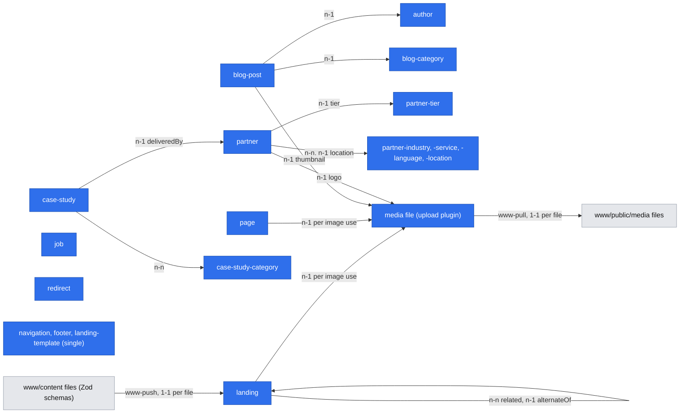

# Strapi CMS for www.openmercato.com: editors publish, the build stays static

Status: Draft for review. Author: catalog maintainers. Date: 2026-11-27. Builds on the www migration spec
([2026-11-24-www-site-migration.md](https://github.com/open-mercato/modules/blob/spec/www-site-migration/docs/specs/2026-11-24-www-site-migration.md),
PR #23, branch `spec/www-site-migration`, still a draft) and on the merged layout of `docs/RUNBOOK.md` (Preview of the
main site, `lib/emit/pages-merge.ts`). Design only: no code, no server, no DNS, Cloudflare or repository-variable change
comes with this document.

## 📝 TLDR

- **Who needs it.** The two marketing editors who run www.openmercato.com in Webflow today. Once Webflow editing ends
  the content is files in `www/content/` and every change is a pull request (migration spec D2, D10), which they cannot
  work with day to day.
- **Today.** 32 landings, 19 pages, 72 blog posts, 20 case studies, 27 partners, 1 job, 8 dictionary files, `redirects.yaml`,
  9 HTML embeds, 350 media files (71 MB, `www/public/media`) and 15 site files (`www/public/files`) live in the repository (counted on `main`, 27 Nov 2026). The menus and the
  footer are constants in `lib/core/main-site.ts`.
- **Proposed (future behavior).** A self-hosted Strapi 5 (Community edition) holds all of that content. Its project
  lives in a `cms/` folder of this repository, outside the catalog's toolchain, and the Strapi host runs a pinned tag
  of that folder. Publishing fires a dispatch of the `pages` workflow; the build pulls content and media from the
  Strapi REST API, turns them back into the exact files of today (`yarn om www-pull`), validates them with the existing
  Zod schemas and builds the same static site on Cloudflare Pages. The first import is a round trip whose output must
  be byte-identical to the files it started from.
- **When.** Strapi becomes the source of the merged site on modules.openmercato.com before the www switch (Q10). At
  that moment Webflow editing stops for good; www.openmercato.com keeps serving the frozen Webflow content until the
  www switch, which then serves the Strapi content with no second migration.
- **Decided 27 Nov 2026 (Q1 to Q10).** `cms.openmercato.com` behind a Cloudflare Tunnel with Access on `/admin`,
  Community edition, a fine-grained token for the dispatch, media on a Docker volume, backups to a Hetzner Storage
  Box, drafts on a separate Pages project behind Access, and every editor a Super Admin.
- **Why this shape.** Turning Strapi back into today's files keeps every existing contract (schemas, routes, the
  srcset step of PR #39, `compare-live`, the merge) unchanged, makes parity a `git diff`, and makes rollback to files a
  copy of the last snapshot.

## 📝 Decisions

Made by the repository owner. This spec designs within them and does not reopen them.

| #   | Date        | Decision                                                                                                                                                                                                                                                                                                                                                                                                                                                             |
| --- | ----------- | -------------------------------------------------------------------------------------------------------------------------------------------------------------------------------------------------------------------------------------------------------------------------------------------------------------------------------------------------------------------------------------------------------------------------------------------------------------------- |
| S1  | 27 Nov 2026 | Strapi is hosted on the owner's server Cezar (Hetzner, Ubuntu 26.04, Docker) for the build phase. Later the infrastructure owner (who runs the Cloudflare side) moves it to the hosting they run. The move must be cheap: everything as code (Docker Compose, config in a repository), documented backup and restore of the database and media, no Cezar path in the site build. This reverses the "no CMS, Strapi rejected" decision D2 of 24 Nov (migration spec). |
| S2b | 27 Nov 2026 | All content of the main site goes to Strapi: blog, case studies, partners, pricing, pages, navigation, footer, SEO fields, redirects where sensible. Every content type and field of `www/` maps to a Strapi type; what stays in code is listed with a reason.                                                                                                                                                                                                       |
| S3a | 27 Nov 2026 | Publishing in Strapi triggers the site build (a dispatch of the `pages` workflow). The build fetches content from the Strapi API at build time. The site stays fully static on Cloudflare Pages.                                                                                                                                                                                                                                                                     |
| S4  | 27 Nov 2026 | Out of scope: the marketplace contact form (decided separately: a Pages Function form, the author address from a `contactEmail` field of the module YAML, mail provider not chosen) and analytics (GA and Hotjar only after the www switch).                                                                                                                                                                                                                         |
| Q1  | 27 Nov 2026 | Option a. The Strapi admin and API answer at `cms.openmercato.com` in the `openmercato.com` zone; the infrastructure owner sets the record. The address survives the move, only the record's target changes.                                                                                                                                                                                                                                                         |
| Q2  | 27 Nov 2026 | Option a. A Cloudflare Tunnel from the Strapi host, no open port. Cloudflare Access with an email one-time code is in front of `/admin`; the API stays reachable with its token.                                                                                                                                                                                                                                                                                     |
| Q3  | 27 Nov 2026 | Option a. Strapi Community (free, MIT). The git snapshot of every publish gives the history and audit trail that Community lacks.                                                                                                                                                                                                                                                                                                                                    |
| Q4  | 27 Nov 2026 | Option a. A fine-grained personal access token of a machine account, this repository only, permission Actions read and write, expiry one year.                                                                                                                                                                                                                                                                                                                       |
| Q5  | 27 Nov 2026 | Option a. Media on a Docker volume of the Strapi host (the upload provider `local`), in the same backup as the database.                                                                                                                                                                                                                                                                                                                                             |
| Q6  | 27 Nov 2026 | Option b. The Strapi project lives in a `cms/` folder of this repository with its own `package.json` and lockfile, outside the catalog's dependency list and tooling (The `cms/` folder, below).                                                                                                                                                                                                                                                                     |
| Q7  | 27 Nov 2026 | Option a. Drafts are rendered on a separate Pages project (for example `open-mercato-www-drafts`) with Cloudflare Access on it.                                                                                                                                                                                                                                                                                                                                      |
| Q8  | 27 Nov 2026 | Option a. Encrypted backups go to a Hetzner Storage Box.                                                                                                                                                                                                                                                                                                                                                                                                             |
| Q9  | 27 Nov 2026 | Option b. The marketing editors are Super Admins too, each with a personal account. There is no Editor-role account.                                                                                                                                                                                                                                                                                                                                                 |
| Q10 | 27 Nov 2026 | Option b. Strapi becomes the source of the live site before the www switch, on the merged site of `modules.openmercato.com` (D11 of the migration spec). Shadow mode comes first; the www switch then serves the Strapi content.                                                                                                                                                                                                                                     |

What Community holds (Q3, checked 27 Nov 2026 in Step 0.1 against the Preview docs and the self-hosted pricing page):
Preview with a preview handler is in the free plan (the docs call it Free, the pricing page Community), and so is
RBAC with unlimited roles. The side-by-side live preview is paid; Content History and Releases need Growth or higher;
Review Workflows and Audit Logs are Enterprise; SSO is not in Community (an add-on). So the Preview button of Phase 5
works on Community, and the `www-content` history stands in for Content History and Audit Logs.

Effect on the migration spec (PR #23): D2 is superseded by S1. D10 (content pull requests reviewed by the site owner)
ends for content that lives in Strapi: editors publish there, and the repository keeps code review for code. D5
(images in the repository) holds until the source switch (Phase 6); after it the media of record are in Strapi and a
copy rides in the snapshot branch. D6 (Webflow drafts kept as `draft: true`) maps to Strapi drafts.

Effect of Q10 on the migration spec's Cutover (C1 to C10) and A9. A9 (the catalog's switch first, the main site's
second) holds, and so does the order of C2 and C4 to C10. What moves is the content part: C1 (freeze) and C3 (final
Webflow export and delta) leave the C8 sequence and happen at the source switch, after C2 and before C4. C2 is the
precondition of both switches: in the RUNBOOK's Main site switch it is the merged site stable on
modules.openmercato.com, the path that replaced the `/run` proxy of A9. D10 ends there, not at C8: after the freeze
editors work in Strapi, not in pull requests. C6, C8 and C10 change as Phase 6 describes (C6 compares Webflow with the
freeze commit, C8 compares against the same deployment, C10 copies back everything published since the freeze). The
migration spec (PR #23, its own branch) is not edited by this PR; Step 6.1 amends its Cutover and the RUNBOOK's Main
site switch.

## 📝 Resolved assumptions (autonomous defaults)

Design choices this spec made itself, each the most reversible option. Any of them can be changed before merge. None
of the owner's answers of 27 Nov 2026 (Q1 to Q10) changes one of them.

| #   | Question                                                              | Applied default                                                                                                                                                                                                                                                                                                                                      | Why                                                                                                                                                                                                                                  | Confirm?   |
| --- | --------------------------------------------------------------------- | ---------------------------------------------------------------------------------------------------------------------------------------------------------------------------------------------------------------------------------------------------------------------------------------------------------------------------------------------------- | ------------------------------------------------------------------------------------------------------------------------------------------------------------------------------------------------------------------------------------ | ---------- |
| A1  | One spec or several (the Strapi server, the pull, the draft preview)? | One spec, delivered in phases that each ship alone. Phase 1 (content as data, the mapping) and Phase 5 (draft preview) could be specs of their own; they stay here because editing the site in a CMS is their only reason and the brief asks for them together.                                                                                      | The server alone publishes nothing and the pull alone has nothing to read; splitting would leave specs without a consumer.                                                                                                           | reversible |
| A2  | How the build reads Strapi.                                           | REST with `populate` per type, not GraphQL. The pull writes today's files and Astro reads them as now.                                                                                                                                                                                                                                               | REST is in Strapi core (GraphQL is a plugin); writing files keeps schemas, routes, parity and rollback unchanged.                                                                                                                    | reversible |
| A3  | What happens when Strapi is down or its content is invalid.           | A build started by a publish fails loudly. Every other build (push, catalog data, schedule) falls back to the last good snapshot, says so in its summary and updates the issue of A9.                                                                                                                                                                | An editor must learn that a publish did not go live; the catalog's several builds a day must not stop because of a second server or an editor's mistake.                                                                             | reversible |
| A4  | Rich text format in Strapi.                                           | The Markdown rich text field, not Blocks.                                                                                                                                                                                                                                                                                                            | Bodies are Markdown today with GFM tables, `<lite-video>` and `<om-embed>`; Blocks JSON cannot hold them and would break the byte round trip.                                                                                        | reversible |
| A5  | Localization.                                                         | No i18n plugin. `locale` stays a field and `alternateOf` a relation, as in the files.                                                                                                                                                                                                                                                                | One Polish landing out of 32; i18n would change how documents and slugs relate for one pair.                                                                                                                                         | reversible |
| A6  | Database.                                                             | PostgreSQL 17 in the same Compose file.                                                                                                                                                                                                                                                                                                              | The common Strapi production database, `pg_dump` is a standard backup, and a managed Postgres is a likely target of the move.                                                                                                        | reversible |
| A7  | Strapi image formats.                                                 | The Media Library settings "Responsive friendly upload", "Size optimization" and "Auto orientation" are all off, written by the bootstrap of `cms/` into the upload plugin's stored settings at every start (where 5.64.0 stores them is found in Step 2.1). Byte identity of the stored original is a test (Step 2.1, Step 3.3), not an assumption. | The build already makes webp variants and srcset from originals (`www/image-variants.ts`, PR #39); Strapi variants would be unused and would break byte parity.                                                                      | reversible |
| A8  | Drafts in the public snapshot.                                        | Production builds and the snapshot exclude documents that were never published. The one-off parity run includes them and runs on Cezar only; the drafts build (Phase 5) prints counts only to the public run.                                                                                                                                        | The repository and its Actions logs are public, and an unpublished post in Strapi is unannounced (unlike the 13 Webflow drafts already in `main`). Drafts are never built for production, so the built site is identical either way. | reversible |
| A9  | How editors learn that a publish did not go live.                     | Field rules in Strapi catch the simple cases at save; the full Zod check runs in the build. A failed publish build, and any build that fell back to the snapshot, opens or updates one issue in this repository listing the cause (no draft content in it), without assignees or mentions; the next good Strapi build closes it.                     | No new service; the issue is a visible, linkable list, and it still appears when GitHub replaced a pending publish run with another trigger. The last good snapshot stays live meanwhile.                                            | reversible |

## 📝 Problem Statement

- **Editors lose their tool at the content freeze.** Webflow editing ends at the freeze (C1 of the migration spec) and
  Webflow itself at C8. From then on, without a CMS, a typo fix is a branch, a commit and a review, for two people who
  do not use Git.
- **The content is ready for a CMS but has none.** The migration spec built typed collections (`lib/schema/www-content.ts`,
  15 collections, references checked at build). That model maps cleanly to Strapi types; what is missing is an editor
  and a publish path.
- **The menus are code.** `lib/core/main-site.ts` holds the navbar and footer as TypeScript constants (327 lines), so
  a new menu item needs a developer (RUNBOOK, Navbar and footer).
- **Constraints from this repository.** AGENTS.md rule 1 (fixed dependency list), rule 3 (nothing outside the
  repository without a yes), rule 5 (heavy work on Cezar), rule 6 (erasable TypeScript), rule 7 (texts) and rule 8 (no
  typed numbers) all apply to the new parts.

## 📝 Proposed Solution

1. **Strapi 5 Community in Docker Compose** (Strapi, PostgreSQL, a backup job, a tunnel), defined in the `cms/` folder
   of this repository (Q6) with content types and components as code. The Content-Type Builder is available only in
   development, so in production the model changes only through code, in a reviewed commit.
2. **`yarn om www-push`**, the one-off and repeatable import: files of `www/content/` and media of `www/public/media/`
   and `www/public/files/` into Strapi, upserted by slug, idempotent.
3. **`yarn om www-pull`**, the reverse: Strapi documents and media into the same files, same bytes. It is the only
   reader of Strapi.
4. **`pages` reads content through `www-pull`** behind a repository variable `WWW_CONTENT_SOURCE` (`files` by default,
   `shadow`, `strapi`). After a good deploy it writes the pulled content to a `www-content` branch, the pinned
   snapshot and the fallback.
5. **A publish hook in the Strapi project** calls `workflow_dispatch` of `pages` after a quiet period of 60 seconds.
6. **Draft preview** as a second static build of draft content on its own Pages project behind Access (Q7).

### Alternatives considered

- **Astro pages call Strapi directly (the pattern of the Astro guide, a hand-written `fetch` at build) or a content
  loader for Strapi (the guide recommends none).** Rejected as the
  main path: the schemas, the namespace check of `www/content.config.ts`, the media paths the srcset step reads and the
  byte parity would all have to be rebuilt around API objects, and rollback to files would need a converter anyway.
  The pull is that converter, written once.
- **GraphQL.** Rejected (A2): a plugin, a second schema to keep in step, no gain for a full read at build.
- **Strapi's built-in Webhooks to GitHub.** Not usable as is: the payload shape is fixed by Strapi (event, model,
  entry), while `workflow_dispatch` needs `{"ref": ..., "inputs": ...}`, and its headers (where the token would go) are set per
  webhook in the admin panel, so any Super Admin can view and edit them there (Q9). A few lines in the Strapi project
  send the right body and read the token from the environment; Step 2.4 confirms the mechanism, and its fallback keeps
  the built-in sender but points it at a relay container that holds the token.
- **Cloudflare Pages deploy hooks.** Not used: deploy hooks are tied to a branch of a connected Git repository, and
  the Pages project is a direct-upload project built by GitHub Actions.
- **A git-based editor (Decap, Keystatic, TinaCMS) on the files.** Superseded by S1.
- **Static build only from the snapshot branch, Strapi never read by `pages`.** Rejected: S3a asks the build to fetch at
  build time, and a separate sync workflow would add a second moving part with no gain.

### What comparable Astro and Strapi setups do, and what this spec takes

Step 0.1, done 27 Nov 2026: every page below was read live that day by independent checkers, two per disputed claim.
Each bullet gives what the page says, what this spec takes, and where the page is silent. A silent point is not
answered here; it is a test on a running instance in the step that first needs it, with a stated fallback.

- **Astro guide for Strapi** ([docs.astro.build/en/guides/cms/strapi](https://docs.astro.build/en/guides/cms/strapi/)).
  Says: fetch the Strapi REST API at build time with a hand-written `fetch` helper, configured by `STRAPI_URL` only (no
  token is sent), and rebuild the static site on a Strapi webhook (it shows Netlify and Vercel build hooks). Taken:
  build-time fetch and a rebuild on publish. Not taken: fetching from the pages (Alternatives). Silent: it names no
  Strapi version and recommends no content loader, so neither choice here leans on it. The token of the pull is this
  spec's own choice, because the content API here is not public (Webhook path and its security).
- **Strapi 5 REST** ([REST API](https://docs.strapi.io/cms/api/rest),
  [status](https://docs.strapi.io/cms/api/rest/status),
  [populate and select](https://docs.strapi.io/cms/api/rest/populate-select),
  [API configuration](https://docs.strapi.io/cms/configurations/api)). Says: responses are flattened documents with a
  `documentId`; `status=draft` reads drafts and published is the default; relations, media, components and dynamic
  zones come back only with an explicit `populate`; the default page size is 25; `api.rest.maxLimit` has no built-in
  default (no cap when unset), and generated projects set it to 100. Taken: one paged, fully populated read per type,
  with `maxLimit` set to 100 in `cms/config/api.ts` and the pull paging at exactly that value, never at a default
  (API Contracts, `www-pull`).
- **API tokens** ([API tokens](https://docs.strapi.io/cms/features/api-tokens)). Says: types read-only, full access
  and custom; an optional expiry; a read-only token reaches only `find` and `findOne`; a token is shown once after
  creation, unless an encryption key is configured, in which case it can be viewed again later. Taken: a read-only
  token for production builds, a separate drafts token for the drafts build only (`STRAPI_DRAFTS_TOKEN`), a full-access
  token only on Cezar for the import, and no encryption key in `cms/`, so no Super Admin can display an existing token
  (Q9). Silent: whether a read-only token can read drafts with `status=draft`. Step 3.3 tests it on the Cezar
  instance; fallback: the drafts token is a custom token with `find` and `findOne` on the content types.
- **Webhooks** ([Webhooks](https://docs.strapi.io/cms/backend-customization/webhooks)). Says: events for entry
  create, update, delete, publish and unpublish and for media; custom headers per webhook; a fixed payload (event,
  model, entry); no signature. Taken: the event list. Not taken: the built-in sender (Alternatives). Silent: where the
  headers are stored or shown beyond the admin panel, and how a project listens to publish events in code (lifecycle
  hooks, document service middlewares, `strapi.eventHub`). Step 2.4 starts by confirming the mechanism in the source
  of the pinned Strapi release; fallback: a built-in webhook to a small relay container on the Compose network that
  holds the GitHub token.
- **Preview and plans** ([Preview](https://docs.strapi.io/cms/features/preview),
  [self-hosted pricing](https://strapi.io/pricing-self-hosted)). Says: Preview with a `preview.handler` is in the free
  plan (the docs call it Free, the pricing page Community); the side-by-side live preview is paid; Content History and
  Releases need Growth or higher; Review Workflows and Audit Logs are Enterprise; SSO is not in Community (an add-on);
  Community includes RBAC with unlimited roles. Taken: the Preview button pointing at the draft build (Q7), recorded
  under Q3 in Decisions.
- **Media Library** ([Media Library](https://docs.strapi.io/cms/features/media-library)). Says: format generation is
  the admin setting "Responsive friendly upload" (Settings, Global Settings, Media Library); breakpoints only set the
  sizes; "Size optimization" (on by default, reduces size and quality) and "Auto orientation" (off by default) are
  separate toggles. These are admin settings, not documented config keys. Taken: all three off, written by the
  bootstrap of `cms/` at every start (A7). Silent: whether the original is kept byte for byte (tested in Step 2.1 and
  over every file in Step 3.3), whether the local provider serves `/uploads` without authentication (checked in Step
  2.1; Risks), and S3 or R2 storage: the page names neither `@strapi/provider-upload-aws-s3` nor R2. Cloudflare's
  [R2 S3 API](https://developers.cloudflare.com/r2/api/s3/api/) page holds the R2 side; Strapi's upload providers page
  is read when option b of Q5 is ever chosen, not before.
- **Data management** ([Data management](https://docs.strapi.io/cms/features/data-management), with its transfer
  page). Says: `strapi export`, `import` and `transfer` exist; admin users and API tokens are not included; `export`
  encrypts archives by default (`--no-encrypt` turns it off, `--key` sets the key) and `import` reads encrypted
  archives; `transfer` has no encryption, only checksums. Taken: an encrypted weekly `export` as the portable archive
  of the move, next to `pg_dump`. Not taken: `transfer`.
- **Docker and versions** ([Docker](https://docs.strapi.io/cms/installation/docker),
  [CLI installation](https://docs.strapi.io/cms/installation/cli), the docs release notes,
  [npm](https://www.npmjs.com/package/@strapi/strapi)). Says: Docker with PostgreSQL is documented (the examples use
  `node:22-alpine`); the latest Strapi on npm on 27 Nov 2026 is 5.64.0 (the docs release notes still list 5.62.0);
  supported Node is the active and maintenance LTS lines, today 22, 24 and 26 (engines `>=22.0.0 <=26.x.x`);
  PostgreSQL 14 at least, 17 recommended. Taken: Compose with Postgres (A6), Strapi pinned at exactly 5.64.0 and
  re-checked at Step 2.1, PostgreSQL 17, and Node 24 for the image, the same Node as the rest of this repository.
- **Content-Type Builder**
  ([Content-Type Builder](https://docs.strapi.io/cms/features/content-type-builder)). Says: available in the
  development environment only; the Markdown rich text field still exists next to Blocks. Taken: the model changes
  only through code in production, and the Markdown field (A4). Silent: `NODE_ENV` and `schema.json`; Step 2.3 proves
  on a running production-mode instance that a model change is refused.
- **GitHub** ([permissions of fine-grained tokens](https://docs.github.com/en/rest/authentication/permissions-required-for-fine-grained-personal-access-tokens),
  [workflow dispatch](https://docs.github.com/en/rest/actions/workflows#create-a-workflow-dispatch-event),
  [concurrency](https://docs.github.com/en/actions/writing-workflows/choosing-what-your-workflow-does/control-the-concurrency-of-workflows-and-jobs),
  [GITHUB_TOKEN](https://docs.github.com/en/actions/concepts/security/github_token)). Says: `workflow_dispatch` needs
  Actions write and `repository_dispatch` Contents write for a fine-grained token; a concurrency group keeps one
  running and one pending run; a push made with `GITHUB_TOKEN` starts no new workflow run (`workflow_dispatch` and
  `repository_dispatch` excepted). Taken: `workflow_dispatch` (Q4), the existing `pages` group as the second half of
  the debounce, and the snapshot push to `www-content` with `GITHUB_TOKEN`, which therefore triggers nothing.
- **Cloudflare** ([preview deployments](https://developers.cloudflare.com/pages/configuration/preview-deployments/),
  [known issues](https://developers.cloudflare.com/pages/platform/known-issues/),
  [Tunnel](https://developers.cloudflare.com/cloudflare-one/connections/connect-networks/),
  [deploy hooks](https://developers.cloudflare.com/pages/configuration/deploy-hooks/), the Zero Trust plans page).
  Says: Access can protect preview deployments and, by the known-issues steps plus a self-hosted Access application, a
  project's production `*.pages.dev` address and custom domain; Tunnel needs no open inbound port; deploy hooks are tied
  to a branch of a connected Git repository; Access is free up to 50 users on the Zero Trust free plan, so the four
  accounts of Q9 fit. Taken: Tunnel and Access on `/admin` (Q2), the known-issues procedure for the drafts project
  (Step 5.0). Silent: the deploy hooks page does not say that direct-upload projects lack them; this project is direct
  upload, so hooks are not used either way.

What the common setups skip and this spec keeps: a schema check stricter than the CMS (the Zod schemas), a parity
proof at migration, and a rollback that does not need the CMS.

## 📝 Architecture

```mermaid
flowchart LR
    classDef existing fill:#e5e7eb,color:#111,stroke:#9ca3af
    classDef new fill:#2f6feb,color:#fff,stroke:#1b4fb0
    e["Editor in Strapi admin"]:::new
    s["Strapi 5 + Postgres + media volume (Compose)"]:::new
    h["publish hook (in the Strapi project)"]:::new
    p["pages workflow (workflow_dispatch)"]:::existing
    pull["yarn om www-pull"]:::new
    f["www/content + www/public/media (files, as today)"]:::existing
    b["www build, srcset step, merge, check"]:::existing
    cf["Pages project open-mercato-modules"]:::existing
    snap["branch www-content (pinned snapshot)"]:::new
    e --> s --> h -->|after 60 s quiet| p
    p --> pull -->|REST, read-only token| s
    pull --> f --> b --> cf
    b -->|after a good deploy| snap
    pull -.->|Strapi down, not a publish run| snap
```



Takeaway: everything right of `www-pull` is the build of today; the new parts are Strapi, the hook, the pull and the
snapshot branch.

### Components

| Component               | Where                                                                                                                                                                | What it does                                                                                                                                                                                                                                                                                                                                                                      |
| ----------------------- | -------------------------------------------------------------------------------------------------------------------------------------------------------------------- | --------------------------------------------------------------------------------------------------------------------------------------------------------------------------------------------------------------------------------------------------------------------------------------------------------------------------------------------------------------------------------- |
| Strapi project          | `cms/` of this repository (Q6): `compose.yaml`, `Dockerfile`, `src/api/**`, `src/components/**`, `config/**`, `scripts/backup.sh`, `scripts/restore.sh`, `README.md` | Content types and components as `schema.json` files, upload config (A7), roles seed, the publish hook (its mechanism confirmed in Step 2.4), the preview handler, backup and restore. Strapi pinned at exactly 5.64.0 (re-checked at Step 2.1), PostgreSQL 17, and an image on Node 24, the Node of this repository, which Strapi supports (22 to 26).                            |
| `lib/www-cms/model.ts`  | this repository                                                                                                                                                      | The mapping table between each file collection and its Strapi type: field names, components, relations, media fields. Pure functions `toDocument(entry)` and `fromDocument(doc)`; erasable TypeScript, no Node APIs.                                                                                                                                                              |
| `yarn om www-push`      | `lib/commands/www-push.ts`                                                                                                                                           | Files into Strapi (API Contracts).                                                                                                                                                                                                                                                                                                                                                |
| `yarn om www-pull`      | `lib/commands/www-pull.ts`                                                                                                                                           | Strapi into files (API Contracts).                                                                                                                                                                                                                                                                                                                                                |
| `lib/www-cms/source.ts` | this repository                                                                                                                                                      | One function that decides, from `WWW_CONTENT_SOURCE`, the trigger and the pull result, which content a build uses (Edge Cases). Unit-tested as a table.                                                                                                                                                                                                                           |
| `pages.yml` steps       | this repository                                                                                                                                                      | Read www content (before the www build), Write www snapshot (a job after `deploy`, `contents: write` on that job only), the `www_content` input of `workflow_dispatch`, the drafts build moves to `pages-drafts.yml` (Phase 5).                                                                                                                                                   |
| branch `www-content`    | this repository                                                                                                                                                      | The pulled files of the last good deploy: `content/**` (without `embeds/`, and with only the `manual` rules of `redirects.yaml`; a fallback takes the rest from the checkout), `media/**`, `manifest.json` (Strapi `documentId` and `updatedAt` per file, SHA-256 per media file, the pull time). Written only by the snapshot job with `GITHUB_TOKEN`, so it starts no workflow. |

### No Cezar path in the site build

The site repository knows Strapi only by the variable `STRAPI_URL` (an https address, Q1), the repository secret
`STRAPI_READ_TOKEN` (production builds) and, from Phase 5, the secret `STRAPI_DRAFTS_TOKEN` of the environment
`www-drafts`, which only `pages-drafts.yml` uses. Nothing in `pages.yml`, `www/` or `lib/` names Cezar, a Docker volume or a host path. The Strapi
project reads every host-specific value from `cms/.env` on the host, which is never committed (`.gitignore` lists it,
`cms/.env.example` lists the keys): database password, app keys, JWT secrets, the GitHub token, the tunnel token, the
backup target and key. It sets no encryption key for API tokens, so a token is shown once at creation and no Super
Admin can display it later (API tokens docs; Q9); a lost token is replaced, as at rotation.

### The `cms/` folder (Q6)

The Strapi project is a folder of this repository, not a package of it. `cms/` has its own `package.json`, `yarn.lock`
and `.yarnrc.yml`, so Yarn treats it as a project of its own; its `.yarnrc.yml` restates the root rules (dependency
scripts off, the 14-day age gate) and names the Strapi packages that need a build step as `dependenciesMeta`
exceptions, each with a comment. Nothing of its tree enters the root `package.json` or `yarn.lock`, so AGENTS.md rule
1 holds: the catalog's dependency list does not grow. The root toolchain and `cms/` stay apart as follows.

| Tool                                  | How `cms/` is kept out of the catalog, and the catalog out of `cms/`                                                                                                                                                                                                                                                                                                                                                                                     |
| ------------------------------------- | -------------------------------------------------------------------------------------------------------------------------------------------------------------------------------------------------------------------------------------------------------------------------------------------------------------------------------------------------------------------------------------------------------------------------------------------------------- |
| Root workspace and install            | The root `package.json` has no `workspaces` field, so `yarn install` at the root never reads `cms/`. `cms/` installs with `yarn install --immutable` inside the folder.                                                                                                                                                                                                                                                                                  |
| `yarn check`: `tsc`, `astro check`    | The root `tsconfig.json` includes `lib`, `site/src`, `scripts` and `test` only; `astro check` reads `site/` and `www/`. `cms/` has Strapi's own `tsconfig.json`, compiled by `strapi build` on Node 24 in the Strapi image. Its TypeScript is still erasable (rule 6), so the same reviewers read it the same way.                                                                                                                                       |
| `yarn check`: Prettier and check-text | Root Prettier checks the sources of `cms/` with the root config (no new dependency); `.prettierignore` gains the folder's outputs (`cms/node_modules/`, `cms/dist/`, `cms/build/`, `cms/.strapi/`, `cms/types/generated/`, `cms/public/uploads/`). check-text already covers every `*.md`; `cms/src/` and `cms/config/` join its text directories, so help texts are checked for the banned dashes and control characters; the rest of rule 7 is review. |
| `yarn test`                           | Vitest includes `test/**` only, so no test of `cms/` runs there. One root test reads `cms/src/**/schema.json` as plain JSON, without importing Strapi, and compares it with `lib/www-cms/model.ts` (Step 2.2). `cms/` tests itself with `node --test`, so it adds no test runner.                                                                                                                                                                        |
| `validate.yml`                        | No trigger change. A PR that changes `cms/` is outside `modules/`, so `yarn check` and `yarn test` run (the drift test with them) without installing `cms/`; its site builds are skipped because `cms/` is not among the paths of Detect site changes.                                                                                                                                                                                                   |
| `cms.yml` (new)                       | On pull requests and pushes with `paths: ['cms/**']` only: `yarn install --immutable` in `cms/`, `strapi build`, `node --test`, `docker compose config`. `ubuntu-latest`, Node 24, `contents: read`, no secrets. A change outside `cms/` never starts it.                                                                                                                                                                                                |
| `pages.yml`                           | Its `push` trigger gains `paths-ignore: ['cms/**']`, so a merge that changes only `cms/` neither builds nor deploys the site. The `workflow_run`, schedule and `workflow_dispatch` triggers do not change. The reverse holds by construction: no change of this repository redeploys Strapi, because the host runs a tag (below).                                                                                                                        |
| Dependency updates                    | No Dependabot or Renovate config exists today (no `.github/dependabot.yml`, no `renovate.json`, checked 27 Nov 2026). If one is added, `cms/` gets an entry of its own (`directory: /cms`, Dependabot's own key), so a Strapi update never lands in a root PR. GitHub's dependency graph reads every lockfile, so security alerts for the Strapi tree appear on this repository's Security tab; the owners of `cms/` triage them.                        |
| CODEOWNERS                            | A `/cms/` line names the owner and the infrastructure owner; every other path keeps its owner.                                                                                                                                                                                                                                                                                                                                                           |
| AGENTS.md                             | Its Map gains a `cms/` line: the Strapi project, its own `package.json` and lockfile, not part of the root toolchain (a note for its owner in the PR of Step 2.1).                                                                                                                                                                                                                                                                                       |

#### How the Strapi host deploys from this repository

The host runs a pinned tag of `cms/` from a sparse checkout, and builds the image itself:

```sh
git clone --filter=blob:none --no-checkout --sparse https://github.com/open-mercato/modules.git www-cms
cd www-cms && git sparse-checkout set cms && git checkout cms-v1.0.0
docker compose -f cms/compose.yaml up -d --build
```

- **Tags.** `cms-v<major>.<minor>.<patch>` on a commit of `main` whose `cms.yml` run is green. A tag ruleset on `cms-v*`
  limits who can create or move one (an owner click). An upgrade is `git fetch --tags`, a checkout of the new tag and
  `up -d --build`, after a backup; a downgrade is the previous tag plus the restore of that backup, because Strapi's
  database migrations run forward only.
- **Why a sparse checkout, not a release artifact.** An artifact (an image in GitHub Packages or a tarball on a
  Release) is a published output that needs a yes under rule 3 for each release, a workflow with `packages: write` or
  `contents: write`, and a host that trusts a build it did not make. The repository is public, so the checkout needs
  no credential on the host; the image is built from the same lockfile `cms.yml` checked; and the working tree holds
  only `cms/` (the blob filter fetches no file of other paths). The cost is that the host builds the admin panel at
  each upgrade, which takes minutes and memory.

#### The hand-over to the infrastructure owner: a folder, not a repository

- **Access.** GitHub has no per-folder write permission. The infrastructure owner either works through pull requests
  from a fork, merged by a maintainer, or gets write access to this repository. With write access, the `/cms/` line of
  CODEOWNERS and the rule "require review from code owners" on `main` make their review required for `cms/` and keep
  the owner's review required for every other path; the access itself is repository-wide (branches, workflow runs),
  which the owner accepts by granting it.
- **What they own.** The host, its `cms/.env`, the tunnel, the backup target, the `cms-v*` tags (when the ruleset
  allows them) and the review of `cms/`. The repository holds no Strapi secret except `STRAPI_READ_TOKEN` and, from
  Phase 5, `STRAPI_DRAFTS_TOKEN`, which the owner sets.
- **The exit.** If they later want a repository of their own, `git subtree split --prefix=cms` gives one with the
  folder's history. The site side does not change (it knows only `STRAPI_URL`); only the drift test of Step 2.2 goes
  back to reading a pinned commit of another repository.

### Shared code and the catalog

The navbar and footer data leave `lib/core/main-site.ts` for `www/content/navigation.json` and `www/content/footer.json`
(Phase 1). They are JSON, not YAML, so `lib/core` keeps no Node API: `main-site.ts` imports them with an import
attribute (`with { type: 'json' }`), which Node 24 and Vite both read. The catalog build under `/run` and
`yarn om pages-site --check` keep reading the same exported constants, so the catalog sees no change of shape. The
catalog's own `RUN_MENU` stays code (Stays in code, below).

## 📝 Data Model

### Strapi types for every collection of `www/content/`

Conventions for every type: Draft and Publish on; `slug` is a `uid` field with the regex of `SLUG_RE`
(`^[a-z0-9]+(-[a-z0-9]+)*$`), required and unique, and is the file name; `webflowId` is an optional text field, hidden
from the edit view, kept for parity; field names are the file's keys, so the mapping is mostly identity. Shared
components:

- `shared.seo` { `title` (required), `description` (required), `ogImage` (media, single, optional), `noindex` (boolean) }
- `shared.image` { `file` (media, single, images, required), `alt` (text), `decorative` (boolean), `width`, `height`
  (integers, optional, written only when the file sets them) }. The alt text lives on the use, not on the media file,
  because one file can serve two uses with two alts today.
- `shared.cta` { `label`, `href`, `trackingPlacement`, `trackingAction` } (the file's `tracking` object is flattened,
  because a component of one optional sub-object adds a click for editors).
- `shared.faq-item` { `question`, `answer` (Markdown rich text) }, `shared.source-link` { `label`, `url` },
  `shared.title-body`, `shared.art-item`, `shared.block-item` (the fields of `BlockItem`).

| File collection (Zod)                               | Strapi type (API id)                   | Kind       | Field mapping and notes                                                                                                                                                                                                                                                                                                                                                                                                                                                                                                                                                                                                             |
| --------------------------------------------------- | -------------------------------------- | ---------- | ----------------------------------------------------------------------------------------------------------------------------------------------------------------------------------------------------------------------------------------------------------------------------------------------------------------------------------------------------------------------------------------------------------------------------------------------------------------------------------------------------------------------------------------------------------------------------------------------------------------------------------- |
| `landings` (32)                                     | `landing`                              | collection | `locale` (enum `en`, `pl`), `kind` (enum), `competitor`, `alternateOf` (relation to `landing`, many to one), `seo`, and one component per section: `landing.hero`, `landing.pains`, `landing.features`, `landing.capabilities` (with repeatable `landing.capability-group` holding repeatable `landing.capability-row`; the file's two-item `columns` tuple becomes `oursColumn` and `theirsColumn`), `landing.comparison`, `landing.demo`, `landing.steps`, `landing.faq`, `landing.cta`, `landing.sources`; `sectionNav` (repeatable `landing.nav-item`); `related` (relation to `landing`, many to many, ordered).               |
| `pages` (19, pricing among them)                    | `page`                                 | collection | `seo`, `jsonLd` (component: `type` enum of `PAGE_JSON_LD_TYPES`, repeatable `faq`), `siteCta` (boolean, default true), `blocks` (dynamic zone of one component per block type: `block.hero`, `block.logos`, `block.features`, `block.carousel`, `block.video`, `block.stats`, `block.team`, `block.quote`, `block.steps`, `block.faq`, `block.cta`, `block.prose`, `block.list`, `block.legacy`, `block.copy`). The shared block head (`id`, `layout`, `label`, `eyebrow`, `lead`, `primary`, `secondary`, `note`) is repeated in each component. `block.legacy.component` is an enum of the files in `www/src/components/legacy/`. |
| `blog` (72)                                         | `blog-post`                            | collection | `title`, `description`, `date` (date-time), `updated`, `author` (relation to `author`), `category` (relation to `blog-category`), `featured`, `thumbnail` (`shared.image`), `seo` (optional override), `body` (Markdown rich text).                                                                                                                                                                                                                                                                                                                                                                                                 |
| `authors`                                           | `author`                               | collection | `slug`, `name`; later `role`, `avatar`, `url` as the schema grows.                                                                                                                                                                                                                                                                                                                                                                                                                                                                                                                                                                  |
| `blogCategories`                                    | `blog-category`                        | collection | `slug`, `name`, `order`, `labelColor`, `textColor` (text with the `HexColor` regex).                                                                                                                                                                                                                                                                                                                                                                                                                                                                                                                                                |
| `caseStudies` (20)                                  | `case-study`                           | collection | `title`, `heading`, `description`, `thumbnail`, `heroVideo` (text, YouTube id regex), `deliveredBy` (relation to `partner`), `deliveredByUrl`, `overview` (component), `stats` (repeatable, exactly 3 when present: checked by Zod at pull, `max: 3` in Strapi), `screenshots` (repeatable `shared.image`), `categories` (relation to `case-study-category`, many to many), `featuredOnAgencies`, `order`, `body`.                                                                                                                                                                                                                  |
| `caseStudyCategories`                               | `case-study-category`                  | collection | `slug`, `name`.                                                                                                                                                                                                                                                                                                                                                                                                                                                                                                                                                                                                                     |
| `partners` (27)                                     | `partner`                              | collection | `name`, `logo`, `tier` (relation to `partner-tier`), `industries`, `services`, `languages` (relations, many to many), `location` (relation to `partner-location`), `budget` and `availability` (enums with the keys of `PARTNER_BUDGETS` and `PARTNER_AVAILABILITY`), `projectsInPortfolio`, `website`, `description`, `body`.                                                                                                                                                                                                                                                                                                      |
| `partnerTiers`                                      | `partner-tier`                         | collection | `slug`, `name`, `order`, `backgroundColor`, `textColor`.                                                                                                                                                                                                                                                                                                                                                                                                                                                                                                                                                                            |
| `partnerIndustries`, `partnerServices`              | `partner-industry`, `partner-service`  | collection | `slug`, `name`, `order`.                                                                                                                                                                                                                                                                                                                                                                                                                                                                                                                                                                                                            |
| `partnerLanguages`, `partnerLocations`              | `partner-language`, `partner-location` | collection | `slug`, `name`.                                                                                                                                                                                                                                                                                                                                                                                                                                                                                                                                                                                                                     |
| `jobs` (1)                                          | `job`                                  | collection | the fields of `jobSchema`; `employmentType` enum with the keys of `EMPLOYMENT_TYPES`.                                                                                                                                                                                                                                                                                                                                                                                                                                                                                                                                               |
| `redirects` (`source: manual` only)                 | `redirect`                             | collection | `from` (text, `RedirectFrom` regex, unique), `to`, `status` (enum 301, 302). The pull copies the file's other rules (and their comments) from the checkout verbatim and appends these after them with `source: manual`.                                                                                                                                                                                                                                                                                                                                                                                                             |
| `MAIN_SITE_MENUS`, `MAIN_SITE_LINKS`                | `navigation`                           | single     | repeatable `nav.menu` { `label`, repeatable `nav.item` { `label`, `description`, `href`, `icon` (enum of the keys of `site/src/components/nav-icons.ts`) } }, `links` (repeatable `shared.cta`), `sandbox` (`shared.cta`).                                                                                                                                                                                                                                                                                                                                                                                                          |
| `MAIN_SITE_FOOTER`, `_FOOTER_OTHER`, `_FOOTER_NOTE` | `footer`                               | single     | `links`, repeatable `footer.group` { `label`, `links` }, `note`.                                                                                                                                                                                                                                                                                                                                                                                                                                                                                                                                                                    |
| `LANDING_TEMPLATE_TEXT`                             | `landing-template`                     | single     | two components `en` and `pl` with the keys of the constant (`reviewedPrefix`, `sourcesLabel`, `reviewedInline`, `navLabel`, `detailsSummary`, `relatedTitle`, `marks`). It moves to `www/content/landing-template.yaml`; the constant becomes the schema.                                                                                                                                                                                                                                                                                                                                                                           |

Drafts: a document that has a published version is written from that version with `draft: false`; a document with no
published version is written from its draft with `draft: true` only by `www-pull --drafts` (A8). Order: lists keep the
order of today's files; collections without `order` are written in slug order, as the files are read today.

Relations to drafts keep today's rule (migration spec): a published entry that references a never-published one builds,
and the reference renders as plain text with a build warning.

Sensitive data: none new. Partner and author profiles are public. The Strapi admin users (name, email, password hash)
live only in the Strapi database and its backups, never in this repository or the snapshot.



### Media

- **Paths survive the round trip.** The push puts each file into a Media Library folder named after its directory
  (`/media/blog`, `/media/partners`, `/files`) with its original file name. The pull writes
  `www/public<folder>/<name>`, so every `src` of today keeps its path, and the srcset step of PR #39
  (`www/image-variants.ts`, which reads raster images under `/media/` and `/files/` from the built pages) works
  unchanged.
- **New uploads.** A file an editor uploads outside those folders is written to `/media/uploads/<name>`, the name
  lowercased with every character outside `[a-z0-9.-]` turned into `-` (the importer's rule). Two different files that
  reach the same path stop the pull with both names, so nothing is overwritten silently.
- **Bytes.** With the three Media Library settings off (A7), Strapi is expected to store the original unchanged. The
  Media Library docs do not say so, so Step 2.1 tests it on a running instance (a JPEG, a PNG, a WebP and an SVG, each
  with EXIF or metadata, uploaded and compared by SHA-256 with the stored file) and Step 3.3 checks it over every file
  of the import. If a type is not kept byte for byte, the plan stops at Step 2.1 and this section is revised before
  Phase 3, because byte parity cannot hold. The pull checks the SHA-256 against
  the `manifest.json` of the snapshot and downloads only new or changed files; the media cache of the build is the
  Actions cache keyed by that manifest.
- **Limits.** The Strapi upload limit is set to 25 MiB, the Pages file limit; the pull fails above it too, and
  `pages-site --check` keeps the file count check.

### Stays in code, and why

| Item                                                                                             | Why it stays                                                                                                                                                                               |
| ------------------------------------------------------------------------------------------------ | ------------------------------------------------------------------------------------------------------------------------------------------------------------------------------------------ |
| `www/content/embeds/*.html` (9 interactive tools in blog posts)                                  | HTML, CSS and scripts that run on the site: they need code review. Editors place them in Markdown with `<om-embed name>`; the pull fails on a name without its file.                       |
| Components, layouts, `legacy` components, block `layout` files, SVG icons (`nav-icons.ts`)       | The look belongs to the designer (D7); editors pick a layout or an icon from an enum, they do not edit markup.                                                                             |
| Redirects with `source: docs-map` (307 rules) and `webflow-panel`                                | Generated from the docs sitemap or copied once at cutover (D8); hand edits there risk search traffic, and the merge checks their limits. Only new `manual` redirects are edited in Strapi. |
| `RUN_MENU`, `MAIN_SITE_ORIGIN`, the GitHub address, the star fallback                            | The catalog's own menu and constants that the layout check and the count tokens (A6 of the migration spec) depend on.                                                                      |
| Option labels (`PARTNER_BUDGET_LABELS`, `PARTNER_AVAILABILITY_LABELS`, `EMPLOYMENT_TYPE_LABELS`) | Stored by key in content; the label map is one place, so a label edit is not a content migration (migration spec, Data Model).                                                             |
| SEO computed per page type (canonical, `og:url`, JSON-LD, sitemap), count tokens                 | Computed from data, never typed (AGENTS.md rule 8). Editors type `{moduleCount}` or `{githubStars}` in copy; the pull fails on an unknown token.                                           |
| Consent banner texts, analytics                                                                  | Out of scope (S4) and fixed by D9 of the migration spec.                                                                                                                                   |

## 📝 API Contracts

### `yarn om www-push`

```
yarn om www-push --strapi <https url> [--content www/content] [--public www/public] [--only <collection>[,...]] [--dry-run] [--publish-as-files]
```

- **Token.** `STRAPI_ADMIN_TOKEN` from the environment, a full-access API token made for the import and deleted after
  it. Run only on Cezar or the Strapi host (AGENTS.md rule 5), never in CI.
- **Upsert by slug.** For each file it finds the document by `slug` (single types by type), compares the mapped
  document with the current one and writes only differences. Media are matched by folder, name and SHA-256: same bytes
  is the same file, so a second run uploads nothing.
- **Order.** Dictionaries, authors and categories first, then partners, then case studies, posts, landings (two passes:
  documents, then `alternateOf` and `related`), pages, single types, redirects. Relations are set by `documentId`
  looked up by slug.
- **Status.** A file with `draft: false` is published; `draft: true` stays a draft. `--publish-as-files` makes the
  Strapi status follow the files on a re-run.
- **Idempotent.** Run twice on the same files, the second run writes nothing and prints `0 changed`.
- **Output.** A report: created, updated, unchanged per type, media uploaded and skipped, and every value Strapi
  refused, with its file and field. `--dry-run` writes nothing and prints the same report.

### `yarn om www-pull`

```
yarn om www-pull --strapi <https url> [--out <dir>] [--drafts] [--status published|draft] [--check] [--snapshot <dir>]
```

- **Token.** `STRAPI_READ_TOKEN`, a read-only API token, for `status=published`. With `--status draft` or `--drafts`
  the pull reads `STRAPI_DRAFTS_TOKEN` instead and never the other one, so the production build holds no token made for
  drafts. Whether a read-only token can read drafts at all is not documented; Step 3.3 tests it, and if it cannot, the
  drafts token is a custom token with `find` and `findOne` on the content types.
- **Read.** For each type, paged REST reads with an explicit `populate` from `lib/www-cms/model.ts`. `cms/config/api.ts`
  sets `rest.maxLimit` to 100 (Strapi has no cap when it is unset, and the default page size is 25); the pull asks for
  `pagination[pageSize]=100` and fails with exit 2 when an answer's `meta.pagination.pageSize` is not 100 or its page
  count does not add up, so a changed limit can never drop documents silently. `status=published` is sent explicitly
  (it is also Strapi's default), `status=draft` for the drafts build. Requests
  at most 4 at a time, 30 seconds each, 3 tries with backoff; any failure ends the run with exit 2 (environment), never
  with partial files.
- **Write.** Into a fresh directory, then validated with the Zod schemas of `lib/schema/www-content.ts`, the slug and
  namespace checks of `www/content.config.ts`, the embed names and the count tokens. Only a valid tree replaces
  `www/content` and the media (exit 1 on invalid content, with every problem listed by file and field). Files are
  formatted with the repository's Prettier config, keys in schema order, LF, UTF-8, no run timestamps: the same Strapi
  state gives the same bytes.
- **Removed URLs.** A slug that was in the snapshot and is gone (renamed, deleted or unpublished) fails the pull unless
  a redirect from its old path exists (migration spec D3: every URL keeps answering). The message names the old path
  and says to add a redirect in Strapi.
- **`--check`.** Writes nothing; exits 1 when the result differs from `--out`, printing the files that differ.
- **Output for the build summary.** Counts per type, media downloaded and reused, the Strapi `updatedAt` of the newest
  document.

### `pages` workflow (changes)

- `workflow_dispatch` gains two inputs: `www_content`, an enum of `auto` (default), `publish` (sent by the hook)
  and `snapshot`; and `snapshot`, a commit of `www-content` (only with `www_content: snapshot`, for rollback;
  the build then reads that commit and never Strapi).
- Step **Read www content** (before the www build), by `WWW_CONTENT_SOURCE`:
  - `files` (default while unset): nothing changes, the build reads `www/content` of the commit.
  - `shadow`: pull into a temporary directory, `--check` against `www/content`, the result in the summary as
    `Strapi shadow: N files differ`; the build still reads the files.
  - `strapi`: pull into `www/content` and the media folders. On failure, `lib/www-cms/source.ts` decides (Edge Cases).
- Job **Write www snapshot**, after `deploy`, only when the build pulled fresh, valid Strapi content: in `strapi`
  mode, and in `shadow` mode too, so the first `strapi` build already has a fallback. It pushes the pulled tree to
  `www-content` as one commit (`www-content: <newest updatedAt>`), skipped when nothing changed. History is kept as the audit
  trail; it grows by new or changed media only, since git stores each file once. `permissions:
contents: write` on this job only.
- The drafts build (Phase 5) is a workflow of its own, `pages-drafts.yml`, dispatched by the hook, with its own
  concurrency group, so a draft save never replaces a pending publish run. It deploys to the drafts project of Q7,
  never to production.
- The existing `concurrency: pages` group (one running, one pending) is kept; a burst of publishes becomes at most one
  running and one pending build.

### Publish hook (Strapi project)

- Listens to publish, unpublish and delete of every type above, and to media update and delete. The Webhooks docs
  name these events but not how a project listens to them in code; Step 2.4 confirms the mechanism in the source of
  Strapi 5.64.0 (document service middlewares, lifecycle hooks or the event hub) before writing the hook, and tests
  that one publish on a running instance gives exactly one hook call. Fallback: a built-in Strapi webhook on those
  events to a small relay container on the Compose network (no published port), which debounces and sends the
  dispatch; the GitHub token lives only in the relay's environment, and the webhook in the admin carries no header and
  no token.
- Waits for 60 seconds without a new event (at most 5 minutes from the first), then calls
  `POST /repos/open-mercato/modules/actions/workflows/pages.yml/dispatches` with
  `{"ref": "main", "inputs": {"www_content": "publish"}}` and the token of Q4 from the environment.
- Draft saves (create, update without publish) dispatch `pages-drafts.yml` the same way, after 120 seconds
  quiet, once the drafts project of Q7 exists (Phase 5).
- Three tries with backoff on a 5xx or a network error; a 401 or 403 is logged as `dispatch refused: token` and not
  retried. The daily scheduled `pages` run (05:47 UTC) pulls Strapi anyway in `strapi` mode, so a lost dispatch is at
  most a day late.

### Webhook path and its security

- **Direction.** Strapi calls GitHub; nothing calls Strapi from outside except editors and the pull. There is no
  inbound webhook endpoint to protect.
- **What a stolen dispatch token can do.** Actions write cannot be limited to one workflow: with the token of Q4 the
  holder can dispatch any workflow of this repository on any branch of it with any inputs (`nightly.yml`,
  `mcp-deploy.yml`), cancel or delete runs, delete caches and disable workflows. It cannot push code or content, and
  deploys stay safe because environments `cloudflare` (`pages.yml`) and `mcp` (`mcp-deploy.yml`) accept only `main`; the
  `main`-only rule of `mcp` is still an owner step in the RUNBOOK (Repository setup), so Step 2.6 makes it a
  precondition of the token. `pages` checks its own input against the enum and ends on any other value. A relay (a
  Worker that holds the token, option c of Q4) would narrow this to `pages.yml` and `pages-drafts.yml` on `ref: main`
  with their fixed inputs, at the cost of a service to run; it is the natural upgrade at the move.
- **What a stolen read token can do.** `STRAPI_READ_TOKEN` reads published content (and drafts too if the test of Step
  3.3 shows that read-only tokens can; then no token type separates the two, and Risks records it). It is a
  repository secret, not available to pull requests from forks. `STRAPI_DRAFTS_TOKEN` reads drafts; it is a secret of
  the environment `www-drafts`, which accepts only `main` and is named only by `pages-drafts.yml`, so neither the
  production build nor any other workflow holds it. Both are rotated with the dispatch token.
- **Where secrets live.** The GitHub token and the Strapi secrets are in `cms/.env` on the Strapi host (file mode 600,
  not in the image, not in the database, not in the admin UI). That stays true with every editor a Super Admin (Q9):
  no built-in Strapi webhook carries the GitHub token (with the relay fallback of the publish hook it carries none
  either), so no account can read it in the UI, and with no token encryption key set no account can display an
  existing API token.
- **What every Super Admin can do (Q9).** Each of the four accounts can list and create API tokens (a full-access token
  reads drafts and writes every type), change settings (upload settings, built-in webhooks, which could send entry
  events to any address), and create, change and delete admin users. What none of them can do in production is change
  the model: the Content-Type Builder is available only in development, so a type or field changes only through a reviewed commit to
  `cms/`, and the drift test of Step 2.2 keeps it equal to the mapping. Two more doors stay open to every account: the
  Public role (any Super Admin can grant it `find`, which opens the content API without a token, since Access covers
  only `/admin`) and the upload settings. The bootstrap of `cms/` resets the Public role to no permission and re-applies
  the upload settings of A7 at every start; `www-pull` fails when an anonymous `GET /api/<type>` answers 200; and the
  pull's SHA-256 check against the snapshot manifest names every existing media file whose bytes changed. What remains
  is in Risks.
- **Rotation.** The dispatch, read and drafts tokens expire within a year; rotation is a RUNBOOK section (new token, update `cms/.env`, the
  repository secret or the environment secret, restart, one dispatch by hand). API tokens made in the admin UI are listed and reviewed at the
  same time; any not named in the RUNBOOK is deleted.

## 📝 UI/UX

- **Editors work in the Strapi admin** at `cms.openmercato.com/admin` (Q1), behind Access with an email one-time code
  (Q2), each with a personal Super Admin account (Q9). Content types are grouped as the site
  is: Pages and Landings, Blog, Case studies, Partners, Careers, Site (navigation, footer, landing template,
  redirects). Edit views hide `webflowId` and order fields as the site reads them.
- **Publish means live after the next build.** Publish, then about 60 seconds of quiet, then the `pages` build (about
  the length of a merged build today). The Strapi project adds a short help text on every type: "Published changes are
  on the site when the next site build ends, a minute after the last publish at the earliest. Until the www switch the
  site is modules.openmercato.com; www.openmercato.com still shows the frozen Webflow pages." The second sentence goes
  at C8 (Step 6.4).
- **When a publish cannot go live.** The live site keeps its last good version. The run summary lists the problems by
  document and field, and A9's single issue in this repository carries the same list. Strapi field rules (required,
  regex, max) catch most problems at save.
- **Preview.** The Preview button of Strapi 5 opens the draft build at the document's path (`/blog-posts/<slug>`,
  `/<landing slug>`, and so on, from the same route map as the site). The draft build lives on its own Pages project
  behind Access (Q7). If the drafts build failed validation, the draft site's page for that path is a plain list of
  the problems, so the editor sees why. Until Phase 5 ships there is no Preview button.
- **Slugs.** Changing the slug of a published entry needs a redirect from the old path (API Contracts, Removed URLs);
  the help text of every `slug` field says so.

Prototype: none. The editor UI is Strapi's own admin; the site's look does not change.

## 📝 Edge Cases & Failure Scenarios

| Case                                                                                                       | What happens                                                                                                                                                                                                                                                                                                                                                              |
| ---------------------------------------------------------------------------------------------------------- | ------------------------------------------------------------------------------------------------------------------------------------------------------------------------------------------------------------------------------------------------------------------------------------------------------------------------------------------------------------------------- |
| Strapi is down or times out, build started by a publish (`www_content: publish`)                           | The build fails at Read www content with `Strapi unreachable: <status>`. Nothing deploys; the live site keeps the last good version. The hook does not retry a failed build; the next publish or the daily run does.                                                                                                                                                      |
| Strapi is down, any other build (push to main, catalog data, schedule)                                     | The build uses the `www-content` snapshot, adds a warning and the line `Main site content from snapshot <sha> of <date>: Strapi unreachable` to the summary, updates the issue of A9 and deploys. The catalog keeps its several deploys a day.                                                                                                                            |
| Strapi is down and there is no snapshot yet                                                                | The build fails. This happens only before the first good `strapi` deploy, which Phase 6 rules out by running `shadow` first.                                                                                                                                                                                                                                              |
| Strapi answers, but the content is invalid (missing alt, a fourth stat, a removed slug without a redirect) | A publish build fails with every problem listed by document and field. Any other build falls back to the snapshot as in the row above, with `Strapi content invalid` as the reason. The live site keeps the last good version either way, and the issue of A9 lists the problems.                                                                                         |
| An editor deletes a media file still used by a published entry                                             | Strapi clears the field; the pull fails the schema on a required image, as above. An optional image just disappears from the page, as the editor asked.                                                                                                                                                                                                                   |
| A published slug changes without a redirect                                                                | The pull fails naming the old path (D3).                                                                                                                                                                                                                                                                                                                                  |
| Two publishes 20 seconds apart                                                                             | One dispatch after 60 seconds of quiet. If a build is already running, GitHub keeps one pending run; later dispatches replace it.                                                                                                                                                                                                                                         |
| The dispatch token expired                                                                                 | The hook logs `dispatch refused: token`; the daily run still publishes. Rotation is in the RUNBOOK; GitHub mails the token owner before expiry.                                                                                                                                                                                                                           |
| A publish lands while `WWW_CONTENT_SOURCE` is `files` or `shadow`                                          | The build runs and reads the files (or only compares). Before the freeze editors do not edit Strapi; `shadow` names any difference, removed before the switch (Phase 6).                                                                                                                                                                                                  |
| The Strapi model and the Zod schemas drift (a field added on one side)                                     | The pull's mapping table names unknown or missing fields and exits 1 (then the rows above apply). A model change ships as one PR here (schema, mapping, test fixture, and a migration of the `www-content` snapshot so a fallback still validates) and the `schema.json` of `cms/`, in the same commit; the drift test of Step 2.2 fails a PR that changes one side only. |
| Strapi or Postgres is upgraded                                                                             | Pinned versions; an upgrade is a PR that changes `cms/`, tested on a restored copy first (Backup), then a new `cms-v*` tag.                                                                                                                                                                                                                                               |
| Somebody edits `www/content` in a PR after the source switch                                               | Overwritten by the pull at the next build. Phase 6 adds a check to `validate.yml` that fails a PR touching `www/content/**` (except `embeds/` and `redirects.yaml`) or the media folders while the source is `strapi`.                                                                                                                                                    |

## 📝 Migration of today's files

1. **Round trip without a server (Phase 1).** `fromDocument(toDocument(file))` must give the same bytes for every file of
   `www/content` (unit test over the real files and the fixture data). This proves the mapping before Strapi exists.
2. **Import on Cezar (Phase 3).** A Strapi of the Compose file with an empty database; `yarn om www-push --dry-run`,
   then `www-push`. A second `www-push` prints `0 changed`.
3. **Byte parity.** `yarn om www-pull --drafts --out <tmp>` and `diff -r` against `www/content` and `www/public/media`
   plus `www/public/files`: no difference allowed. Drafts are included here (A8) because this run stays on Cezar.
4. **Built-site parity.** Two merged builds on Cezar, one from the files, one from the pull without drafts:
   `diff -r` of `dist-www` must be empty (the build is a function of the files, so step 3 implies it; the diff catches a
   build that reads anything else). Then `yarn om compare-live --baseline <report of the files build> --candidate
<the pull build served by wrangler pages dev>` with the migration spec's checks, no planned differences.
5. **Shadow (Phase 6).** `WWW_CONTENT_SOURCE=shadow` on `pages` from Step 4.3 on: every build reports
   `0 files differ` or names the difference.
6. **Freeze and source switch.** The content freeze of the migration spec (C1) is the moment of the final `www-push`;
   after it, edits go to Strapi only. Shadow must show `0 files differ` on the commit of that push before the owner sets
   `WWW_CONTENT_SOURCE=strapi`. This happens on the merged site of modules.openmercato.com, before the www switch (Q10).

### Before and after the www switch (Q10)

Strapi becomes the source of the live site while www.openmercato.com still serves Webflow. The live site here is the
merged site on modules.openmercato.com (D11 of the migration spec: not indexed, canonical addresses on www).

| Period                                                  | Editors edit                                                                                                                                          | www.openmercato.com           | modules.openmercato.com          |
| ------------------------------------------------------- | ----------------------------------------------------------------------------------------------------------------------------------------------------- | ----------------------------- | -------------------------------- |
| Until the freeze                                        | Webflow only. Strapi is not edited: its copy must equal the files, and `shadow` names every difference, which is removed in Strapi before the switch. | Webflow, live edits           | the files of `main`              |
| Freeze day (C1, C3, final `www-push`, shadow, `strapi`) | Nothing. Target: one working session.                                                                                                                 | Webflow, frozen               | the files of `main`, then Strapi |
| From the source switch to the www switch                | Strapi only. Webflow is not edited again.                                                                                                             | Webflow, frozen at the freeze | Strapi, every publish            |
| From the www switch (C8) on                             | Strapi only.                                                                                                                                          | Strapi, every publish         | the same deployment              |

- **The freeze day, in order.** C2 is green (the merged site stable on modules.openmercato.com). C1: Webflow editing
  stops. C3: the final Webflow export and its delta PR into `www/content` are merged. The owner runs the final
  `www-push` from that commit of `main` (the freeze commit, recorded in the RUNBOOK). The next `pages` run in `shadow`
  shows `0 files differ`; only then `WWW_CONTENT_SOURCE=strapi`, one dispatch by hand, `compare-live` against the
  previous build with no planned difference. From here editors work in Strapi.
- **The two sites diverge on purpose.** Every publish after the freeze reaches modules.openmercato.com only; the
  indexed site keeps the Webflow state of the freeze. The divergence is exactly the difference between `www/content`
  of the freeze commit and the latest `www-content` commit (same formats), so it is listed by one `git diff`. A fix
  that cannot wait for C8 (a wrong price, a legal text) is made in Strapi and, with the owner's yes, copied by hand
  into Webflow; the RUNBOOK keeps the list of such pages. Webflow never becomes a source again.
- **C8 needs no second migration.** C3 is not repeated at C8: Strapi already holds everything. C4 (the Webflow 301
  list) still runs before C8, as a PR on `redirects.yaml`, which stays a file. C6 compares Webflow with a merged build
  on Cezar of the current `main` with the content of the freeze commit (`www/content` without `redirects.yaml`,
  `www/public/media` and `www/public/files` checked out from that commit; served by `wrangler pages dev`, as in step 4
  above). The code and the C4 redirects are then the ones that go live, and the pass rule stays `0 failed`, with the
  hand-copied pages of the list as `--planned` differences; the person's side by side review of C6
  uses `www-preview`, which shows the current Strapi content. C8 adds the custom domain to the project that already
  serves the Strapi content, and its `compare-live --baseline` is a report of that same deployment on its `pages.dev`
  address taken just before the switch, so C8 checks the switch, not the content.
- **Spacing.** The source switch and C8 are never on the same day: C8 waits until Strapi builds have deployed for 7
  days without a snapshot fallback, so each change keeps its own rollback (the reason of A9 of the migration spec).
- **C10 grows with the freeze.** A rollback of the www switch points www back to the frozen Webflow; everything
  published in Strapi since the freeze, not only since C8, is copied to Webflow by hand from that `git diff`.

## 📝 Backup and restore

- **Nightly** on the Strapi host, by `scripts/backup.sh` in a container of the Compose file: `pg_dump --format=custom`
  of the database and a tar of the uploads volume, encrypted with `age` to a public key whose private key the owner
  holds, sent to the target of Q8. Kept 14 daily and 8 weekly.
- **Weekly** a `strapi export` archive (content, media, config) as the portable copy for the move. `export` encrypts
  by default; the backup passes `--key` from `cms/.env` and never `--no-encrypt`, and `import` reads the encrypted
  archive. `strapi transfer` is not used: it has no encryption, only checksums. Admin users and API tokens are not in it; they are recreated (four personal Super Admin accounts, Q9).
- **Last resort.** The `www-content` branch holds every published state since the source switch. `www-push` from it into
  an empty Strapi restores the published content and media without any backup (drafts and users excluded).
- **Restore drill.** `scripts/restore.sh` into a fresh Compose project, then `www-pull --check` against the snapshot
  (in Phase 3, before the snapshot branch exists, against `www/content` of the commit the import was pushed from):
  equal means the backup is good. Run once in Phase 3 and before the move; the RUNBOOK records the date.

## 📝 The move to the infrastructure owner's hosting

Because the site knows only `STRAPI_URL` and two secrets, the move is:

1. A host with Docker; the sparse checkout of the current `cms-v*` tag (The `cms/` folder, above); copy `cms/.env`
   (new secrets where the new host differs: tunnel token, backup target).
2. Restore the latest backup (`scripts/restore.sh`), then `www-pull --check` against the snapshot.
3. Stop writes on Cezar (editors told; a short freeze), take a final backup, restore it on the new host.
4. Point the DNS record of Q1 at the new host (or move the tunnel). `STRAPI_URL` does not change.
5. One `pages` dispatch by hand; `www-pull --check` passes; Cezar's Strapi is stopped and its volumes kept for 30 days.

Nothing in this repository changes for the move (CODEOWNERS of `/cms/` already names the infrastructure owner). If the
infrastructure owner later prefers R2 for media (option b of Q5), it is a change of the upload provider plus a
one-time copy, done before or after the move, not during it. Its facts are not in this spec: Strapi's upload providers
page and Cloudflare's R2 S3 API page are read at that time, and the byte test of Step 2.1 is run again on R2.

## 📝 Rollback to files

| Level                  | When                   | How                                                                                                                                                                                                                                                                                                                                             | Loss                                         |
| ---------------------- | ---------------------- | ----------------------------------------------------------------------------------------------------------------------------------------------------------------------------------------------------------------------------------------------------------------------------------------------------------------------------------------------- | -------------------------------------------- |
| One bad publish        | A wrong text went live | Fix or unpublish in Strapi and publish again. With Strapi broken: dispatch `pages` on `main` with `www_content: snapshot` and `snapshot: <sha>` of an earlier `www-content` commit; it builds from that commit without reading Strapi. After the source switch the snapshot branch is the only rollback source (the files of `main` are stale). | none                                         |
| Strapi lost            | Host or database gone  | Restore from backup; or `www-push` from the snapshot into a new Strapi.                                                                                                                                                                                                                                                                         | drafts since the last backup                 |
| Back to files for good | The owner ends Strapi  | A PR copies `content/**` and `media/**` of `www-content` into `www/content` and `www/public`; `WWW_CONTENT_SOURCE` set to `files` (or unset). The formats are the same, so the PR is a plain diff.                                                                                                                                              | unpublished drafts (kept in the last backup) |

## 📝 Risks & Impact Review

- **Third-party code on Cezar.** Strapi and its npm tree run on a server that holds other secrets (AGENTS.md rule 4
  concerns module code from the catalog, not Strapi, but the concern is the same). Mitigation: its own Compose project
  and network, a non-root user, no mount outside its volumes, no access to other `.env` files, only the tunnel exposed,
  pinned versions. The move (S1) ends this.
- **A second deployable system.** A Strapi outage stops publishing, not the site (Edge Cases). The daily run and the
  snapshot bound the damage.
- **The model in two places, one repository (Q6).** A field lives in the Zod schema, the mapping and a `schema.json`
  of `cms/`. All three change in one PR; the drift test (Step 2.2) fails a PR that changes one side only, and the pull's
  strict mapping makes any drift at run time fail loudly rather than lose data.
- **A Strapi tree inside the catalog repository (Q6).** The clone grows by `cms/` and its lockfile; GitHub's security
  alerts for the Strapi tree appear on this repository; `cms.yml` adds CI minutes on `cms/` changes only. Write access
  for the infrastructure owner is repository-wide, so CODEOWNERS and the code-owner review rule on `main` carry the
  boundary, not the permission. The exit to a repository of its own is a `git subtree split` (The `cms/` folder).
- **Every editor is a Super Admin (Q9).** Any of the four accounts can create a full-access API token, change settings,
  add a built-in webhook or manage users, so one taken-over account can read every draft or change every document.
  What remains as mitigation: Access with an email one-time code in front of `/admin` (a password alone is not
  enough), personal accounts only and no shared login, the `www-content` history as the audit trail of every published
  change, the model changeable only through code in production, and the token review at every rotation (Webhook path and its security).
- **The freeze is longer (Q10).** From the source switch to C8 the indexed site does not change unless a page is
  copied into Webflow by hand, and a rollback at C10 must copy back everything published since the freeze. The 7-day
  spacing is a minimum; the freeze day records a target date for C8 in the RUNBOOK, and when C8 slips past it the
  owner decides again whether to wait or to copy the divergence into Webflow.
- **Draft media are public by URL (checked in Step 2.1).** On 5.64.0 with the local provider an anonymous `GET` of an
  uploaded file under `/uploads/` answers 200 with the file (`cms/test/instance/media.test.ts`, run in `cms.yml`). So a
  draft's image can be fetched by anyone who has its address (file names carry a hash): acceptable for marketing
  images, and Access on the whole host or a private R2 bucket closes it if needed. The pull sends its token on media
  downloads either way.
- **Media Library settings (checked in Step 2.1).** 5.64.0 stores the three settings of A7 in its core store, the row
  `plugin_upload_settings` of the table `strapi_core_store_settings` (JSON `sizeOptimization`, `responsiveDimensions`,
  `autoOrientation`, plus `aiMetadata` of the AI captions); the upload plugin's own bootstrap writes its defaults there
  only for a missing key and runs before the bootstrap of `cms/`, which forces all four off at every start
  (`cms/src/bootstrap/media-settings.ts`). A Super Admin can still turn them on until the next restart; the bytes of a
  file uploaded meanwhile may change, and the pull's SHA-256 check against the snapshot manifest names it. With them off
  a JPEG, a PNG and a WebP with EXIF (orientation 6) or a text chunk and an SVG with metadata keep their SHA-256 as
  stored and as served. Strapi still writes a `thumbnail` format next to a raster original larger than 245 by 156
  pixels; the pull ignores formats.
- **A read token may read drafts.** If the test of Step 3.3 shows that a read-only token reads `status=draft`, the
  production `STRAPI_READ_TOKEN` can read every draft, and a leak of it exposes unannounced content. The separate
  `STRAPI_DRAFTS_TOKEN` then still keeps the drafts workflow's secret out of production and lets each be rotated
  alone, but it no longer limits what a stolen production token reads; the owner decides at Step 3.3 whether that is
  acceptable or whether the spec is revised.
- **Build time and size.** The pull adds one paged read per type and, after the first run, only new media. The 71 MB
  of media move from `main` to Strapi and the snapshot branch at the switch; `main` keeps today's copy until the
  rollback window ends, then a PR removes it.
- **Catalog impact.** `pages.yml`, `lib/core/main-site.ts` and `validate.yml` are catalog files; their owners review
  those PRs (AGENTS.md rule 1). The catalog-only and merged layouts keep their bytes while `WWW_CONTENT_SOURCE` is
  unset.
- **Dependencies.** None added to this repository: the pull and push use `fetch` of Node 24, `yaml`, `zod` and Prettier,
  which the repository already has. Strapi's dependencies live in `cms/package.json` and `cms/yarn.lock` (Q6); the root
  lockfile does not change.
- **Rules honored.** Rule 1: the root dependency list does not grow (The `cms/` folder). Rule 3: the `cms-v*` tags,
  the tokens, DNS, the drafts Pages project and Cloudflare settings are the owner's actions; no
  step here does them. Rule 6: new TypeScript is erasable. Rule 7: help texts and summaries follow it. Rule 8: no typed
  counts. Rule 9: the commands are `www-push` and `www-pull`, the keys carry no `catalog` or `directory`.

## 📋 Phasing

- **Phase 0: checks and answers.** Done. Every cited page was re-checked live (Step 0.1, done 27 Nov 2026) and the
  owner's answers to Q1 to Q10 are recorded (Step 0.2, done 27 Nov 2026), both in this PR. No code.
- **Phase 1: the mapping, offline.** Navigation, footer and landing template become content files; the mapping table
  and its byte round trip over today's files. Ships alone; the site does not change.
- **Phase 2: the Strapi project.** PRs in this repository that add `cms/` (Q6) with Compose, types, roles, hook,
  backup, and keep it out of the root toolchain. Nothing runs on Cezar yet, and no change of `cms/` builds the site.
- **Phase 3: push, pull and parity on Cezar.** Which token type reads drafts, import, byte parity, built-site
  parity, restore drill.
- **Phase 4: `pages` reads Strapi.** The variable, the snapshot branch, the fallback, the dispatch input. Default
  `files`, so it ships without changing the site; it ends with `shadow` on.
- **Phase 5: draft preview.** The drafts build on its own Pages project behind Access (Q7), with its own token
  (`STRAPI_DRAFTS_TOKEN`) in an environment only that workflow names.
- **Phase 6: the source switch, then the www switch.** Shadow until `0 files differ`, the freeze and the final
  `www-push`, then `strapi` on the merged site of modules.openmercato.com (Q10). The www switch (C8) follows later and
  serves the same Strapi content.

## 📋 Implementation Plan

Each step is one PR in this repository, leaves `yarn check` and `yarn test` green (and `cms.yml` green when it
changes `cms/`), and names its test. Steps marked Owner are the owner's actions, not PRs.

### Phase 0: checks and answers

0.1. Done 27 Nov 2026: every source of "What comparable Astro and Strapi setups do" and the plan matrix of Strapi were
read live by independent checkers, two per disputed claim. The research section lists each URL with what it says,
what this spec takes and where it is silent; the spec is corrected where a page differed (Strapi 5.64.0 on Node 24,
PostgreSQL 17, `maxLimit`, the drafts token, the Media Library settings, export encryption, the Content-Type
Builder, deploy hooks, Community plan contents under Q3). Every silent point is a test in Steps 2.1, 2.3, 2.4 and 3.3.

0.2. Done 27 Nov 2026: the owner's answers to Q1 to Q10 are in Decisions, and the spec reads under them.

### Phase 1: the mapping, offline

1.1. Move `MAIN_SITE_MENUS`, `MAIN_SITE_LINKS` and the footer constants of `lib/core/main-site.ts` into
`www/content/navigation.json` and `footer.json`, with Zod schemas in `lib/schema/www-content.ts`; `main-site.ts`
re-exports the same names from the JSON. Test: the catalog and merged builds are byte-identical before and after
(`diff -r dist`), and `yarn om pages-site --check` passes.

1.1a. Move the YAML comments of `www/content/**` out of the content: 17 of the 19 files of `www/content/pages/` carry
`#` comments (counted 27 Nov 2026) that a Strapi document cannot hold. Notes on the structure go to the block schemas
of `lib/schema/www-content.ts`, notes on Webflow quirks to the import manifest. `redirects.yaml` keeps its comments:
the pull copies its non-`manual` part from the checkout verbatim (Data Model, `redirect`). Test: no file of
`www/content` outside `redirects.yaml` has a comment line, and the merged build is byte-identical before and after.

1.1b. Move `LANDING_TEMPLATE_TEXT` (today a constant in `lib/schema/www-content.ts`) into
`www/content/landing-template.yaml`, a `file` collection with its own schema; the landing template reads the entry.
Test: the merged build is byte-identical before and after.

1.2. `lib/www-cms/model.ts`: the mapping table of the Data Model, `toDocument` and `fromDocument`, and a REST fixture
in `test/fixtures/strapi/` written by hand from `toDocument` output in the Strapi 5 response shape (a trimmed answer
per type, public content only; Step 3.2 replaces it with a recording from the Cezar instance and re-runs the test).
Test: for every file of `www/content`, `fromDocument(toDocument(file))` serialized is the file byte for byte; the
fixture maps to valid files.

1.3. `lib/www-cms/source.ts`: the decision table of Edge Cases (source variable, trigger, pull result: unreachable,
invalid or good, to `pull`, `snapshot` or `fail`, plus `www_content: snapshot` with a commit). Test: one case per row.

### Phase 2: the Strapi project in `cms/` (Q6)

The tests of this phase that need a running Strapi start it from the Compose file in `cms.yml` on `ubuntu-latest`,
with an empty database and admin changes made through the admin API; nothing runs on Cezar before Phase 3.

2.1. The folder and its boundary: `cms/package.json`, `cms/yarn.lock`, `cms/.yarnrc.yml`, Compose (Strapi 5.64.0
exactly, re-checked against npm at this step, PostgreSQL 17, backup job, tunnel), `Dockerfile` on Node 24,
`.env.example` (no API token encryption key), a non-root user, `cms/config/api.ts` with `rest.maxLimit` 100, upload
config (25 MiB, the local provider of Q5) and the bootstrap that writes the three Media Library settings of A7 at
every start; `.gitignore` gains `cms/.env`; `.prettierignore`, the check-text directories, the `paths-ignore`
of the `pages` push trigger, the new `cms.yml` and the `/cms/` line of CODEOWNERS as in The `cms/` folder; a note for
the owner of AGENTS.md (the Map line). Test: the root `yarn install --immutable` leaves the root `yarn.lock`
unchanged; `cms.yml` passes `docker compose config` and a start with an empty database; a test of the workflow files
asserts the `paths-ignore` of `pages.yml` and the `paths` of `cms.yml`. On the started instance: after a setting of A7
is changed in the admin and Strapi restarts, all three are off again (the settings are admin settings, not documented
config keys, so the step first finds where 5.64.0 stores them; fallback: the bootstrap reads them at every start and logs each
one that is on, the Compose health check of Strapi stays unhealthy until all three are off, and the RUNBOOK names the
admin page where the owner turns them off); a JPEG, a PNG, a WebP and an SVG, each with EXIF
or metadata, uploaded through the admin API are stored with the same SHA-256 (if not, the plan stops here, Media);
an anonymous `GET` of an uploaded file under `/uploads/` is recorded as answered or refused, and Risks is updated
with the answer.

2.2. Content types and components of the Data Model as `schema.json` in `cms/src/`, with the field rules Strapi can
hold (required, regex, enums, max). Test: a root test (`test/www-cms/model-drift.test.ts`) reads those JSON files and
compares them with `lib/www-cms/model.ts` of the same commit, failing on a difference. In one repository there is no
pinned commit to fetch and no second CI to keep in step: a PR that changes one side without the other is red in
`yarn test`.

2.3. Roles seed (Q9): four personal Super Admin accounts (the owner, the infrastructure owner, the two editors), their
addresses listed in `cms/.env` and each first password set through Strapi's invitation link (no password in
`.env`), no shared login and no Editor-role account; help texts, edit view layout; the Content-Type Builder available only
in development. Test: in production mode on a running instance a Super Admin can publish a post, the Content-Type
Builder is not offered and a request to change a content type is refused; after a start the Public role has no permission; the seed
refuses an account list with a repeated or role address (`admin@`, `marketing@`).

2.4. The publish hook and the preview handler (the handler stays off until Phase 5). First, confirm in the source or
docs of Strapi 5.64.0 which mechanism reports publish, unpublish and delete (document service middlewares, lifecycle
hooks or the event hub) and record the answer, with its source, in `cms/README.md`. Test: `node --test` with a fake
GitHub endpoint: a burst of events gives one dispatch with the fixed body; a 403 is not retried; and on a running
instance with the fake endpoint, one publish, one unpublish and one delete each give exactly one hook call. Fallback,
when no mechanism passes that test: a built-in webhook to a relay container on the Compose network that holds the
token (Publish hook); the same `node --test` cases then run against the relay.

2.5. `cms/scripts/backup.sh` (to the Hetzner Storage Box of Q8), `cms/scripts/restore.sh`, `cms/README.md` (operate,
rotate tokens, deploy a tag, move). Test: in `cms.yml`, backup to a local target and restore into a second
Compose project give the same `pg_dump` listing and the same SHA-256 of every upload. The `www-pull --check` drill
follows in Step 3.3.

2.6. Owner: merge the PRs of Phase 2 and create the first `cms-v*` tag with its ruleset; the record
`cms.openmercato.com` (Q1, set by the infrastructure owner); the tunnel and Access on `/admin` (Q2); the machine
account and its token (Q4), after the `main`-only rule of environment `mcp` is set; the Storage Box (Q8); the
sparse checkout of the tag on Cezar.

### Phase 3: push, pull and parity on Cezar

3.1. `yarn om www-push` (API Contracts). Test: against a local fake Strapi (`node:http` server in the test) the push is
idempotent (second run `0 changed`), creates relations in the right order and uploads each media file once.

3.2. `yarn om www-pull` (API Contracts) with `--check`, `--drafts`, the removed-URL rule, media cache. Test: from the
recorded fixture it writes valid files; a removed slug without a redirect fails; a corrupt answer leaves `www/content`
untouched. Against a local fake Strapi (`node:http`): a type of more than 100 documents is read over several pages; an
answer with a `pageSize` other than 100 ends with exit 2; an anonymous `GET /api/<type>` that answers 200 fails the
pull; a media file whose bytes differ from the snapshot manifest is named; `--status draft` reads only
`STRAPI_DRAFTS_TOKEN`.

3.3. Owner or a maintainer on Cezar: step 2 of Migration (the import). Then the draft-token test: a sentinel post
that was never published is created, and `www-pull --status draft --out <tmp>` runs once with `STRAPI_DRAFTS_TOKEN`
set to a read-only token and once set to a custom token (`find` and `findOne` on the content types); the result names
which token type writes the sentinel, and that type becomes `STRAPI_DRAFTS_TOKEN` (fallback: the custom token; if
neither writes it, Phase 5 is revised before it starts, and a full-access token in CI is not an option). The read-only
run also answers whether the production `STRAPI_READ_TOKEN`, a read-only token, can read drafts (Risks). The sentinel
is deleted.
Then steps 3 and 4 of Migration (byte parity, with the media SHA-256 compared for every file of `www/public/media`
and `www/public/files`, and built-site parity with `compare-live`) and the restore drill. Evidence goes into the PR of 4.1.

### Phase 4: `pages` reads Strapi (default unchanged)

4.1. `pages.yml`: the `www_content` and `snapshot` inputs, Read www content with `files`, `shadow` and `strapi`, the
snapshot job, `STRAPI_URL` and `STRAPI_READ_TOKEN` read only in that step. Test: with the variable unset the
catalog-only and merged uploads are byte-identical to before (the existing checks); `source.ts` tests cover the
branches; the build job with `www_content: snapshot` on a test commit of `www-content` builds that commit (run on a
branch, where the deploy job does not run, never a deploy to production).

4.2. A9: on a failed `publish` build or a snapshot fallback, one issue in this repository created or updated with the
problem list (title fixed, no assignee, no mention). Test: unit test of the issue body from a pull report.

4.3. Owner: create the read-only API token in the Strapi admin and add it as the repository secret
`STRAPI_READ_TOKEN`; add the variable `STRAPI_URL` (`https://cms.openmercato.com`); set
`WWW_CONTENT_SOURCE=shadow`.

### Phase 5: draft preview (Q7)

5.0. Owner: create the Pages project for drafts (for example `open-mercato-www-drafts`); put Cloudflare Access on its
preview deployments and, by the steps of the Pages known issues page, a self-hosted Access application on its
production `*.pages.dev` address and any custom domain (the Zero Trust free plan covers up to 50 users); give the
deploy token of environment `cloudflare` access to it; create the environment `www-drafts` (deployment branch `main`)
with the secret `STRAPI_DRAFTS_TOKEN` of the type Step 3.3 chose. Check: an anonymous request to each hostname gets
the Access login, not the site.

5.1. The drafts build, `pages-drafts.yml` (environment `www-drafts`, the only workflow that names it): `www-pull
--status draft --drafts` with `STRAPI_DRAFTS_TOKEN`, `PAGES_NOINDEX=1`, deploy to the
drafts project; on invalid content a problem page per path on that protected project. The public run prints counts
only, uploads no artifact and never echoes draft text (A8). Test: the build of the fixture in drafts mode routes the
draft documents and writes noindex headers; a test greps the job log of a fixture run for a draft title and fails on
a match.

5.2. Turn on the preview handler and the draft-save dispatch in `cms/`. Test: the handler maps each type to its route
(the route map is a JSON file in this repository that the site build and the handler both read, at the same commit);
`node --test` with a fake GitHub endpoint: a burst of draft saves gives one `pages-drafts.yml` dispatch after 120
seconds of quiet and no `pages.yml` dispatch.

### Phase 6: the source switch, then the www switch (Q10)

6.1. Docs: amend the migration spec's Cutover (PR #23, its own branch) and the RUNBOOK's Main site switch as Effect of
Q10 describes (C1 and C3 at the source switch, the C6 build of the freeze commit, the C8 baseline, C10 since the
freeze), and add the RUNBOOK sections: publishing, the freeze day, Strapi down, rotation, backup, deploying a `cms-v*`
tag, the move, rollback. Test: check-text and Prettier on the files.

6.2. `validate.yml`: fail a PR that changes `www/content/**` (except `embeds/` and `redirects.yaml`),
`www/public/media/**` or `www/public/files/**` while the variable is `strapi`; when a run cannot read the variable
(a PR from a fork), the check treats the source as `strapi`. Merged before the freeze; it does nothing while the
variable is `shadow`. Test: the check on a sample diff.

6.3. Owner, the freeze day (Before and after the www switch): C2 green; C1, C3 merged; the final `www-push` from the
freeze commit; the next `shadow` run shows `0 files differ`; `WWW_CONTENT_SOURCE=strapi`, one dispatch by hand,
`compare-live` against the previous build. Editors are told that Strapi is now the only place to edit.

6.4. At C8, after 7 days of Strapi builds without a snapshot fallback: a `cms/` PR and tag that drop the second sentence
of the publish help text; C4 to C10 of the amended Cutover.

6.5. After the rollback window (30 days after C8, as A7 of the migration spec): a PR removes the media copy from
`main` and leaves a README in `www/content` that points to Strapi and the snapshot branch.

## Review notes

- Scope: one capability (editing the main site in a CMS); the Strapi server and the pull are its two halves (A1).
- Merge order with the migration spec: PR #23 is still a draft on its own branch. Step 6.1 amends its Cutover, so
  that step lands after #23 merges or as a change in #23 itself, whichever comes first.
- Web sources: read live on 27 Nov 2026 by independent checkers (Step 0.1); what they leave open is a test in Steps
  2.1, 2.3, 2.4 and 3.3.
- Not checked yet: any Strapi behavior on a running instance, the build time of a pull.
